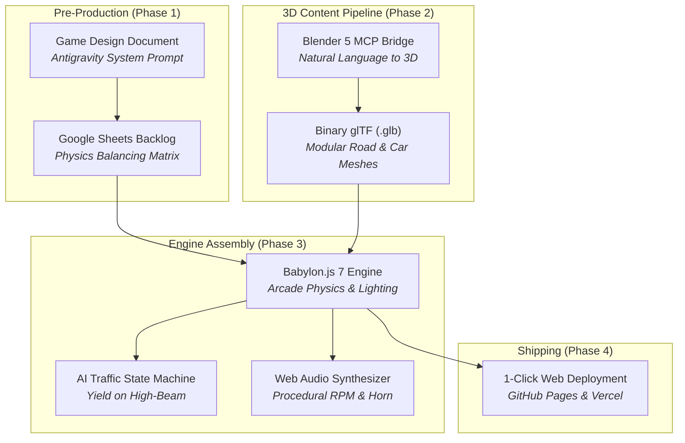

# King Myvi: Highway Legends 🚗💨
> **AI for Gaming: Hands-On Workshop & Tutorial Demo**  
> *How Generative AI, Autonomous Coding Agents, and Model Context Protocol (MCP) are Reshaping Game Development*

<div align="center">

[](https://www.babylonjs.com/)
[](https://vitejs.dev/)
[](https://c-fu.github.io/krackeddevs-ai-for-gaming/)
[](https://www.blender.org/)
[](https://c-fu.github.io/krackeddevs-ai-for-gaming/slides.html)
[](src/audio.js)
[](LICENSE)

[🎮 **Play Live Game (GitHub Pages)**](https://c-fu.github.io/krackeddevs-ai-for-gaming/) &bull; [📑 **Open Slide Deck**](https://c-fu.github.io/krackeddevs-ai-for-gaming/slides.html) &bull; [📋 **3-Hour Run-of-Show**](docs/AI_FOR_GAMING_MASTER_PLAN.md) &bull; [💬 **Attendee Prompt Pack**](docs/WORKSHOP_HANDOUT_AND_PROMPTS.md)

</div>

---

## 📖 Overview

**King Myvi: Highway Legends** is a high-octane 3D arcade web runner designed specifically for a **3-hour hands-on tutorial** on AI-assisted game development. 

In this workshop, attendees write **zero boilerplate syntax by hand**. Instead, they step into the shoes of the **Creative Director & Lead Producer**, using AI agents (**Antigravity**, **OpenCode**) and 3D pipelines (**Blender MCP**) to conceptualize, scaffold, model, assemble, and deploy a full 3D game from scratch.

```
   ┌────────────────────────────────────────────────────────┐
   │                  THE AGENTIC WORKFLOW                  │
   │                                                        │
   │  Creative Vision ──► AI-Generated GDD ──► Sheets Backlog│
   │         │                                      │       │
   │         ▼                                      ▼       │
   │  Blender 5 (MCP) ──► 3D .GLB Meshes ──► Babylon.js 7   │
   │                                                │       │
   │                                                ▼       │
   │                                       1-Click Web Deploy
   └────────────────────────────────────────────────────────┘
```

---

## 🎯 The Core Philosophy: "Point A to Point B + 1–2 USPs"

The single biggest reason beginner and indie game projects fail is **scope creep**. Teams attempt to build massive open-world RPGs with dynamic weather, procedural economies, and inventory systems — burning out after two weeks.

At its mathematical and narrative foundation, every engaging game is about going from **Point A to Point B**:

* **Point A (The Origin):** Where the player begins (Toll Plaza Jalan Duta, KM 0.0, 0 km/h, evening rush hour, 90-second countdown).
* **Point B (The Destination):** Where the player must arrive (Ayer Keroh Toll Plaza & R&R, KM 5.0, dinner reservation).

What transforms simple traversal into an addictive, expressive game are **1 or 2 Unique Selling Propositions (USPs)**:

### ⚡ USP 1: The High-Beam Flash (`Spacebar`)
In Malaysia, the white Perodua Myvi is culturally renowned as the undisputed *"King of the Highway"*. Rather than shooting missiles or dropping cartoon bananas, the player's primary weapon is the **Right-Lane High-Beam Flash**:
* Project high-intensity dual spotlight cones 42 meters forward.
* Slow-moving traffic (lorries, delivery vans, passenger sedans) will panic, trigger their left turn signal, and yield into the middle lane.
* Successfully clearing the fast lane rewards **+250 PTS** and keeps your speed streak alive.

### 🚀 USP 2: Pothole Slalom & SmartTAG Ramp Boosts
* **Potholes (The Hazard):** Road repair craters scattered across lanes 1 and 2. Hitting one incurs an instant **45% speed penalty**, rattles the camera, and triggers erratic steering wobble for 1.2s.
* **SmartTAG Boost Pads (The Reward):** Glowing emerald green runway lanes leading into toll gantries. Driving over them grants a supersonic surge up to **240 km/h** and launches the car into a low-gravity aerial ramp jump flying directly over slow traffic!

---

## 🕹️ Controls

| Action | Keyboard | Touchscreen (Mobile / Tablet) |
| :--- | :--- | :--- |
| **Accelerate** | `W` or `↑ Up Arrow` | `GAS` Pedal |
| **Brake / Reverse** | `S` or `↓ Down Arrow` | `BRAKE` Pedal |
| **Steer Left / Right** | `A` / `D` or `←` / `→` | `←` / `→` D-Pad |
| **High-Beam Flash (USP 1)** | `Spacebar` (Hold / Tap) | `FLASH` Button |
| **Malaysian Horn ("Pon-pon!")** | `H` or `B` | — |
| **Toggle Babylon Inspector** | `I` | — |

---

## ⚡ Quickstart

### Prerequisites
* **Node.js**: v18.0.0+ or v20.0.0+
* **npm**: v9.0.0+ or v10.0.0+
* **Browser**: Chrome, Edge, Brave, Safari, or Firefox (WebGL2 enabled)
* *(Optional for 3D Generation)*: **Blender 4.x or 5.x**

### 1. Clone & Install
```bash
# Clone the repository
git clone https://github.com/<your-username>/king-myvi-highway-legends.git
cd king-myvi-highway-legends

# Install dependencies (Babylon.js, loaders, inspector, Vite)
npm install
```

### 2. Launch Local Development
```bash
npm run dev
```
* **Playable Game:** Open [`http://localhost:5173`](http://localhost:5173)
* **Presentation Slides:** Open [`http://localhost:5173/slides.html`](http://localhost:5173/slides.html)

### 3. Build for Production
```bash
npm run build
```
Generates an optimized static bundle in `/dist` containing both `index.html` and `slides.html`.

---

## 📁 Repository Structure

```
KD_AI_FOR_GAMING/
├── index.html                   # Main HTML5 entry & retro-arcade HUD overlay
├── style.css                    # Cyberpunk / Synthwave styling, glassmorphism, responsive HUD
├── slides.html                  # Interactive 16-slide Reveal.js presentation for the talk
├── vite.config.js               # Multi-page Vite 6 build configuration
├── package.json                 # Dependencies: @babylonjs/core, loaders, inspector, vite
│
├── src/
│   ├── main.js                  # Engine loop, chase camera (180° offset), scene lighting, win/loss
│   ├── myvi.js                  # Player car arcade physics, banking roll (8°), spotlights, jump physics
│   ├── traffic.js               # AI traffic manager: sedans, vans, lorries; 4-stage yield state machine
│   ├── highway.js               # PLUS North-South Expressway, barriers, green gantries, palm trees, toll
│   ├── obstacles.js             # Procedural potholes (speed penalty) & SmartTAG boost pads (ramp jump)
│   ├── audio.js                 # Pure Web Audio procedural sound engine (RPM synth, horn, boost whoosh)
│   └── ui.js                    # Speedometer, distance remaining meter, timer, banner popups, touch D-pad
│
├── tools/
│   └── blender/
│       ├── README.md            # Guide for running scripts via Blender MCP or CLI
│       ├── generate_myvi.py     # Python script generating the low-poly Myvi car with spoiler & wheels
│       └── generate_environment.py # Python script generating palm trees, overhead signs & gantries
│
├── public/
│   └── assets/
│       └── models/              # Output directory for exported 3D binary glTF (.glb) files
│           ├── myvi.glb         # Low-poly Malaysian Myvi model (34 KB)
│           ├── overhead_gantry.glb # PLUS Highway green overhead gantry sign (18 KB)
│           └── palm_tree.glb    # Roadside low-poly oil palm tree (17 KB)
│
└── docs/                        # Complete 3-Hour Workshop Documentation
    ├── AI_FOR_GAMING_MASTER_PLAN.md    # Minute-by-minute run-of-show, speaker script, stage directions
    ├── GAME_DESIGN_DOCUMENT.md         # Full game design document with mathematical mechanics specs
    ├── PROJECT_MANAGEMENT_TEMPLATE.md  # Agile backlog (CSV format) & vehicle physics balancing matrix
    └── WORKSHOP_HANDOUT_AND_PROMPTS.md # Step-by-step attendee prompt pack for Antigravity & OpenCode
```

---

## 🛠️ The AI Tool Ecosystem



1. **Antigravity / OpenCode:** Autonomous coding agent environments that translate high-level game design prompts into modular, production-ready JavaScript and vector physics.
2. **Blender MCP (Model Context Protocol):** Direct connection from AI agents to Blender's Python runtime (`bpy`), creating procedural low-poly geometry and exporting `.glb` meshes directly to the game's assets folder.
3. **Babylon.js 7:** WebGL2/WebGPU browser engine providing PBR rendering, FollowCamera with dynamic FOV speed stretching, shadow generators, and the runtime Debug Inspector.
4. **Procedural Web Audio API:** Zero external `.mp3` or `.wav` dependencies. Dynamic sawtooth engine oscillators modulated by real-time km/h, harmonic dual-tone Malaysian horns, and exponential chirp ramps for nitro boosts.

---

## 🎨 3D Asset Pipeline: Blender MCP

If you have Blender installed locally, you can regenerate the 3D assets in headless CLI mode or via Model Context Protocol:

```bash
# Windows
& "C:\Program Files\Blender Foundation\Blender 5.2\blender.exe" --background --python tools/blender/generate_myvi.py
& "C:\Program Files\Blender Foundation\Blender 5.2\blender.exe" --background --python tools/blender/generate_environment.py

# macOS
/Applications/Blender.app/Contents/MacOS/Blender --background --python tools/blender/generate_myvi.py
/Applications/Blender.app/Contents/MacOS/Blender --background --python tools/blender/generate_environment.py
```

> **Hybrid / Fallback Mode:**  
> If an attendee's machine doesn't have Blender configured, the starter repository includes verified pre-built `.glb` files and procedural Babylon.js mesh fallbacks. **Nobody gets blocked.**

---

## 📑 Slide Deck Presentation

An interactive 16-slide presentation is included in **[`slides.html`](slides.html)**:

* Built with **Reveal.js 5.1** with custom cyber-sunset themes.
* Press **`S`** to open the **Speaker Notes View** (includes live timer, next slide preview, and verbatim talking points).
* Press **`ESC`** or **`O`** to toggle the slide overview grid.
* Press **`F`** to toggle fullscreen presentation mode.
* Click **`🎮 PLAY LIVE DEMO`** in the top navigation bar to jump directly into the game.

---

## 🚀 Deployment

### Option A: GitHub Pages (Recommended)
1. Commit and push your code to GitHub:
   ```bash
   git add .
   git commit -m "feat: complete King Myvi game demo"
   git push origin main
   ```
2. In your GitHub repository:
   * Go to **Settings &rarr; Pages**.
   * Under **Build and deployment &rarr; Source**, choose **GitHub Actions** (or set branch `main` with folder `/dist`).
3. Your game and slides will be live globally at `https://<your-username>.github.io/<repo-name>/`!

### Option B: Vercel (Instant)
```bash
npx vercel
```
Press `Enter` through the defaults. Vercel automatically detects the Vite configuration and gives you a production HTTPS URL and mobile QR code within 30 seconds.

---

## 🏆 Workshop Master Documents

* **[Workshop Master Plan & Run-of-Show](docs/AI_FOR_GAMING_MASTER_PLAN.md):** 180-minute detailed breakdown, pedagogical framework, and stage directions.
* **[Game Design Document (GDD)](docs/GAME_DESIGN_DOCUMENT.md):** Comprehensive game design document covering vehicle physics, traffic state trees, art direction, and sound design.
* **[Project Management Template](docs/PROJECT_MANAGEMENT_TEMPLATE.md):** Ready-to-copy Agile backlog, CSV data block for Google Sheets, and the vehicle physics balancing matrix.
* **[Attendee Handout & AI Prompt Pack](docs/WORKSHOP_HANDOUT_AND_PROMPTS.md):** Copy-paste prompts for each workshop milestone.

---

## 💡 Post-Workshop Challenges

Ready to extend the prototype into a commercial release? Try these hackathon challenges:

1. **New Malaysian Vehicles:** Add a garage selection screen with a lightweight **Proton Kancil** (higher acceleration, lower top speed) or a **Proton Wira** with drift tuning.
2. **Monsoon Rain Event:** At Kilometer 3.0, dynamically trigger torrential tropical rain: darken the sky, reduce asphalt tire friction by 30%, and activate windshield wiper effects.
3. **Online Leaderboard:** Connect a free [Supabase](https://supabase.com/) Postgres database to record the fastest completion times and top scores from around the room.
4. **Transition to Unreal Engine 5:** Export the game mechanics and track layout into Unreal Engine 5 using the UE Python API and Procedural Content Generation (PCG).

---

## 📜 License

Distributed under the **MIT License**. Free for educational, commercial, and personal use.  
Created for the **AI for Gaming** hands-on tutorial and masterclass.
