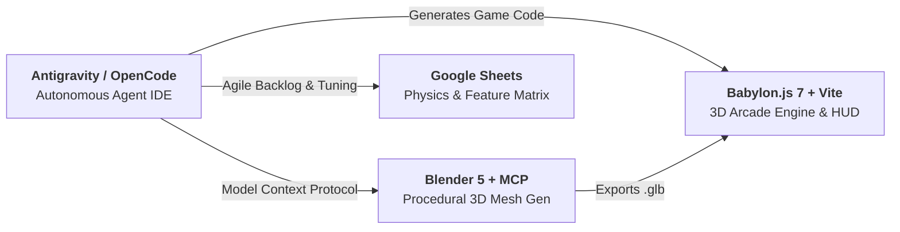

# King Myvi: Highway Legends 🚗💨
> **AI for Gaming Hands-On Workshop & Tutorial Demo**  
> *How Generative AI & Autonomous Coding Agents (Antigravity, OpenCode, Blender MCP) are Reshaping Game Development*

[](https://www.babylonjs.com/)
[](https://vitejs.dev/)
[](https://www.blender.org/)
[](#deployment)

---

## 🎯 The Core Philosophy: "Point A to Point B + 1-2 USPs"

Every great game is fundamentally about navigating from **Point A to Point B**:
* **Point A:** Toll Plaza Jalan Duta (KM 0.0) — 0 km/h, evening rush hour, 90-second countdown.
* **Point B:** Ayer Keroh Toll Plaza & R&R (KM 5.0) — Dinner reservation destination.

What transforms this journey into an addictive game are its **two Malaysian Unique Selling Propositions (USPs)**:
1. **USP 1 — The High-Beam Flash (`Spacebar`):** Flash slow-moving traffic in the right (fast) lane. Vehicles will activate their left turn signal, react, and yield into the middle lane!
2. **USP 2 — Pothole Slalom & SmartTAG Ramp Boosts:** Unpaved road repair potholes sap 40% of your speed and destabilize steering. Driving over glowing green SmartTAG lanes grants a supersonic nitro surge (up to 240 km/h) and launches your Myvi into an acrobatic aerial ramp jump over traffic!

---

## 🕹️ Controls

| Action | Keyboard | Touchscreen (Mobile) |
| :--- | :--- | :--- |
| **Accelerate** | `W` or `Up Arrow` | `GAS` Pedal |
| **Brake / Reverse** | `S` or `Down Arrow` | `BRAKE` Pedal |
| **Steer Left / Right** | `A` / `D` or `Left` / `Right` | `←` / `→` D-Pad |
| **High-Beam Flash (USP 1)** | `Spacebar` (Hold/Tap) | `FLASH` Button |
| **Horn** | `H` or `B` ("Pon-pon!") | — |
| **Toggle Babylon Inspector** | `I` (Workshop Instructor mode) | — |

---

## ⚡ Quickstart

### Prerequisites
* **Node.js**: v18+ or v20+
* **npm**: v9+ or v10+
* **Browser**: Chrome, Edge, Safari, or Firefox (WebGL2 enabled)

### Running Locally
```bash
# 1. Install dependencies
npm install

# 2. Start Vite development server
npm run dev
```
Open [http://localhost:5173](http://localhost:5173) in your browser.

---

## 🛠️ The AI Tool Ecosystem



1. **Antigravity / OpenCode:** Directs the entire codebase architecture, game mechanics, state machines, and HUD.
2. **Blender MCP (Model Context Protocol):** Connects the coding agent directly to Blender's Python runtime, generating low-poly Myvi cars, palm trees, and overhead signs on demand (`tools/blender/generate_myvi.py`).
3. **Web Audio API:** Pure procedural synthesis for engine revs, tire screeches, horns, and nitro whooshes — zero external audio dependencies.
4. **Google Sheets / Notion:** Backlog generation and real-time physics balancing.

---

## 📁 Workshop Documentation & Artifacts

All master documents are structured for the workshop:
* **[Workshop Master Plan & Run-of-Show](AI_FOR_GAMING_MASTER_PLAN.md):** 3-hour minute-by-minute session plan, slide breakdown, and stage directions.
* **[Game Design Document (GDD)](GAME_DESIGN_DOCUMENT.md):** Complete specifications for mechanics, AI state machines, art, and audio.
* **[Project Management Template](PROJECT_MANAGEMENT_TEMPLATE.md):** Agile backlog, CSV import for Google Sheets, and physics balancing matrix.
* **[Attendee Handout & AI Prompt Pack](WORKSHOP_HANDOUT_AND_PROMPTS.md):** Copy-paste prompts for students to build every milestone.

---

## 🚀 Deployment

### Deploy to GitHub Pages (Static Build)
```bash
# 1. Create production build
npm run build

# 2. Commit and push
git add .
git commit -m "feat: complete King Myvi demo"
git push origin main
```
In your GitHub repo: go to **Settings -> Pages**, set source to `/dist` or GitHub Actions.

### Deploy to Vercel (Instant)
```bash
npx vercel
```

---

## 📜 License
MIT License. Created for the **AI for Gaming** hands-on tutorial.
