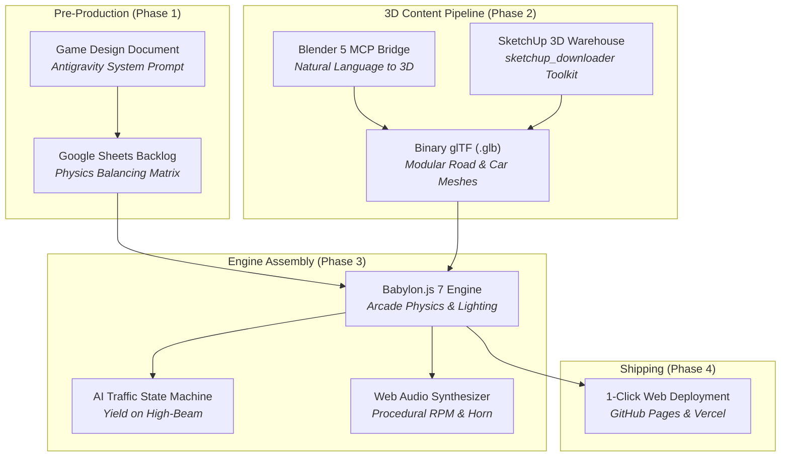

# King Myvi: Highway Legends 🚗💨
> **AI for Gaming: Hands-On Workshop & Tutorial Demo**  
> *How Generative AI, Autonomous Coding Agents, and Model Context Protocol (MCP) are Reshaping Game Development*

<div align="center">

**[English](README.md) | [Bahasa Melayu](README.ms-MY.md)**

[](https://www.babylonjs.com/)
[](https://vitejs.dev/)
[](https://c-fu.github.io/krackeddevs-ai-for-gaming/)
[](https://www.blender.org/)
[](https://c-fu.github.io/krackeddevs-ai-for-gaming/slides.html)
[](src/audio.js)
[](LICENSE)

[🕹️ **All Games Hub (3 Boxes)**](https://c-fu.github.io/krackeddevs-ai-for-gaming/) &bull; [🚗 **Play King Myvi**](https://c-fu.github.io/krackeddevs-ai-for-gaming/myvi.html) &bull; [🍲 **Play Makcik Canteen**](https://c-fu.github.io/krackeddevs-ai-for-gaming/MAKCIK_CANTEEN/index.html) &bull; [🏎️ **Play Neon Kart 3D**](https://c-fu.github.io/krackeddevs-ai-for-gaming/neon_kart_3d/index.html) &bull; [🏛️ **3D Warehouse Downloader**](sketchup_downloader/README.md) &bull; [📑 **Slide Deck**](https://c-fu.github.io/krackeddevs-ai-for-gaming/slides.html) &bull; [📐 **Design Doc Templates**](TEMPLATE_DESIGN_DOCUMENT/README.md) &bull; [💬 **Prompt Pack**](docs/WORKSHOP_HANDOUT_AND_PROMPTS.md)

</div>

---

## 🕹️ The 3 Workshop Games Ecosystem

During the **AI for Gaming** workshop and live sessions, three complete playable 3D games were conceptualized, documented, and built using generative AI, autonomous coding agents, and procedural pipelines:

| Game | Platform & Engine | Core Gameplay & Unique Selling Propositions (USPs) | Design Docs & Links |
| :--- | :--- | :--- | :--- |
| **🚗 King Myvi: Highway Legends** | **Babylon.js 7** + Vite | High-octane arcade highway runner. Flash high-beams (`Spacebar`) to force slow right-lane traffic to yield, dodge asphalt potholes, and jump full-lane SmartTAG toll ramps at 240 km/h. | • [🎮 Play Live Game](https://c-fu.github.io/krackeddevs-ai-for-gaming/myvi.html)<br/>• [🏠 3-Game Hub](https://c-fu.github.io/krackeddevs-ai-for-gaming/)<br/>• [📄 Game GDD](docs/GAME_DESIGN_DOCUMENT.md)<br/>• [🚗 3D Myvi Pipeline](docs/BLENDER_3D_PIPELINE.md)<br/>• [📁 Source Code](src/) |
| **🍛 Makcik Canteen: Haze Fighter** | **Babylon.js 7** + Vite | Malaysian school canteen arcade simulator. Armed with an industrial blower fan (`Spacebar`) and dry ice bomb traps (`E`), clear choking haze clouds to rescue hungry students during a chaotic 60-second recess countdown. *Built live during the workshop session!* | • [🎮 Play Makcik Canteen](https://c-fu.github.io/krackeddevs-ai-for-gaming/MAKCIK_CANTEEN/index.html)<br/>• [📖 Canteen README](MAKCIK_CANTEEN/README.md)<br/>• [📄 Complete 7-Doc Spec](MAKCIK_CANTEEN/GAME_DESIGN_DOCUMENT.md)<br/>• [🔬 Tech & Physics](MAKCIK_CANTEEN/GAME_TECH_STACK.md)<br/>• [💬 Live Copilot Chat](https://copilot.microsoft.com/conversations/join/NppskzM778rkVNxfjVi5D) |
| **🏎️ Neon Kart 3D** | **Three.js** + Vite | Synthwave cyber-arcade drift racer. Features drift boost sparks, floating mystery item cubes, homing rockets, oil slicks, speed pads, and dynamic rubber-banding AI rivals on a glowing neon circuit. | • [🎮 Play Neon Kart 3D](https://c-fu.github.io/krackeddevs-ai-for-gaming/neon_kart_3d/index.html)<br/>• [📖 3-Hour Lab Runbook](neon_kart_3d/ai_for_gaming_3hour_lab_runbook_and_templates.md)<br/>• [📑 Reveal.js Slides](https://c-fu.github.io/krackeddevs-ai-for-gaming/neon_kart_3d/ai_for_gaming_3_hour_hands_on_lab_deck_reveal_js_markdown.html)<br/>• [📚 GitHub Wiki](neon_kart_3d/wiki.md)<br/>• [📁 Folder](neon_kart_3d/) |

---

## 💡 The #1 Game Prototyping Pro-Tip: "Ask Me Relevant Questions"

> [!IMPORTANT]
> **The Secret to Eliminating AI Hallucination & Scope Creep**  
> The single biggest mistake developers and game designers make when using Large Language Models (LLMs) is asking for a full Game Design Document in a single blind prompt:  
> *❌ "Write me a game design document for a multiplayer cyberpunk battle royale."*  
> 
> This guarantees bloated mechanics, unrealistic scope, and generic RPG cliches.
> 
> Instead, trigger a **Consultative Diagnostic Dialogue** by forcing the AI into interview mode with this golden phrase:
> ```text
> "I want to design a game about [concept]. Before creating the game design documents, 
> ask me relevant questions to scope the target audience, core loop, USP, platform constraints, and art style."
> ```

### Real Workshop Evidence on Microsoft Copilot
This exact prompting methodology was demonstrated live to create full game architectures in under 15 minutes:
1. **[Makcik Canteen: Haze Fighter Copilot Dialogue](https://copilot.microsoft.com/conversations/join/NppskzM778rkVNxfjVi5D):** Copilot asked 5 diagnostic scoping questions (core loop, visual style, obstacle types, power-ups, victory conditions) before drafting the 7 modular specification documents.
2. **[Game Design Document Template Suite on Copilot](https://copilot.microsoft.com/conversations/join/a8PJA1mSSRu5JoSRYExV7):** Copilot structured an industry-standard 9-template game design suite covering mechanics, physics, tech stack, UI/UX, assets, testing, and accessibility.

Explore the complete ready-to-use template suite in [`TEMPLATE_DESIGN_DOCUMENT/`](TEMPLATE_DESIGN_DOCUMENT/README.md).

---

## 🚗 The 3D Myvi Evolution: Multimodal Vision & Blender MCP

During the workshop, attendees witnessed the real-time evolution of the player vehicle from an initial low-poly placeholder into the **3rd Generation Perodua Myvi (Lava Red)** matching professional Hum3D studio reference renders:

```
[Reference 3D Renders] ──► [Vision LLM Extraction] ──► [Technical Polygonal Spec]
                                                               │
                                                               ▼
[Live Game Babylon.js] ◄── [Binary .GLB Export] ◄── [Blender MCP Port 9876]
```

### The 3-Step Live Enhancement Workflow:
1. **Multimodal Vision Prompting (Image-to-Spec):** Instead of describing a Myvi from memory, high-res 3/4 front and rear reference renders were analyzed by a vision model to produce a strict geometric breakdown (beltline crease, two-tier aero spoiler with black side fins, floating roof C-pillar insert, horizontal wrap-around taillamps).
2. **Model Context Protocol (MCP) Live Execution:** The agent connected directly to a running Blender instance via TCP socket (`127.0.0.1:9876`), generating procedural Python `bpy` geometry on Blender's main thread with zero manual vertex manipulation.
3. **Human-in-the-Loop Steering Prompt:** When an earlier boxy silhouette was generated, the user prompted:  
   > *"The model is not correct, not like in real life. Change the car model to this one."*  
   The agent re-anchored to the visual ground truth, generated the wrap-around lamps, sports diffusers, turbine wheels, and exported `myvi.glb` directly into the web engine.

*(Read the full story, prompt transcripts, and Python scripts in [`docs/BLENDER_3D_PIPELINE.md`](docs/BLENDER_3D_PIPELINE.md) / [BM: `docs/BLENDER_3D_PIPELINE.ms-MY.md`](docs/BLENDER_3D_PIPELINE.ms-MY.md)).*

---

## 📖 Overview

**King Myvi: Highway Legends** is a high-octane 3D arcade web runner designed specifically for a **3-hour hands-on tutorial** on AI-assisted game development. 

In this workshop, attendees write **zero boilerplate syntax by hand**. Instead, they step into the shoes of the **Creative Director & Lead Producer**, using AI agents (**Antigravity**, **OpenCode**) and 3D pipelines (**Blender MCP**) to conceptualize, scaffold, model, assemble, and deploy a full 3D game from scratch.

```
   ┌────────────────────────────────────────────────────────┐
   │                  THE AGENTIC WORKFLOW                  │
   │                                                        │
   │  Creative Vision ──► AI-Generated GDD ──► Sheets Backlog│
   │         │                                      │       │
   │         ▼                                      ▼       │
   │  Blender 5 (MCP) ──► 3D .GLB Meshes ──► Babylon.js 7   │
   │                                                │       │
   │                                                ▼       │
   │                                       1-Click Web Deploy
   └────────────────────────────────────────────────────────┘
```

---

## 🎯 The Core Philosophy: "Point A to Point B + 1–2 USPs"

The single biggest reason beginner and indie game projects fail is **scope creep**. Teams attempt to build massive open-world RPGs with dynamic weather, procedural economies, and inventory systems — burning out after two weeks.

At its mathematical and narrative foundation, every engaging game is about going from **Point A to Point B**:

* **Point A (The Origin):** Where the player begins (Toll Plaza Jalan Duta, KM 0.0, 0 km/h, evening rush hour, 90-second countdown).
* **Point B (The Destination):** Where the player must arrive (Ayer Keroh Toll Plaza & R&R, KM 5.0, dinner reservation).

What transforms simple traversal into an addictive, expressive game are **1 or 2 Unique Selling Propositions (USPs)**:

### ⚡ USP 1: The High-Beam Flash (`Spacebar`)
In Malaysia, the white Perodua Myvi is culturally renowned as the undisputed *"King of the Highway"*. Rather than shooting missiles or dropping cartoon bananas, the player's primary weapon is the **Right-Lane High-Beam Flash**:
* Project high-intensity dual spotlight cones 42 meters forward.
* Slow-moving traffic (lorries, delivery vans, passenger sedans) will panic, trigger their left turn signal, and yield into the middle lane.
* Successfully clearing the fast lane rewards **+250 PTS** and keeps your speed streak alive.

### 🚀 USP 2: Pothole Slalom & SmartTAG Ramp Boosts
* **Potholes (The Hazard):** Road repair craters scattered across lanes 1 and 2. Hitting one incurs an instant **45% speed penalty**, rattles the camera, and triggers erratic steering wobble for 1.2s.
* **SmartTAG Boost Pads (The Reward):** Glowing emerald green runway lanes leading into toll gantries. Driving over them grants a supersonic surge up to **240 km/h** and launches the car into a low-gravity aerial ramp jump flying directly over slow traffic!

---

## 🕹️ Controls

| Action | Keyboard | Touchscreen (Mobile / Tablet) |
| :--- | :--- | :--- |
| **Accelerate** | `W` or `↑ Up Arrow` | `GAS` Pedal |
| **Brake / Reverse** | `S` or `↓ Down Arrow` | `BRAKE` Pedal |
| **Steer Left / Right** | `A` / `D` or `←` / `→` | `←` / `→` D-Pad |
| **High-Beam Flash (USP 1)** | `Spacebar` (Hold / Tap) | `FLASH` Button |
| **Malaysian Horn ("Pon-pon!")** | `H` or `B` | — |
| **Toggle Babylon Inspector** | `I` | — |

---

## ⚡ Quickstart

### Prerequisites
* **Node.js**: v18.0.0+ or v20.0.0+
* **npm**: v9.0.0+ or v10.0.0+
* **Browser**: Chrome, Edge, Brave, Safari, or Firefox (WebGL2 enabled)
* *(Optional for 3D Generation)*: **Blender 4.x or 5.x**

### 1. Clone & Install
```bash
# Clone the repository
git clone https://github.com/C-Fu/krackeddevs-ai-for-gaming.git
cd krackeddevs-ai-for-gaming

# Install dependencies (Babylon.js, loaders, inspector, Vite)
npm install
```

### 2. Launch Local Development
```bash
npm run dev
```
* **Playable Game:** Open [`http://localhost:5173`](http://localhost:5173)
* **Presentation Slides:** Open [`http://localhost:5173/slides.html`](http://localhost:5173/slides.html)

### 3. Build for Production
```bash
npm run build
```
Generates an optimized static bundle in `/dist` containing both `index.html` and `slides.html`.

---

## 📁 Repository Structure

```
KD_AI_FOR_GAMING/
├── index.html                   # Main HTML5 entry & retro-arcade HUD overlay
├── style.css                    # Cyberpunk / Synthwave styling, glassmorphism, responsive HUD
├── slides.html                  # Interactive 16-slide Reveal.js presentation for the talk
├── vite.config.js               # Multi-page Vite 6 build configuration
├── package.json                 # Dependencies: @babylonjs/core, loaders, inspector, vite
│
├── src/                         # King Myvi: Highway Legends Source Code
│   ├── main.js                  # Engine loop, chase camera (180° offset), scene lighting, win/loss
│   ├── myvi.js                  # Player car arcade physics, banking roll (8°), spotlights, jump physics
│   ├── traffic.js               # AI traffic manager: sedans, vans, lorries; 4-stage yield state machine
│   ├── highway.js               # PLUS North-South Expressway, barriers, green gantries, palm trees, toll
│   ├── obstacles.js             # Procedural potholes (speed penalty) & SmartTAG boost pads (ramp jump)
│   ├── audio.js                 # Pure Web Audio procedural sound engine (RPM synth, horn, boost whoosh)
│   └── ui.js                    # Speedometer, distance remaining meter, timer, banner popups, touch D-pad
│
├── index.html                   # 3-Game Master Hub (Boxes for King Myvi, Makcik Canteen, Neon Kart)
├── myvi.html                    # King Myvi: Highway Legends standalone game
├── slides.html                  # Interactive Workshop Slide Deck (Reveal.js)
├── MAKCIK_CANTEEN/              # Makcik Canteen: Haze Fighter (Live Workshop Game)
│   ├── index.html               # Playable Babylon.js 7 game entry
│   ├── README.md                # English guide & Copilot dialogue documentation
│   ├── README.ms-MY.md          # Bahasa Melayu guide
│   └── *.md                     # Complete 7-doc game design specification
│
├── neon_kart_3d/                # Neon Kart 3D (Synthwave Drift Racer)
│   ├── index.html               # Playable Three.js game entry (auto-served by GitHub Pages)
│   ├── neon_kart_3d_ai_for_gaming_live_workshop_demo.html # Standalone Three.js demo
│   ├── ai_for_gaming_3_hour_hands_on_lab_deck_reveal_js_markdown.html # Slide Deck
│   ├── README.md                # Project documentation
│   └── wiki.md                  # Deep-dive architecture wiki
│
├── TEMPLATE_DESIGN_DOCUMENT/    # Universal Game Design Document Suite
│   ├── README.md                # Suite guide & Copilot dialogue breakdown
│   ├── README.ms-MY.md          # Panduan suite dalam Bahasa Melayu
│   ├── TEMPLATE_*.md            # 9 Reusable blank design doc templates
│   └── EXAMPLE_*.md             # 3 Real workshop game case studies
│
├── sketchup_downloader/         # Fast 3D Warehouse CDN Downloader & GLB Converter
│   ├── get_sketchup_model.ps1   # PowerShell link extractor & GLB downloader
│   ├── get_sketchup_model.sh    # macOS / Linux bash downloader
│   ├── get_sketchup_model.bat   # Windows double-clickable batch downloader
│   ├── glb2gltf.ps1 / .sh / .bat# Zero-dependency GLB to glTF unpacker
│   ├── README.md                # English documentation & 1-liner commands
│   └── README.ms-MY.md          # Dokumentasi Bahasa Melayu
│
├── tools/
│   └── blender/
│       ├── README.md            # Guide for running scripts via Blender MCP or CLI
│       ├── build_hum3d_myvi.py  # Procedural 3rd Gen Lava Red Myvi model generator
│       ├── generate_myvi.py     # Base procedural Myvi script
│       └── generate_environment.py # Python script generating palm trees, overhead signs & gantries
│
├── public/
│   └── assets/
│       └── models/              # Output directory for exported 3D binary glTF (.glb) files
│           ├── myvi.glb         # 3rd Gen Malaysian Myvi model (267 KB)
│           ├── overhead_gantry.glb # PLUS Highway green overhead gantry sign (18 KB)
│           └── palm_tree.glb    # Roadside low-poly oil palm tree (17 KB)
│
└── docs/                        # Complete 3-Hour Workshop Documentation
    ├── AI_FOR_GAMING_MASTER_PLAN.md    # Minute-by-minute run-of-show, speaker script, stage directions
    ├── GAME_DESIGN_DOCUMENT.md         # Full game design document with mathematical mechanics specs
    ├── PROJECT_MANAGEMENT_TEMPLATE.md  # Agile backlog (CSV format) & vehicle physics balancing matrix
    ├── WORKSHOP_HANDOUT_AND_PROMPTS.md # Step-by-step attendee prompt pack for Antigravity & OpenCode
    └── BLENDER_3D_PIPELINE.md          # Procedural 3D Myvi pipeline & Hum3D visual feature breakdown
```

---

## 🛠️ The AI Tool Ecosystem



1. **Antigravity / OpenCode:** Autonomous coding agent environments that translate high-level game design prompts into modular, production-ready JavaScript and vector physics.
2. **Blender MCP (Model Context Protocol):** Direct connection from AI agents to Blender's Python runtime (`bpy`), creating procedural low-poly geometry and exporting `.glb` meshes directly to the game's assets folder.
3. **SketchUp 3D Warehouse Downloader:** Fast asset sourcing alternative that bypasses manual modeling, extracting production-ready GLB models (e.g. KLCC, toll booths, vehicles) directly from Trimble CDN without login.
4. **Babylon.js 7:** WebGL2/WebGPU browser engine providing PBR rendering, FollowCamera with dynamic FOV speed stretching, shadow generators, and the runtime Debug Inspector.
5. **Procedural Web Audio API:** Zero external `.mp3` or `.wav` dependencies. Dynamic sawtooth engine oscillators modulated by real-time km/h, harmonic dual-tone Malaysian horns, and exponential chirp ramps for nitro boosts.

---

## 🎨 3D Asset Pipeline: Blender MCP

If you have Blender installed locally, you can regenerate the 3D assets in headless CLI mode or via Model Context Protocol:

```bash
# Windows
& "C:\Program Files\Blender Foundation\Blender 5.2\blender.exe" --background --python tools/blender/build_hum3d_myvi.py
& "C:\Program Files\Blender Foundation\Blender 5.2\blender.exe" --background --python tools/blender/generate_environment.py

# macOS
/Applications/Blender.app/Contents/MacOS/Blender --background --python tools/blender/build_hum3d_myvi.py
/Applications/Blender.app/Contents/MacOS/Blender --background --python tools/blender/generate_environment.py
```

> **Hybrid / Fallback Mode:**  
> If an attendee's machine doesn't have Blender configured, the starter repository includes verified pre-built `.glb` files and procedural Babylon.js mesh fallbacks. **Nobody gets blocked.**

---

## 🏛️ Sourcing 3D Assets: SketchUp 3D Warehouse Downloader (`sketchup_downloader/`)

> [!TIP]
> **Don't want to build every 3D model from scratch in Blender?**  
> While the Blender MCP bridge is ideal for generating custom procedural assets, indie game development often demands complex real-world architecture, local Malaysian landmarks, and detailed environment props (such as the Petronas Twin Towers / KLCC, PLUS toll plazas, roadside mamak stalls, or school canteen furniture).
>
> The included **[`sketchup_downloader/`](sketchup_downloader/README.md)** (*[BM: `sketchup_downloader/README.ms-MY.md`](sketchup_downloader/README.ms-MY.md)*) toolkit lets you download **production-ready 3D models (GLB, USDZ, KMZ, SKP)** directly from Trimble SketchUp 3D Warehouse **without creating an account or logging in**!

### ⚡ 1-Liner Quick Download (No Installation Required)

Download any 3D model directly into your game project in a single terminal command:

- **Windows (PowerShell):**
  ```powershell
  # Download a GLB model directly from 3D Warehouse:
  & ([scriptblock]::Create((irm https://raw.githubusercontent.com/C-Fu/krackeddevs-ai-for-gaming/main/sketchup_downloader/get_sketchup_model.ps1))) "https://3dwarehouse.sketchup.com/model/16965783-d6e1-4abf-b2d6-ef87f1b25747/Ombak-KLCC" -Download
  ```
- **macOS / Linux (Bash):**
  ```bash
  curl -sSL https://raw.githubusercontent.com/C-Fu/krackeddevs-ai-for-gaming/main/sketchup_downloader/get_sketchup_model.sh | bash -s -- --download "https://3dwarehouse.sketchup.com/model/16965783-d6e1-4abf-b2d6-ef87f1b25747/Ombak-KLCC"
  ```

### 🛠️ Included Tools in `sketchup_downloader/`:
| Tool | Platforms | Purpose |
| :--- | :--- | :--- |
| **`get_sketchup_model.ps1` / `.sh` / `.bat`** | Windows, macOS, Linux | Queries Trimble 3D Warehouse CDN API, bypasses login walls, and downloads `.glb` / `.usdz` assets directly. |
| **`glb2gltf.ps1` / `.sh` / `.bat`** | Windows, macOS, Linux | Pure Shell / PowerShell zero-dependency unpacker converting `.glb` into editable `.gltf` + `.bin` + separate textures (no Python or npm required!). |

*(For full documentation, batch scripting, and conversion options, see [`sketchup_downloader/README.md`](sketchup_downloader/README.md)).*

---

## 📑 Slide Deck Presentation

An interactive 16-slide presentation is included in **[`slides.html`](slides.html)**:

* Built with **Reveal.js 5.1** with custom cyber-sunset themes.
* Press **`S`** to open the **Speaker Notes View** (includes live timer, next slide preview, and verbatim talking points).
* Press **`ESC`** or **`O`** to toggle the slide overview grid.
* Press **`F`** to toggle fullscreen presentation mode.
* Click **`🎮 PLAY LIVE DEMO`** in the top navigation bar to jump directly into the game.

---

## 🚀 Deployment

### Option A: GitHub Pages (Recommended)
1. Commit and push your code to GitHub:
   ```bash
   git add .
   git commit -m "feat: complete King Myvi game demo"
   git push origin main
   ```
2. In your GitHub repository:
   * Go to **Settings &rarr; Pages**.
   * Under **Build and deployment &rarr; Source**, choose **GitHub Actions** (or set branch `main` with folder `/dist`).
3. Your game and slides will be live globally at `https://<your-username>.github.io/<repo-name>/`!

### Option B: Vercel (Instant)
```bash
npx vercel
```
Press `Enter` through the defaults. Vercel automatically detects the Vite configuration and gives you a production HTTPS URL and mobile QR code within 30 seconds.

---

## 🏆 Workshop Master Documents & Suites

| Document Suite (English) | Dokumen (Bahasa Melayu) | Description / Penerangan |
| :--- | :--- | :--- |
| [AI Master Plan](docs/AI_FOR_GAMING_MASTER_PLAN.md) | [Pelan Induk AI](docs/AI_FOR_GAMING_MASTER_PLAN.ms-MY.md) | 180-minute detailed breakdown, pedagogical framework, and speaker script. |
| [Game Design Document (GDD)](docs/GAME_DESIGN_DOCUMENT.md) | [Dokumen Reka Bentuk Permainan](docs/GAME_DESIGN_DOCUMENT.ms-MY.md) | Vehicle physics specs, traffic state trees, art direction, and sound design. |
| [Project Management Template](docs/PROJECT_MANAGEMENT_TEMPLATE.md) | [Templat Pengurusan Projek](docs/PROJECT_MANAGEMENT_TEMPLATE.ms-MY.md) | Agile backlog (CSV data block for Google Sheets) & vehicle physics matrix. |
| [Workshop Handout & Prompts](docs/WORKSHOP_HANDOUT_AND_PROMPTS.md) | [Panduan Peserta & Pek Prom](docs/WORKSHOP_HANDOUT_AND_PROMPTS.ms-MY.md) | Step-by-step copy-paste prompts for Antigravity & OpenCode. |
| [Blender 3D Pipeline & Gallery](docs/BLENDER_3D_PIPELINE.md) | [Saliran 3D Blender & Galeri](docs/BLENDER_3D_PIPELINE.ms-MY.md) | Procedural Gen 3 Myvi modeling via live Blender MCP socket & glTF export. |
| [SketchUp 3D Warehouse Downloader](sketchup_downloader/README.md) | [Pemuat Turun 3D Warehouse](sketchup_downloader/README.ms-MY.md) | Zero-dependency scripts to download GLB assets from Trimble CDN without login. |
| [Makcik Canteen Documentation](MAKCIK_CANTEEN/README.md) | [Dokumentasi Makcik Canteen](MAKCIK_CANTEEN/README.ms-MY.md) | Full 7-doc game specification created live with Microsoft Copilot. |
| [Template Design Document Suite](TEMPLATE_DESIGN_DOCUMENT/README.md) | [Suite Templat Reka Bentuk](TEMPLATE_DESIGN_DOCUMENT/README.ms-MY.md) | 9 standard blank game templates & 3 real workshop case studies. |
| [Neon Kart 3D Documentation](neon_kart_3d/README.md) | [Dokumentasi Neon Kart 3D](neon_kart_3d/README.md) | Synthwave cyber drift racer built with Three.js and Vite. |

---

## 💡 Post-Workshop Challenges

Ready to extend the prototype into a commercial release? Try these hackathon challenges:

1. **New Malaysian Vehicles:** Add a garage selection screen with a lightweight **Proton Kancil** (higher acceleration, lower top speed) or a **Proton Wira** with drift tuning.
2. **Monsoon Rain Event:** At Kilometer 3.0, dynamically trigger torrential tropical rain: darken the sky, reduce asphalt tire friction by 30%, and activate windshield wiper effects.
3. **Online Leaderboard:** Connect a free [Supabase](https://supabase.com/) Postgres database to record the fastest completion times and top scores from around the room.
4. **Transition to Unreal Engine 5:** Export the game mechanics and track layout into Unreal Engine 5 using the UE Python API and Procedural Content Generation (PCG).

---

## 📜 License

Distributed under the **MIT License**. Free for educational, commercial, and personal use.  
Created for the **AI for Gaming** hands-on tutorial and masterclass.
