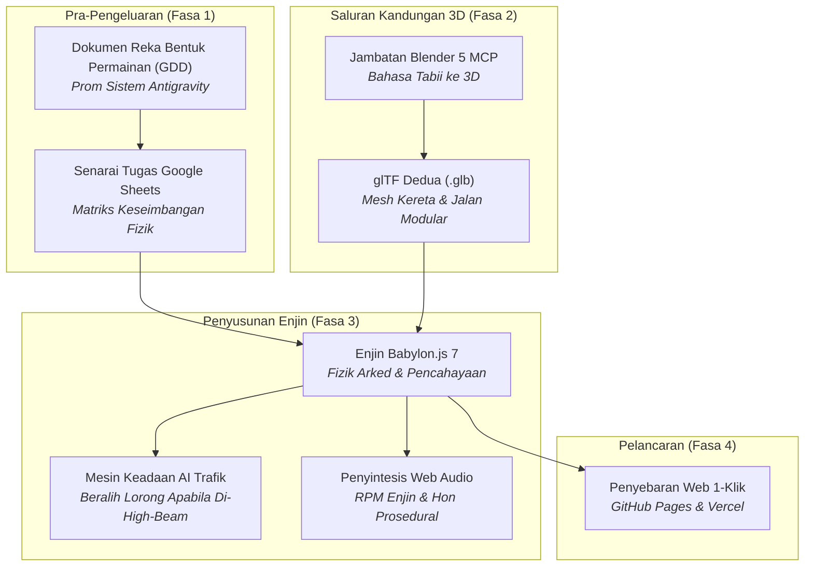

# King Myvi: Highway Legends 🚗💨
> **AI untuk Pembangunan Permainan: Bengkel Praktikal & Demo Tutorial**  
> *Bagaimana AI Generatif, Ejen Pengekodan Autonomi, dan Model Context Protocol (MCP) Mengubah Cara Permainan Video Dibina*

<div align="center">

**[English](README.md) | [Bahasa Melayu](README.ms-MY.md)**

[](https://www.babylonjs.com/)
[](https://vitejs.dev/)
[](https://c-fu.github.io/krackeddevs-ai-for-gaming/)
[](https://www.blender.org/)
[](https://c-fu.github.io/krackeddevs-ai-for-gaming/slides.html)
[](src/audio.js)
[](LICENSE)

[🎮 **Main Demo Langsung**](https://c-fu.github.io/krackeddevs-ai-for-gaming/) &bull; [📑 **Buka Slaid Pembentangan**](https://c-fu.github.io/krackeddevs-ai-for-gaming/slides.html) &bull; [📋 **Pelan Bengkel 3 Jam**](docs/AI_FOR_GAMING_MASTER_PLAN.ms-MY.md) &bull; [💬 **Pek Prom Peserta**](docs/WORKSHOP_HANDOUT_AND_PROMPTS.ms-MY.md)

</div>

---

## 📖 Gambaran Keseluruhan

**King Myvi: Highway Legends** ialah permainan arked larian lebuh raya 3D berhalaju tinggi yang direka khas untuk **tutorial praktikal 3 jam** mengenai pembangunan permainan berbantukan AI.

Dalam bengkel ini, para peserta **tidak perlu menaip sebarang sintaks asas secara manual**. Sebaliknya, mereka bertindak sebagai **Pengarah Kreatif & Penerbit Utama**, menggunakan ejen AI (**Antigravity**, **OpenCode**) serta saluran paip 3D (**Blender MCP**) untuk merangka konsep, membina struktur, memodelkan aset 3D, menyusun logik permainan, dan melancarkan permainan 3D penuh ke web dari awal.

```
   ┌────────────────────────────────────────────────────────┐
   │                  ALIRAN KERJA BERASASKAN EJEN          │
   │                                                        │
   │  Visi Kreatif ──► GDD Dijana AI ──► Senarai Tugas Sheets│
   │         │                                      │       │
   │         ▼                                      ▼       │
   │  Blender 5 (MCP) ──► Mesh .GLB 3D ──► Enjin Babylon.js 7│
   │                                                │       │
   │                                                ▼       │
   │                                   Penyebaran Web 1-Klik │
   └────────────────────────────────────────────────────────┘
```

---

## 🎯 Falsafah Teras: "Titik A ke Titik B + 1–2 USP"

Punca terbesar kegagalan projek permainan pembangun baharu atau indie ialah **pembengkakan skop (scope creep)**. Kebanyakan pasukan cuba membina permainan RPG dunia terbuka yang terlalu luas dengan cuaca dinamik, sistem ekonomi, dan inventori yang rumit — akhirnya berputus asa selepas dua minggu.

Pada asas matematik dan penceritaannya, setiap permainan yang menarik adalah tentang perjalanan dari **Titik A ke Titik B**:

* **Titik A (Permulaan):** Di mana pemain bermula (Plaza Tol Jalan Duta, KM 0.0, kelajuan 0 km/j, waktu puncak petang, kiraan masa 90 saat).
* **Titik B (Destinasi):** Di mana pemain mesti tiba (Plaza Tol & R&R Ayer Keroh, KM 5.0, sebelum tempahan makan malam tamat).

Apa yang mengubah perjalanan biasa menjadi permainan yang ketagih dan menyeronokkan ialah **1 atau 2 Cadangan Nilai Unik (USP - Unique Selling Propositions)**:

### ⚡ USP 1: Pancaran Lampu Tinggi / High-Beam (`Spacebar`)
Di Malaysia, Perodua Myvi putih sinonim dengan gelaran *"Raja Jalanan"*. Alih-alih menembak peluru berpandu atau membaling kulit pisang kartun, senjata utama pemain ialah **Pancaran Lampu Tinggi di Lorong Kanan**:
* Pancarkan kon lampu sorot berkembar berkeamatan tinggi sejauh 42 meter ke hadapan.
* Kenderaan trafik yang perlahan (lori, van penghantaran, sedan) akan panik, menyalakan lampu isyarat ke kiri, dan memberi laluan ke lorong tengah.
* Berjaya mengosongkan lorong memotong memberi ganjaran **+250 MATA** dan mengekalkan rentak kelajuan anda.

### 🚀 USP 2: Mengelak Lubang Jalan & Tanjakan Loncatan SmartTAG
* **Lubang Jalan (Halangan):** Kerosakan jalan berturap yang bertaburan di lorong 1 dan 2. Melanggarnya menyebabkan **pengurangan kelajuan serta-merta sebanyak 45%**, menggegarkan kamera, dan mengakibatkan stereng bergegar tidak stabil selama 1.2 saat.
* **Tanjakan SmartTAG (Ganjaran):** Lorong bertanda hijau zamrud bercahaya penuh yang menuju ke gantri tol. Melaluinya memberikan lonjakan nitro supersonik sehingga **240 km/j** dan melancarkan kereta ke udara dalam lompatan akrobatik merentasi kenderaan trafik di bawah!

---

## 🕹️ Kawalan Permainan

| Tindakan | Papan Kekunci | Skrin Sentuh (Mudah Alih / Tablet) |
| :--- | :--- | :--- |
| **Pecutan (Gas)** | `W` atau `↑ Anak Panah Atas` | Pedal `GAS` |
| **Brek / Undur** | `S` atau `↓ Anak Panah Bawah` | Pedal `BRAKE` |
| **Stereng Kiri / Kanan** | `A` / `D` atau `←` / `→` | Butang D-Pad `←` / `→` |
| **Pancar Lampu Tinggi (USP 1)** | `Spacebar` (Tekan / Tahan) | Butang `FLASH` |
| **Hon Tradisi ("Pon-pon!")** | `H` atau `B` | — |
| **Buka Babylon Inspector** | `I` (Mod Pengajar Bengkel) | — |

---

## ⚡ Panduan Pantas Permulaan

### Keperluan Asas
* **Node.js**: v18.0.0+ atau v20.0.0+
* **npm**: v9.0.0+ atau v10.0.0+
* **Pelayar Web**: Chrome, Edge, Brave, Safari, atau Firefox (dengan sokongan WebGL2)
* *(Pilihan untuk Penjanaan 3D)*: **Blender 4.x atau 5.x**

### 1. Klon & Pasang
```bash
# Klon repositori ini
git clone https://github.com/C-Fu/krackeddevs-ai-for-gaming.git
cd krackeddevs-ai-for-gaming

# Pasang pakej kebergantungan (Babylon.js, loaders, inspector, Vite)
npm install
```

### 2. Jalankan Pelayan Pembangunan Tempatan
```bash
npm run dev
```
* **Permainan Langsung:** Buka [`http://localhost:5173`](http://localhost:5173)
* **Slaid Pembentangan:** Buka [`http://localhost:5173/slides.html`](http://localhost:5173/slides.html)

### 3. Bina untuk Pengeluaran (Production Build)
```bash
npm run build
```
Menghasilkan bundle statik yang dioptimumkan di dalam folder `/dist` yang mengandungi kedua-dua `index.html` dan `slides.html`.

---

## 📁 Struktur Repositori

```
KD_AI_FOR_GAMING/
├── README.md                    # Dokumentasi utama (Bahasa Inggeris)
├── README.ms-MY.md              # Dokumentasi utama (Bahasa Melayu)
├── LICENSE                      # Lesen Sumber Terbuka MIT
├── index.html                   # Titik masuk HTML5 & HUD arked dengan pautan ke slaid & GitHub
├── style.css                    # Penggayaan Cyberpunk / Synthwave, glassmorphism, HUD responsif
├── slides.html                  # Slaid interaktif 16-bahagian menggunakan Reveal.js 5
├── vite.config.js               # Konfigurasi pembina multi-halaman Vite 6
├── package.json                 # Pakej kebergantungan: @babylonjs/core, loaders, inspector, vite
│
├── src/
│   ├── main.js                  # Gelung enjin, kamera kejar (ofset 180°), pencahayaan senja, semakan menang/kalah
│   ├── myvi.js                  # Fizik arked kereta pemain, olengan badan (8°), lampu sorot, fizik lompatan
│   ├── traffic.js               # Pengurus trafik AI: sedan, van, lori; mesin keadaan 4-peringkat untuk memberi laluan
│   ├── highway.js               # Lebuhraya PLUS 3-lorong, penghadang, gantri hijau, pokok kelapa sawit, plaza tol
│   ├── obstacles.js             # Lubang jalan prosedural & tanjakan penuh SmartTAG dengan gantri realistik
│   ├── audio.js                 # Enjin audio sintesis Web Audio tulen (RPM enjin, hon, deruan nitro)
│   └── ui.js                    # Meter kelajuan, meter baki jarak, pemasa, notifikasi banner, D-pad sentuh
│
├── tools/
│   └── blender/
│       ├── README.md            # Panduan menjalankan skrip melalui Blender MCP atau CLI
│       ├── generate_myvi.py     # Skrip Python membina kereta Myvi dengan spoiler & roda
│       └── generate_environment.py # Skrip Python menjana pokok kelapa sawit, papan tanda & gantri
│
├── public/
│   └── assets/
│       └── models/              # Folder output untuk fail model 3D binary glTF (.glb)
│           ├── myvi.glb         # Model 3D Perodua Myvi (34 KB)
│           ├── overhead_gantry.glb # Gantri papan tanda hijau PLUS (18 KB)
│           └── palm_tree.glb    # Model pokok kelapa sawit tepi jalan (17 KB)
│
└── docs/                        # Dokumentasi Penuh Bengkel 3 Jam
    ├── AI_FOR_GAMING_MASTER_PLAN.md        # Pelan induk & skrip pembentang (English)
    ├── AI_FOR_GAMING_MASTER_PLAN.ms-MY.md  # Pelan induk & skrip pembentang (Bahasa Melayu)
    ├── GAME_DESIGN_DOCUMENT.md             # Dokumen Reka Bentuk Permainan (English)
    ├── GAME_DESIGN_DOCUMENT.ms-MY.md       # Dokumen Reka Bentuk Permainan (Bahasa Melayu)
    ├── PROJECT_MANAGEMENT_TEMPLATE.md      # Senarai tugas Agile & matriks fizik (English)
    ├── PROJECT_MANAGEMENT_TEMPLATE.ms-MY.md# Senarai tugas Agile & matriks fizik (Bahasa Melayu)
    ├── WORKSHOP_HANDOUT_AND_PROMPTS.md     # Pek prom & panduan peserta (English)
    └── WORKSHOP_HANDOUT_AND_PROMPTS.ms-MY.md # Pek prom & panduan peserta (Bahasa Melayu)
```

---

## 🛠️ Ekosistem Alatan AI



1. **Antigravity / OpenCode:** Persekitaran ejen pengekodan autonomi yang menterjemahkan arahan reka bentuk tahap tinggi kepada kod JavaScript modular dan fizik vektor yang sedia untuk pengeluaran.
2. **Blender MCP (Model Context Protocol):** Sambungan terus dari ejen AI ke enjin Python Blender (`bpy`), membina geometri poli rendah secara prosedural dan mengeksport fail `.glb` terus ke folder aset permainan.
3. **Babylon.js 7:** Enjin pelayar berasaskan WebGL2/WebGPU yang menyediakan pemaparan PBR, FollowCamera dengan tarikan medan pandangan (FOV) dinamik mengikut kelajuan, penjana bayang-bayang, dan Debug Inspector masa larian.
4. **API Web Audio Prosedural:** Bebas daripada sebarang kebergantungan fail luaran `.mp3` atau `.wav`. Osilator gelombang gigi gergaji dinamik yang dimodulasikan mengikut kelajuan km/j sebenar, hon harmonik dwi-ton Malaysia, dan bunyi lonjakan frekuensi untuk pecutan nitro.

---

## 🎨 Saluran Kandungan 3D: Blender MCP

Sekiranya anda memasang Blender pada komputer tempatan, anda boleh menjana semula semua aset 3D dalam mod tanpa grafik (headless CLI) atau melalui Model Context Protocol:

```bash
# Windows
& "C:\Program Files\Blender Foundation\Blender 5.2\blender.exe" --background --python tools/blender/generate_myvi.py
& "C:\Program Files\Blender Foundation\Blender 5.2\blender.exe" --background --python tools/blender/generate_environment.py

# macOS
/Applications/Blender.app/Contents/MacOS/Blender --background --python tools/blender/generate_myvi.py
/Applications/Blender.app/Contents/MacOS/Blender --background --python tools/blender/generate_environment.py
```

> **Mod Hibrid / Sandaran:**  
> Jika komputer peserta tidak mempunyai Blender, repositori permulaan ini telah pun menyertakan fail model `.glb` sedia ada serta mesh sandaran prosedural Babylon.js. **Tiada peserta yang akan terhalang.**

---

## 📑 Slaid Pembentangan Interaktif

Pembentangan 16 slaid interaktif disediakan dalam fail **[`slides.html`](slides.html)**:

* Dibina menggunakan **Reveal.js 5.1** dengan tema visual cyber-sunset lebuh raya Malaysia.
* Tekan **`S`** untuk membuka **Paparan Nota Pembentang (Speaker Notes)** (mengandungi pemasa masa nyata, pratonton slaid seterusnya, dan skrip penerangan perkataan demi perkataan).
* Tekan **`ESC`** atau **`O`** untuk membuka paparan grid gambaran keseluruhan slaid.
* Tekan **`F`** untuk mod pembentangan skrin penuh.
* Klik butang **`🎮 PLAY LIVE DEMO`** di bar navigasi atas untuk melompat terus ke permainan yang boleh dimainkan.

---

## 🚀 Panduan Penyebaran / Pelancaran (Deployment)

### Pilihan A: GitHub Pages (Disyorkan)
Aliran kerja GitHub Actions automatik telah disediakan dalam [`.github/workflows/deploy.yml`](.github/workflows/deploy.yml):
1. Tolak kod anda ke repositori GitHub:
   ```bash
   git add .
   git commit -m "feat: lengkapkan demo permainan King Myvi"
   git push origin main
   ```
2. Dalam repositori GitHub anda:
   * Pergi ke **Settings &rarr; Pages**.
   * Di bawah bahagian **Build and deployment &rarr; Source**, pilih **GitHub Actions**.
3. Permainan dan slaid anda akan dilancarkan secara langsung di seluruh dunia melalui `https://<nama-pengguna>.github.io/<nama-repo>/`!

### Pilihan B: Vercel (Segera)
```bash
npx vercel
```
Tekan `Enter` mengikut tetapan lalai. Vercel akan mengesan konfigurasi Vite secara automatik dan menyediakan URL pengeluaran HTTPS beserta kod QR dalam masa 30 saat.

---

## 🏆 Dokumen Utama Bengkel

| Dokumen (English) | Dokumen (Bahasa Melayu) | Penerangan |
| :--- | :--- | :--- |
| [AI Master Plan](docs/AI_FOR_GAMING_MASTER_PLAN.md) | [Pelan Induk AI](docs/AI_FOR_GAMING_MASTER_PLAN.ms-MY.md) | Pembahagian 180 minit, rangka kerja pedagogi, dan skrip pembentang. |
| [Game Design Document (GDD)](docs/GAME_DESIGN_DOCUMENT.md) | [Dokumen Reka Bentuk Permainan](docs/GAME_DESIGN_DOCUMENT.ms-MY.md) | Spesifikasi fizik kenderaan, pokok keadaan trafik AI, dan reka bentuk audio. |
| [Project Management Template](docs/PROJECT_MANAGEMENT_TEMPLATE.md) | [Templat Pengurusan Projek](docs/PROJECT_MANAGEMENT_TEMPLATE.ms-MY.md) | Senarai tugas Agile (format CSV untuk Google Sheets) & matriks fizik. |
| [Workshop Handout & Prompts](docs/WORKSHOP_HANDOUT_AND_PROMPTS.md) | [Panduan Peserta & Pek Prom](docs/WORKSHOP_HANDOUT_AND_PROMPTS.ms-MY.md) | Senarai prom langkah demi langkah sedia salin-tampal untuk Antigravity / OpenCode. |

---

## 💡 Cabaran Lanjutan Selepas Bengkel

Ingin mengembangkan prototaip ini menjadi keluaran komersial penuh? Cuba cabaran hackathon ini:

1. **Pilihan Kereta Malaysia Tambahan:** Tambah skrin garaj untuk memilih antara **Proton Kancil** (pecutan tinggi, kelajuan maksimum lebih rendah) atau **Proton Wira** dengan talaan drift.
2. **Peristiwa Hujan Lebat Monsun:** Di Kilometer 3.0, cetuskan ribut hujan tropika secara dinamik: gelapkan langit, kurangkan cengkaman tayar atas asfalt sebanyak 30%, dan aktifkan animasi pengelap cermin depan.
3. **Papan Pendahulu Dalam Talian:** Sambungkan pangkalan data Postgres percuma [Supabase](https://supabase.com/) untuk mencatat masa terpantas dan skor tertinggi di dalam dewan.
4. **Peralihan ke Unreal Engine 5:** Eksport logik mekanik dan reka letak trek ke Unreal Engine 5 menggunakan API Python UE dan Penjanaan Kandungan Prosedural (PCG).

---

## 📜 Lesen

Diedarkan di bawah **Lesen MIT**. Bebas untuk kegunaan pendidikan, peribadi, dan komersial.  
Dicipta khas untuk tutorial dan bengkel hands-on **AI for Gaming**.
