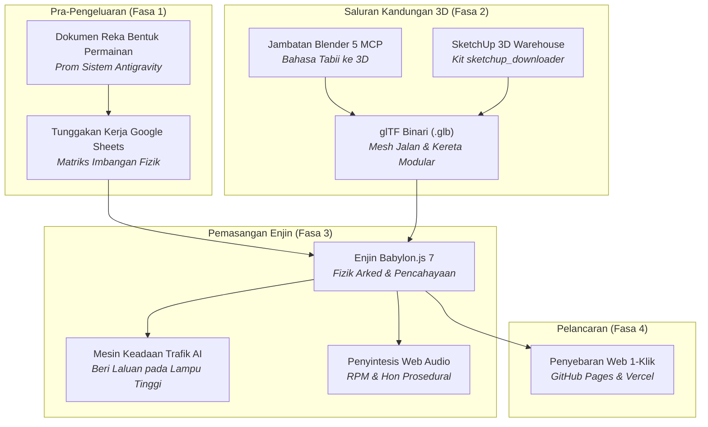

# King Myvi: Highway Legends 🚗💨
> **AI untuk Pembangunan Permainan: Bengkel Praktikal & Demo Tutorial**  
> *Bagaimana AI Generatif, Ejen Pengekodan Autonomi, dan Model Context Protocol (MCP) Mengubah Cara Permainan Video Dibina*

<div align="center">

**[English](README.md) | [Bahasa Melayu](README.ms-MY.md)**

[](https://www.babylonjs.com/)
[](https://vitejs.dev/)
[](https://c-fu.github.io/krackeddevs-ai-for-gaming/)
[](https://www.blender.org/)
[](https://c-fu.github.io/krackeddevs-ai-for-gaming/slides.html)
[](src/audio.js)
[](LICENSE)

[🕹️ **Hab Semua Permainan (3 Kotak)**](https://c-fu.github.io/krackeddevs-ai-for-gaming/) &bull; [🚗 **Main King Myvi**](https://c-fu.github.io/krackeddevs-ai-for-gaming/myvi.html) &bull; [🍲 **Main Makcik Canteen**](https://c-fu.github.io/krackeddevs-ai-for-gaming/MAKCIK_CANTEEN/index.html) &bull; [🏎️ **Main Neon Kart 3D**](https://c-fu.github.io/krackeddevs-ai-for-gaming/neon_kart_3d/index.html) &bull; [🏛️ **Pemuat Turun 3D Warehouse**](sketchup_downloader/README.ms-MY.md) &bull; [📑 **Slaid Pembentangan**](https://c-fu.github.io/krackeddevs-ai-for-gaming/slides.html) &bull; [📐 **Templat Dokumen Reka Bentuk**](TEMPLATE_DESIGN_DOCUMENT/README.ms-MY.md) &bull; [💬 **Pek Prom**](docs/WORKSHOP_HANDOUT_AND_PROMPTS.ms-MY.md)

</div>

---

## 🕹️ Ekosistem 3 Permainan Bengkel

Sepanjang bengkel dan sesi langsung **AI for Gaming**, tiga buah permainan 3D penuh yang boleh dimainkan telah dirangka konsepnya, didokumentasikan, dan dibina sepenuhnya menggunakan AI generatif, ejen pengekodan autonomi, dan saluran paip prosedur:

| Permainan | Platform & Enjin | Permainan Teras & Cadangan Nilai Unik (USP) | Dokumen Reka Bentuk & Pautan |
| :--- | :--- | :--- | :--- |
| **🚗 King Myvi: Highway Legends** | **Babylon.js 7** + Vite | Larian lebuh raya arked berhalaju tinggi. Pancarkan lampu tinggi (`Spacebar`) untuk memaksa trafik lorong kanan memberi laluan, elak kawah lubang jalan, dan lompat tanjakan tol SmartTAG penuh lorong pada 240 km/j. | • [🎮 Main Game Langsung](https://c-fu.github.io/krackeddevs-ai-for-gaming/myvi.html)<br/>• [🏠 Hab 3-Permainan](https://c-fu.github.io/krackeddevs-ai-for-gaming/)<br/>• [📄 GDD Permainan](docs/GAME_DESIGN_DOCUMENT.ms-MY.md)<br/>• [🚗 Saliran 3D Myvi](docs/BLENDER_3D_PIPELINE.ms-MY.md)<br/>• [📁 Kod Sumber](src/) |
| **🍛 Makcik Canteen: Haze Fighter** | **Babylon.js 7** + Vite | Simulator arked kantin sekolah Malaysia. Berbekalkan kipas penghembus industri (`Spacebar`) dan perangkap bom ais kering (`E`), bersihkan kepulan jerebu tebal demi menyelamatkan pelajar lapar dalam kiraan undur waktu rehat 60 saat. *Dibina secara langsung semasa bengkel menggunakan Microsoft Copilot!* | • [🎮 Main Makcik Canteen](https://c-fu.github.io/krackeddevs-ai-for-gaming/MAKCIK_CANTEEN/index.html)<br/>• [📖 README Kantin](MAKCIK_CANTEEN/README.ms-MY.md)<br/>• [📄 Spesifikasi Penuh 7-Dokumen](MAKCIK_CANTEEN/GAME_DESIGN_DOCUMENT.md)<br/>• [🔬 Teknologi & Fizik](MAKCIK_CANTEEN/GAME_TECH_STACK.md)<br/>• [💬 Dialog Langsung Copilot](https://copilot.microsoft.com/conversations/join/NppskzM778rkVNxfjVi5D) |
| **🏎️ Neon Kart 3D** | **Three.js** + Vite | Pelumba drift arked siber bernuansa Synthwave. Menampilkan percikan kuasa drift, kiub misteri terapung, roket penjejak, tompokan minyak, pad pemecut, dan saingan AI berdaya dinamik di litar neon bercahaya. | • [🎮 Main Neon Kart 3D](https://c-fu.github.io/krackeddevs-ai-for-gaming/neon_kart_3d/index.html)<br/>• [📖 Buku Panduan Makmal 3 Jam](neon_kart_3d/ai_for_gaming_3hour_lab_runbook_and_templates.md)<br/>• [📑 Slaid Reveal.js](https://c-fu.github.io/krackeddevs-ai-for-gaming/neon_kart_3d/ai_for_gaming_3_hour_hands_on_lab_deck_reveal_js_markdown.html)<br/>• [📚 Wiki GitHub](neon_kart_3d/wiki.md)<br/>• [📁 Folder](neon_kart_3d/) |

---

## 💡 Petua Utama Prototip Permainan: "Ajukan Soalan Relevan Kepada Saya"

> [!IMPORTANT]
> **Rahsia Menghapuskan Halusinasi AI & Pembengkakan Skop (Scope Creep)**  
> Kesilapan terbesar yang kerap dilakukan oleh pembangun dan pereka permainan apabila menggunakan Model Bahasa Raya (LLM) ialah meminta dokumen reka bentuk permainan (GDD) penuh dalam satu prom buta:  
> *❌ "Tuliskan dokumen reka bentuk permainan untuk game battle royale cyberpunk multipemain."*  
> 
> Kaedah ini hampir pasti menghasilkan mekanik yang melampau, skop yang mustahil disiapkan, dan idea RPG generik yang klise.
> 
> Sebaliknya, cetuskan **Dialog Diagnostik Perundingan** dengan memaksa AI bertindak sebagai penemuduga menerusi frasa emas ini:
> ```text
> "Saya ingin mereka bentuk permainan tentang [konsep]. Sebelum mencipta dokumen reka bentuk permainan, 
> ajukan soalan-soalan relevan kepada saya untuk menetapkan skop audiens sasaran, gelung teras, USP, kekangan platform, dan gaya seni."
> ```

### Bukti Sesi Sebenar di Microsoft Copilot
Metodologi prompting ini telah dibuktikan secara langsung untuk membina struktur permainan penuh dalam masa kurang 15 minit:
1. **[Dialog Copilot Makcik Canteen: Haze Fighter](https://copilot.microsoft.com/conversations/join/NppskzM778rkVNxfjVi5D):** Copilot mengemukakan 5 soalan skoping diagnostik (gelung teras, gaya visual, jenis halangan, bantuan kuasa, syarat kemenangan) sebelum merangka 7 dokumen spesifikasi modular.
2. **[Suite Templat Dokumen Reka Bentuk di Copilot](https://copilot.microsoft.com/conversations/join/a8PJA1mSSRu5JoSRYExV7):** Copilot menstrukturkan suite reka bentuk 9-templat standard industri merangkumi mekanik, fizik, tindanan teknologi, UI/UX, aset, ujian, dan kebolehcapaian.

Terokai suite templat sedia guna yang lengkap dalam [`TEMPLATE_DESIGN_DOCUMENT/`](TEMPLATE_DESIGN_DOCUMENT/README.ms-MY.md).

---

## 🚗 Evolusi 3D Myvi: Visi Pelbagai Mod & Blender MCP

Semasa sesi bengkel, para peserta menyaksikan evolusi masa nyata kenderaan pemain daripada model awal poli rendah yang ringkas kepada **Perodua Myvi Generasi ke-3 (Merah Lava)** yang bertepatan sepenuhnya dengan render rujukan studio Hum3D profesional:

```
[Imej Rujukan 3D] ──► [Ekstraksi LLM Vision] ──► [Spesifikasi Poligon Teknikal]
                                                              │
                                                              ▼
[Enjin Web Babylon.js] ◄── [Eksport Binari .GLB] ◄── [Jambatan MCP Blender 9876]
```

### Aliran Kerja 3-Langkah Peningkatan Langsung:
1. **Prompt Penglihatan Pelbagai Mod (Imej-ke-Spesifikasi):** Daripada menggambarkan Myvi berdasarkan ingatan, render rujukan tiga suku hadapan dan belakang dianalisis oleh model penglihatan untuk menghasilkan pecahan geometri yang tepat (garisan pinggang, spoiler aero dua tingkat dengan sirip sisi hitam, sisipan bumbung terapung tiang C, kluster lampu belakang melintang membalut sisi).
2. **Pelaksanaan Langsung Model Context Protocol (MCP):** Ejen berhubung terus ke instans Blender yang sedang berjalan melalui soket TCP (`127.0.0.1:9876`), menjana geometri Python `bpy` prosedur pada urutan utama Blender tanpa pengubahsuaian bucu secara manual.
3. **Prompt Pembetulan Interaktif (Human-in-the-Loop):** Apabila lakaran awal menghasilkan bentuk berkotak generasi lama, pengajar mengarahkan:  
   > *"The model is not correct, not like in real life. Change the car model to this one."*  
   Ejen segera menambat semula model kepada rujukan visual sebenar, menjana lampu melengkung, peresap sporty, roda turbin, dan mengeksport `myvi.glb` terus ke direktori enjin permainan web.

*(Ketahui kisah penuh, transkrip prom, dan skrip Python di [`docs/BLENDER_3D_PIPELINE.ms-MY.md`](docs/BLENDER_3D_PIPELINE.ms-MY.md) / [English: `docs/BLENDER_3D_PIPELINE.md`](docs/BLENDER_3D_PIPELINE.md)).*

---

## 📖 Gambaran Keseluruhan

**King Myvi: Highway Legends** ialah permainan arked larian lebuh raya 3D berhalaju tinggi yang direka khas untuk **tutorial praktikal 3 jam** mengenai pembangunan permainan berbantukan AI.

Dalam bengkel ini, para peserta **tidak perlu menaip sebarang sintaks asas secara manual**. Sebaliknya, mereka bertindak sebagai **Pengarah Kreatif & Penerbit Utama**, menggunakan ejen AI (**Antigravity**, **OpenCode**) serta saluran paip 3D (**Blender MCP**) untuk merangka konsep, membina struktur, memodelkan aset 3D, menyusun logik permainan, dan melancarkan permainan 3D penuh ke web dari awal.

```
   ┌────────────────────────────────────────────────────────┐
   │                  ALIRAN KERJA BERASASKAN EJEN          │
   │                                                        │
   │  Visi Kreatif ──► GDD Dijana AI ──► Senarai Tugas Sheets│
   │         │                                      │       │
   │         ▼                                      ▼       │
   │  Blender 5 (MCP) ──► Mesh .GLB 3D ──► Enjin Babylon.js 7│
   │                                                │       │
   │                                                ▼       │
   │                                   Penyebaran Web 1-Klik │
   └────────────────────────────────────────────────────────┘
```

---

## 🎯 Falsafah Teras: "Titik A ke Titik B + 1–2 USP"

Punca terbesar kegagalan projek permainan pembangun baharu atau indie ialah **pembengkakan skop (scope creep)**. Kebanyakan pasukan cuba membina permainan RPG dunia terbuka yang terlalu luas dengan cuaca dinamik, sistem ekonomi, dan inventori yang rumit — akhirnya berputus asa selepas dua minggu.

Pada asas matematik dan penceritaannya, setiap permainan yang menarik adalah tentang perjalanan dari **Titik A ke Titik B**:

* **Titik A (Permulaan):** Di mana pemain bermula (Plaza Tol Jalan Duta, KM 0.0, kelajuan 0 km/j, waktu puncak petang, kiraan masa 90 saat).
* **Titik B (Destinasi):** Di mana pemain mesti tiba (Plaza Tol & R&R Ayer Keroh, KM 5.0, sebelum tempahan makan malam tamat).

Apa yang mengubah perjalanan biasa menjadi permainan yang ketagih dan menyeronokkan ialah **1 atau 2 Cadangan Nilai Unik (USP - Unique Selling Propositions)**:

### ⚡ USP 1: Pancaran Lampu Tinggi / High-Beam (`Spacebar`)
Di Malaysia, Perodua Myvi putih sinonim dengan gelaran *"Raja Jalanan"*. Alih-alih menembak peluru berpandu atau membaling kulit pisang kartun, senjata utama pemain ialah **Pancaran Lampu Tinggi di Lorong Kanan**:
* Pancarkan kon lampu sorot berkembar berkeamatan tinggi sejauh 42 meter ke hadapan.
* Kenderaan trafik yang perlahan (lori, van penghantaran, sedan) akan panik, menyalakan lampu isyarat ke kiri, dan memberi laluan ke lorong tengah.
* Berjaya mengosongkan lorong memotong memberi ganjaran **+250 MATA** dan mengekalkan rentak kelajuan anda.

### 🚀 USP 2: Mengelak Lubang Jalan & Tanjakan Loncatan SmartTAG
* **Lubang Jalan (Halangan):** Kerosakan jalan berturap yang bertaburan di lorong 1 dan 2. Melanggarnya menyebabkan **pengurangan kelajuan serta-merta sebanyak 45%**, menggegarkan kamera, dan mengakibatkan stereng bergegar tidak stabil selama 1.2 saat.
* **Tanjakan SmartTAG (Ganjaran):** Lorong bertanda hijau zamrud bercahaya penuh yang menuju ke gantri tol. Melaluinya memberikan lonjakan nitro supersonik sehingga **240 km/j** dan melancarkan kereta ke udara dalam lompatan akrobatik merentasi kenderaan trafik di bawah!

---

## 🕹️ Kawalan Permainan

| Tindakan | Papan Kekunci | Skrin Sentuh (Mudah Alih / Tablet) |
| :--- | :--- | :--- |
| **Pecutan (Gas)** | `W` atau `↑ Anak Panah Atas` | Pedal `GAS` |
| **Brek / Undur** | `S` atau `↓ Anak Panah Bawah` | Pedal `BRAKE` |
| **Stereng Kiri / Kanan** | `A` / `D` atau `←` / `→` | Butang D-Pad `←` / `→` |
| **Pancar Lampu Tinggi (USP 1)** | `Spacebar` (Tekan / Tahan) | Butang `FLASH` |
| **Hon Tradisi ("Pon-pon!")** | `H` atau `B` | — |
| **Buka Babylon Inspector** | `I` (Mod Pengajar Bengkel) | — |

---

## ⚡ Panduan Pantas Permulaan

### Keperluan Asas
* **Node.js**: v18.0.0+ atau v20.0.0+
* **npm**: v9.0.0+ atau v10.0.0+
* **Pelayar Web**: Chrome, Edge, Brave, Safari, atau Firefox (dengan sokongan WebGL2)
* *(Pilihan untuk Penjanaan 3D)*: **Blender 4.x atau 5.x**

### 1. Klon & Pasang
```bash
# Klon repositori ini
git clone https://github.com/C-Fu/krackeddevs-ai-for-gaming.git
cd krackeddevs-ai-for-gaming

# Pasang pakej kebergantungan (Babylon.js, loaders, inspector, Vite)
npm install
```

### 2. Jalankan Pelayan Pembangunan Tempatan
```bash
npm run dev
```
* **Permainan Langsung:** Buka [`http://localhost:5173`](http://localhost:5173)
* **Slaid Pembentangan:** Buka [`http://localhost:5173/slides.html`](http://localhost:5173/slides.html)

### 3. Bina untuk Pengeluaran (Production Build)
```bash
npm run build
```
Menghasilkan bundle statik yang dioptimumkan di dalam folder `/dist` yang mengandungi kedua-dua `index.html` dan `slides.html`.

---

## 📁 Struktur Repositori

```
KD_AI_FOR_GAMING/
├── README.md                    # Dokumentasi utama (Bahasa Inggeris)
├── README.ms-MY.md              # Dokumentasi utama (Bahasa Melayu)
├── LICENSE                      # Lesen Sumber Terbuka MIT
├── index.html                   # Titik masuk HTML5 & HUD arked dengan pautan ke slaid & GitHub
├── style.css                    # Penggayaan Cyberpunk / Synthwave, glassmorphism, HUD responsif
├── slides.html                  # Slaid interaktif 16-bahagian menggunakan Reveal.js 5
├── vite.config.js               # Konfigurasi pembina multi-halaman Vite 6
├── package.json                 # Pakej kebergantungan: @babylonjs/core, loaders, inspector, vite
│
├── src/                         # Kod Sumber King Myvi: Highway Legends
│   ├── main.js                  # Gelung enjin, kamera kejar (ofset 180°), pencahayaan senja, semakan menang/kalah
│   ├── myvi.js                  # Fizik arked kereta pemain, olengan badan (8°), lampu sorot, fizik lompatan
│   ├── traffic.js               # Pengurus trafik AI: sedan, van, lori; mesin keadaan 4-peringkat untuk memberi laluan
│   ├── highway.js               # Lebuhraya PLUS 3-lorong, penghadang, gantri hijau, pokok kelapa sawit, plaza tol
│   ├── obstacles.js             # Lubang jalan prosedural & tanjakan penuh SmartTAG dengan gantri realistik
│   ├── audio.js                 # Enjin audio sintesis Web Audio tulen (RPM enjin, hon, deruan nitro)
│   └── ui.js                    # Meter kelajuan, meter baki jarak, pemasa, notifikasi banner, D-pad sentuh
│
├── index.html                   # Hab Utama 3-Permainan (3 Kotak pilihan untuk Myvi, Makcik Canteen, Neon Kart)
├── myvi.html                    # Permainan penuh King Myvi: Highway Legends
├── slides.html                  # Slaid Bengkel Interaktif (Reveal.js)
├── MAKCIK_CANTEEN/              # Makcik Canteen: Haze Fighter (Permainan Sesi Langsung)
│   ├── index.html               # Titik masuk permainan Babylon.js 7 boleh dimainkan
│   ├── README.md                # Panduan Bahasa Inggeris & dokumentasi Copilot
│   ├── README.ms-MY.md          # Panduan Bahasa Melayu
│   └── *.md                     # Spesifikasi lengkap reka bentuk permainan 7-dokumen
│
├── neon_kart_3d/                # Neon Kart 3D (Pelumba Drift Synthwave)
│   ├── index.html               # Titik masuk permainan Three.js boleh dimainkan (dihidangkan automatik di GitHub Pages)
│   ├── neon_kart_3d_ai_for_gaming_live_workshop_demo.html # Permainan Three.js boleh dimainkan
│   ├── ai_for_gaming_3_hour_hands_on_lab_deck_reveal_js_markdown.html # Slaid Reveal.js
│   ├── README.md                # Dokumentasi projek
│   └── wiki.md                  # Wiki seni bina litar 3D Three.js
│
├── TEMPLATE_DESIGN_DOCUMENT/    # Suite Templat Dokumen Reka Bentuk Permainan Sejagat
│   ├── README.md                # Panduan suite dalam Bahasa Inggeris
│   ├── README.ms-MY.md          # Panduan suite dalam Bahasa Melayu
│   ├── TEMPLATE_*.md            # 9 Templat kosong reka bentuk standard
│   └── EXAMPLE_*.md             # 3 Kajian kes permainan bengkel sebenar
│
├── sketchup_downloader/         # Kit Pemuat Turun CDN 3D Warehouse & Penukar GLB
│   ├── get_sketchup_model.ps1   # Skrip PowerShell mengekstrak pautan & memuat turun GLB
│   ├── get_sketchup_model.sh    # Skrip bash untuk macOS / Linux
│   ├── get_sketchup_model.bat   # Skrip kelompok boleh dwi-klik untuk Windows
│   ├── glb2gltf.ps1 / .sh / .bat# Penukar GLB ke glTF tanpa kebergantungan luar
│   ├── README.md                # Dokumentasi Bahasa Inggeris
│   └── README.ms-MY.md          # Dokumentasi Bahasa Melayu & arahan 1-baris
│
├── tools/
│   └── blender/
│       ├── README.md            # Panduan menjalankan skrip melalui Blender MCP atau CLI
│       ├── build_hum3d_myvi.py  # Skrip penjana model Myvi Merah Lava Generasi ke-3
│       ├── generate_myvi.py     # Skrip asas Myvi berprosedur
│       └── generate_environment.py # Skrip Python menjana pokok kelapa sawit, papan tanda & gantri
│
├── public/
│   └── assets/
│       └── models/              # Folder output untuk fail model 3D binary glTF (.glb)
│           ├── myvi.glb         # Model 3D Perodua Myvi Generasi ke-3 (267 KB)
│           ├── overhead_gantry.glb # Gantri papan tanda hijau PLUS (18 KB)
│           └── palm_tree.glb    # Model pokok kelapa sawit tepi jalan (17 KB)
│
└── docs/                        # Dokumentasi Penuh Bengkel 3 Jam
    ├── AI_FOR_GAMING_MASTER_PLAN.md        # Pelan induk & skrip pembentang (English)
    ├── AI_FOR_GAMING_MASTER_PLAN.ms-MY.md  # Pelan induk & skrip pembentang (Bahasa Melayu)
    ├── GAME_DESIGN_DOCUMENT.md             # Dokumen reka bentuk permainan terperinci (English)
    ├── GAME_DESIGN_DOCUMENT.ms-MY.md       # Dokumen reka bentuk permainan terperinci (Bahasa Melayu)
    ├── PROJECT_MANAGEMENT_TEMPLATE.md      # Templat pengurusan projek & matriks fizik (English)
    ├── PROJECT_MANAGEMENT_TEMPLATE.ms-MY.md# Templat pengurusan projek & matriks fizik (Bahasa Melayu)
    ├── WORKSHOP_HANDOUT_AND_PROMPTS.md     # Panduan peserta & pek prom langkah-demi-langkah (English)
    ├── WORKSHOP_HANDOUT_AND_PROMPTS.ms-MY.md# Panduan peserta & pek prom langkah-demi-langkah (Bahasa Melayu)
    ├── BLENDER_3D_PIPELINE.md              # Saliran pemodelan 3D Myvi & rujukan Hum3D (English)
    └── BLENDER_3D_PIPELINE.ms-MY.md        # Saliran pemodelan 3D Myvi & rujukan Hum3D (Bahasa Melayu)
```

---

## 🛠️ Ekosistem Alatan AI



1. **Antigravity / OpenCode:** Persekitaran ejen pengekodan autonomi yang menterjemahkan arahan prom reka bentuk peringkat tinggi kepada kod JavaScript modular sedia pengeluaran dan fizik vektor.
2. **Blender MCP (Model Context Protocol):** Sambungan terus dari ejen AI ke enjin masa nyata Python Blender (`bpy`), membina geometri berprosedur dan mengeksport mesh `.glb` terus ke folder aset permainan.
3. **Pemuat Turun SketchUp 3D Warehouse:** Alternatif pantas mendapatkan aset 3D tanpa perlu membina dari awal, mengekstrak model GLB sedia guna (contoh: Menara KLCC, pondok tol PLUS, kenderaan, gerai) terus daripada CDN Trimble tanpa memerlukan akaun atau log masuk.
4. **Babylon.js 7:** Enjin pelayar WebGL2/WebGPU yang menyediakan pemaparan berasaskan fizik (PBR), FollowCamera dengan regangan FOV dinamik, penjana bayang-bayang, dan Debug Inspector.
5. **API Web Audio Prosedural:** Bebas kebergantungan fail luaran `.mp3` atau `.wav`. Pengayun enjin gigi gergaji (sawtooth) dinamik yang dimodulasi kelajuan km/j, hon harmoni dwi-nada kereta tempatan, dan cip frekuensi eksponen bagi lonjakan nitro.

---

## 🎨 Saluran Paip Aset 3D: Blender MCP

Sekiranya anda memasang perisian Blender secara tempatan, anda boleh menjana semula aset 3D dalam mod tanpa paparan (headless CLI) atau melalui Model Context Protocol:

```bash
# Windows
& "C:\Program Files\Blender Foundation\Blender 5.2\blender.exe" --background --python tools/blender/build_hum3d_myvi.py
& "C:\Program Files\Blender Foundation\Blender 5.2\blender.exe" --background --python tools/blender/generate_environment.py

# macOS
/Applications/Blender.app/Contents/MacOS/Blender --background --python tools/blender/build_hum3d_myvi.py
/Applications/Blender.app/Contents/MacOS/Blender --background --python tools/blender/generate_environment.py
```

> **Mod Hibrid / Sandaran (Fallback):**  
> Sekiranya komputer peserta tidak mempunyai perisian Blender, repositori ini telah menyertakan fail model `.glb` sedia guna yang telah disahkan serta penjana geometri sandaran prosedural dalam Babylon.js. **Tiada siapa yang akan terhalang.**

---

## 🏛️ Memperoleh Aset 3D: Pemuat Turun SketchUp 3D Warehouse (`sketchup_downloader/`)

> [!TIP]
> **Tidak mahu membina setiap model 3D dari awal dalam Blender?**  
> Walaupun jambatan Blender MCP sangat berkuasa untuk penjanaan berprosedur, pembangunan permainan sering memerlukan mercu tanda dunia sebenar, seni bina Malaysia, dan prop persekitaran terperinci (seperti Menara Berkembar Petronas / KLCC, plaza tol PLUS, gerai mamak tepi jalan, atau meja kerusi kantin sekolah).
>
> Repositori ini menyertakan kit alat **[`sketchup_downloader/`](sketchup_downloader/README.ms-MY.md)** (*[English: `sketchup_downloader/README.md`](sketchup_downloader/README.md)*) — penyelesaian ringan tanpa kebergantungan luar untuk **mengekstrak pautan CDN terus dan memuat turun model 3D (GLB, USDZ, KMZ, SKP) dari Trimble SketchUp 3D Warehouse tanpa perlu mendaftar akaun atau log masuk**!

### ⚡ Muat Turun Pantas 1-Baris (Tanpa Pemasangan Perisian)

Muat turun mana-mana model 3D terus ke dalam folder projek permainan anda menerusi satu baris arahan terminal:

- **Windows (PowerShell):**
  ```powershell
  # Muat turun model GLB terus dari 3D Warehouse:
  & ([scriptblock]::Create((irm https://raw.githubusercontent.com/C-Fu/krackeddevs-ai-for-gaming/main/sketchup_downloader/get_sketchup_model.ps1))) "https://3dwarehouse.sketchup.com/model/16965783-d6e1-4abf-b2d6-ef87f1b25747/Ombak-KLCC" -Download
  ```
- **macOS / Linux (Bash):**
  ```bash
  curl -sSL https://raw.githubusercontent.com/C-Fu/krackeddevs-ai-for-gaming/main/sketchup_downloader/get_sketchup_model.sh | bash -s -- --download "https://3dwarehouse.sketchup.com/model/16965783-d6e1-4abf-b2d6-ef87f1b25747/Ombak-KLCC"
  ```

### 🛠️ Alatan yang Disertakan dalam `sketchup_downloader/`:
| Alat | Platform | Kegunaan |
| :--- | :--- | :--- |
| **`get_sketchup_model.ps1` / `.sh` / `.bat`** | Windows, macOS, Linux | Menghubungi API CDN Trimble 3D Warehouse, melepasi halangan log masuk, dan memuat turun aset `.glb` / `.usdz` secara terus. |
| **`glb2gltf.ps1` / `.sh` / `.bat`** | Windows, macOS, Linux | Pembuka fail GLB tanpa kebergantungan luar (PowerShell / Shell tulen) yang menukar `.glb` kepada `.gltf` + `.bin` + tekstur berasingan (tiada Node.js atau Python diperlukan!). |

*(Untuk panduan penuh, skrip kelompok, dan pilihan penukaran, lihat [`sketchup_downloader/README.ms-MY.md`](sketchup_downloader/README.ms-MY.md)).*

---

## 📑 Slaid Pembentangan

Pembentangan interaktif 16-bahagian disertakan dalam **[`slides.html`](slides.html)**:

* Dibina menggunakan **Reveal.js 5.1** dengan tema visual cyber-sunset tersuai.
* Tekan **`S`** untuk membuka **Paparan Nota Pembentang (Speaker Notes)** (mengandungi pemasa langsung, pratonton slaid seterusnya, dan skrip pertuturan penuh).
* Tekan **`ESC`** atau **`O`** untuk membuka paparan gambaran keseluruhan slaid (grid overview).
* Tekan **`F`** untuk mod pembentangan skrin penuh.
* Klik butang **`🎮 MAIN DEMO LANGSUNG`** di bar navigasi atas untuk terus melompat masuk ke dalam permainan.

---

## 🚀 Pelancaran & Penyebaran

### Pilihan A: GitHub Pages (Disyorkan)
1. Rakam dan tolak kod ke repositori GitHub anda:
   ```bash
   git add .
   git commit -m "feat: lengkapkan demo permainan King Myvi"
   git push origin main
   ```
2. Di dalam repositori GitHub anda:
   * Pergi ke **Settings &rarr; Pages**.
   * Di bawah bahagian **Build and deployment &rarr; Source**, pilih **GitHub Actions** (atau pilih cawangan `main` dengan folder `/dist`).
3. Permainan dan slaid anda kini boleh diakses di seluruh dunia melalui `https://<nama-pengguna>.github.io/<nama-repo>/`!

### Pilihan B: Vercel (Pantas Serta-Merta)
```bash
npx vercel
```
Tekan `Enter` untuk pilihan lalai. Vercel secara automatik mengesan konfigurasi Vite dan memberikan URL HTTPS pengeluaran serta kod QR mudah alih dalam masa 30 saat.

---

## 🏆 Suite & Dokumen Induk Bengkel

| Suite Dokumen (Bahasa Melayu) | Document Suite (English) | Penerangan / Description |
| :--- | :--- | :--- |
| [Pelan Induk AI](docs/AI_FOR_GAMING_MASTER_PLAN.ms-MY.md) | [AI Master Plan](docs/AI_FOR_GAMING_MASTER_PLAN.md) | Pecahan terperinci 180 minit, kerangka pedagogi, dan skrip pembentang. |
| [Dokumen Reka Bentuk Permainan (GDD)](docs/GAME_DESIGN_DOCUMENT.ms-MY.md) | [Game Design Document (GDD)](docs/GAME_DESIGN_DOCUMENT.md) | Spesifikasi fizik kenderaan, pohon keadaan trafik, arahan seni, dan reka bentuk audio. |
| [Templat Pengurusan Projek](docs/PROJECT_MANAGEMENT_TEMPLATE.ms-MY.md) | [Project Management Template](docs/PROJECT_MANAGEMENT_TEMPLATE.md) | Tunggakan kerja Agile (blok data CSV untuk Google Sheets) & matriks fizik. |
| [Panduan Peserta & Pek Prom](docs/WORKSHOP_HANDOUT_AND_PROMPTS.ms-MY.md) | [Workshop Handout & Prompts](docs/WORKSHOP_HANDOUT_AND_PROMPTS.md) | Prom salin-dan-tampal langkah demi langkah untuk Antigravity & OpenCode. |
| [Saliran 3D Blender & Galeri](docs/BLENDER_3D_PIPELINE.ms-MY.md) | [Blender 3D Pipeline & Gallery](docs/BLENDER_3D_PIPELINE.md) | Pemodelan prosedur Myvi Generasi ke-3 melalui soket Blender MCP & eksport glTF. |
| [Pemuat Turun 3D Warehouse](sketchup_downloader/README.ms-MY.md) | [SketchUp 3D Warehouse Downloader](sketchup_downloader/README.md) | Skrip tanpa kebergantungan untuk memuat turun model GLB daripada CDN Trimble tanpa log masuk. |
| [Dokumentasi Makcik Canteen](MAKCIK_CANTEEN/README.ms-MY.md) | [Makcik Canteen Documentation](MAKCIK_CANTEEN/README.md) | Spesifikasi lengkap 7-dokumen permainan yang dicipta secara langsung dengan Microsoft Copilot. |
| [Suite Templat Reka Bentuk](TEMPLATE_DESIGN_DOCUMENT/README.ms-MY.md) | [Template Design Document Suite](TEMPLATE_DESIGN_DOCUMENT/README.md) | 9 templat reka bentuk standard & 3 kajian kes permainan bengkel sebenar. |
| [Dokumentasi Neon Kart 3D](neon_kart_3d/README.md) | [Neon Kart 3D Documentation](neon_kart_3d/README.md) | Permainan drift arked siber Synthwave dibina dengan Three.js dan Vite. |

---

## 💡 Cabaran Selepas Bengkel

Bersedia untuk memperluaskan prototaip ini menjadi permainan komersial penuh? Sahut cabaran hackathon ini:

1. **Kenderaan Tempatan Baharu:** Bina skrin pemilihan garaj dengan pilihan kenderaan seperti **Proton Kancil** (pecutan tinggi, kelajuan maksimum rendah) atau **Proton Wira** dengan talaan drift.
2. **Peristiwa Hujan Monsun:** Di Kilometer 3.0, cetuskan ribut hujan tropika secara dinamik: gelapkan langit, kurangkan geseran tayar di atas asfalt sebanyak 30%, dan aktifkan animasi pengelap cermin hadapan.
3. **Papan Pendahulu Dalam Talian:** Sambungkan pangkalan data Postgres [Supabase](https://supabase.com/) percuma untuk merekodkan masa terpantas dan skor tertinggi dari seluruh dewan.
4. **Peralihan ke Unreal Engine 5:** Eksport mekanik permainan dan susun atur laluan ke dalam Unreal Engine 5 menggunakan API Python UE dan Procedural Content Generation (PCG).

---

## 📜 Lesen

Diedarkan di bawah **Lesen Sumber Terbuka MIT**. Bebas digunakan untuk tujuan pendidikan, komersial, dan peribadi.  
Dicipta khas untuk tutorial praktikal dan masterclass **AI for Gaming**.
