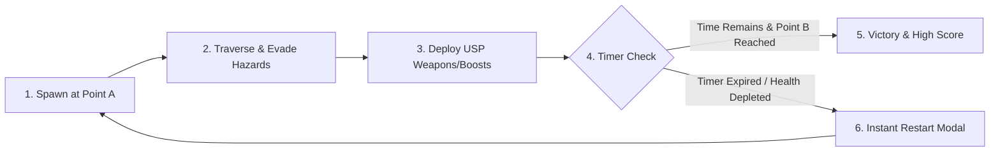

# [Game Title] — Game Design Document (GDD)

> **Core Logline:** *"[One punchy sentence summarizing the unique gameplay hook and tone.]"*

---

## 1. Executive Summary & Overview
- **Game Title:** [Title]
- **Genre:** [e.g. 3D Arcade Racer, Action Arcade, Physics Puzzler]
- **Target Platform:** Web Browser (Desktop & Mobile, WebGL2/WebGPU, 60 FPS, Zero Backend)
- **Target Audience:** [Specific persona: Age, context, gaming habits]
- **Session Duration:** [e.g. 60–90 seconds per run, instant restart]
- **Reference Inspirations:** [1–2 classic games, e.g. OutRun, Overcooked, Mario Kart]

---

## 2. The Core Philosophy: Point A to Point B + 1–2 USPs
Every engaging arcade prototype reduces scope creep by establishing a strict traversal foundation with 1 or 2 distinct twists:
- **Point A (The Origin):** [Starting location, state, or initial challenge]
- **Point B (The Goal):** [Destination, clear state, or victory condition]

### ⚡ Unique Selling Proposition (USP) #1
- **Name:** [e.g. Right-Lane High-Beam Flash / Industrial Blower Fan]
- **Input:** [Key / Button]
- **Player Effect:** [What happens to the player]
- **World Effect:** [How obstacles, enemies, or environment react]

### 🚀 Unique Selling Proposition (USP) #2 (Optional)
- **Name:** [e.g. SmartTAG Ramp Jump / Cryogenic Dry Ice Bombs]
- **Input / Trigger:** [Pickup, pad, or button]
- **Gameplay Impact:** [High-risk high-reward mechanic]

---

## 3. Core Gameplay Loop

---

## 4. Narrative & Thematic Flavor
- **Setting:** [e.g. Malaysian PLUS Highway at twilight / School canteen at recess]
- **Art Direction:** [e.g. Low-poly stylized, neon cyber-sunset, cartoony]
- **Cultural / Emotional Hook:** [Why does this resonate emotionally or humorously with players?]

---

## 5. Progression & Prototype Scope
- **Level Depth:** Single polished vertical slice (1 complete level / track).
- **Difficulty Curve:**
  - *Early Phase (0–30%):* Gentle onboarding, wide lanes, low hazard density.
  - *Mid Phase (30–70%):* Hazard density increases, power-up pickups appear.
  - *Climax Phase (70–100%):* High-speed obstacle slalom, intense audio tempo, final sprint to Point B.

---

## 6. Specification Document Links
- [Technical Design Document](TEMPLATE_TECHNICAL_DESIGN_DOCUMENT.md)
- [Game Mechanics & Controls](TEMPLATE_GAME_MECHANICS.md)
- [Physics Specifications](TEMPLATE_GAME_PHYSICS.md)
- [Tech Stack Architecture](TEMPLATE_GAME_TECH_STACK.md)
- [UI / UX Wireframes](TEMPLATE_GAME_UI_UX.md)
- [Asset & Audio Pipeline](TEMPLATE_GAME_ASSETS.md)
- [Testing & QA Plan](TEMPLATE_GAME_TESTING.md)
- [Accessibility Guidelines](TEMPLATE_GAME_ACCESSIBILITY.md)
