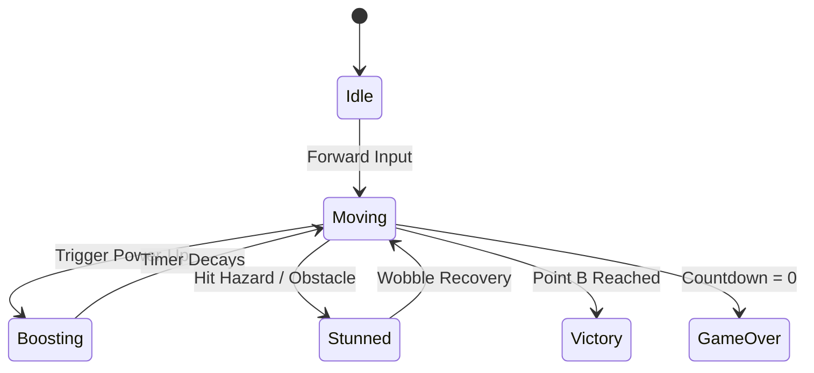

# [Game Title] — Game Mechanics & Controls

## 1. Input Mapping Matrix
| Action | Keyboard & Mouse | Gamepad | Touchscreen (Mobile / Tablet) |
| :--- | :--- | :--- | :--- |
| **Move / Steer** | `W, A, S, D` or `Arrow Keys` | Left Thumbstick / D-Pad | Onscreen Virtual Floating Joystick |
| **Brake / Reverse** | `S` or `Down Arrow` | Left Trigger (LT) / B Button | Virtual Brake Button (Red) |
| **Primary Action (USP 1)** | `Spacebar` / Right-Click | Right Trigger (RT) / A Button | Virtual Action Button #1 (Yellow) |
| **Secondary Action (USP 2)** | `Left-Click` / `E Key` | Right Bumper (RB) / X Button | Virtual Action Button #2 (Cyan) |
| **Toggle Audio** | `M Key` | Select Button | HUD Audio Icon |
| **Restart Session** | `R Key` / `Enter` | Start Button | Modal "Play Again" Button |

---

## 2. Core Mechanics State Machines

---

## 3. Power-Up & Interactive Props
| Prop Name | Spawn Probability | Trigger Effect | Duration | Sound Cue |
| :--- | :--- | :--- | :--- | :--- |
| **[Speed Boost Item]** | 40% | Instant +50 km/h surge, speed cap raised to 240 km/h | 3.5s | Exponential pitch-up chirp |
| **[AOE Cleaner / Bomb]** | 35% | Ballistic projectile with cryogenic frost shockwave | Instant | Deep sub-bass boom |
| **[Invincible Shield]** | 25% | Repels incoming traffic, ignores potholes | 5.0s | High harmonic drone |
