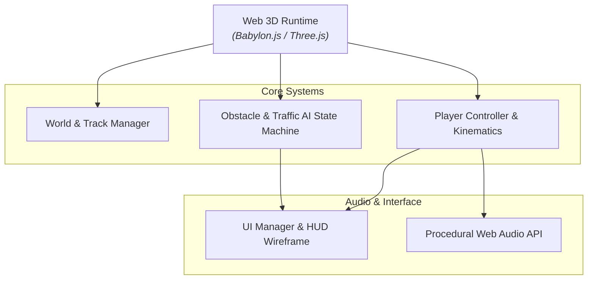

# [Game Title] — Technical Design Document (TDD)

## 1. System Architecture & Module Boundaries

---

## 2. Module Responsibilities
| Module File | Class / Namespace | Responsibilities |
| :--- | :--- | :--- |
| `src/main.js` | `GameApp` | Engine loop, scene lighting, camera rig, lifecycle state (`START`, `PLAYING`, `GAMEOVER`, `VICTORY`). |
| `src/player.js` | `PlayerEntity` | Movement kinematics, input buffering, health/boost state, weapon discharge. |
| `src/world.js` | `WorldManager` | Track spline, procedural chunk recycling, collision boundaries, skybox/fog. |
| `src/hazards.js` | `HazardSystem` | Spawning, pooling, raycast collision checks, yield/flee state trees. |
| `src/ui.js` | `UIManager` | DOM HUD overlays, timer countdown, speedometers, touch joysticks, victory screens. |
| `src/audio.js` | `SoundSynthesizer` | Zero-dependency Web Audio API sound synthesis (oscillators, noise, gain ramps). |

---

## 3. Performance Budgets & Target Constraints
- **Target Framerate:** Solid 60 FPS (16.6ms frame time) on Intel UHD 620 / iPhone SE / M1 Mac.
- **Draw Call Limit:** Max 65 draw calls per frame (use instanced meshes and merged geometries).
- **Triangle / Poly Budget:** Max 45,000 active triangles visible in viewport frustum.
- **Memory Footprint:** Under 150 MB heap allocation.
- **Network / Asset Payload:** Total initial bundle under 5 MB compressed (no heavy multi-megabyte sound files or uncompressed 4K textures).
