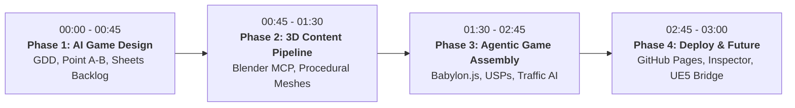

# AI for Gaming: Master Workshop & Tutorial Blueprint
## *How AI is Reshaping Game Design, Content Pipelines, and Playable 3D Worlds*

---

> [!IMPORTANT]
> **Core Workshop Philosophy: "The Game is Point A to Point B + 1-2 USPs"**
> Most beginner game development projects fail due to scope bloat and ambiguous design objectives. At its mathematical and narrative foundation, every game is a journey from **Point A to Point B** (a physical finish line, a narrative revelation, an escalation of difficulty, or a resource threshold). What transforms a sterile traversal into a viral, addictive game are **one or two Unique Selling Propositions (USPs)** — mechanical or physical twists that force the player to make expressive micro-decisions. In this lab, we build **"King Myvi: Highway Legends"** live using this exact thesis.

---

## 1. Executive Summary & Workshop Metadata

| Parameter | Specification |
| :--- | :--- |
| **Duration** | 180 Minutes (3 Hours) |
| **Target Audience** | Students, AI Builders, Tech Professionals, Aspiring Indie Devs (Beginner to Intermediate) |
| **Coding Requirement** | Prompt-driven / Agent-orchestrated (No manual syntax typing; all code generated via Antigravity / OpenCode) |
| **Tech Stack** | **Babylon.js 7.x** + **Vite** (Web 3D runtime), **Blender 5.x + MCP** (3D procedural generation), **Web Audio API** (procedural audio) |
| **Live Showcase Game** | **"King Myvi: Highway Legends"** (Arcade expressway sprint with High-Beam traffic parting & SmartTAG ramp boosts) |
| **Deployment Target** | Local Dev (`localhost:5173`) + One-Click Deploy to **GitHub Pages** / **Vercel** |
| **Core Tools** | **Antigravity** (Autonomous Coding Agent), **OpenCode** (Local Agent Alternative), **Blender + Blender MCP** (AI-to-3D Bridge), **Google Sheets / Notion** (AI-driven GDD & Backlog) |

---

## 2. The Complete 3-Hour Minute-by-Minute Run-of-Show

### Phase 1: The Core Philosophy & AI Pre-Production (00:00 – 00:45 | 45 Mins)

#### 00:00 - 00:15 | The Mindset Shift: From Syntax to Creative Direction
- **Speaker Hook**: *"10 years ago, building a 3D game required a team of 15: physics programmers, 3D modellers, rigger, level designer, audio engineer, and QA. Today, you are the Creative Director. Your AI agent (Antigravity/OpenCode) is your junior dev team."*
- **The Golden Rule**: The "Point A to Point B" Principle.
  - Why games get abandoned: 90% of indie devs design an "infinite open world" and stall after 2 weeks.
  - The framework:
    1. **Point A**: Where does the player start? (Toll Plaza Jalan Duta, 0 km/h, calm evening).
    2. **Point B**: Where must they arrive? (Ayer Keroh R&R / Toll Plaza, 5,000 meters away, before the timer runs out).
    3. **USP 1 (Core Mechanic Twist)**: **High-Beam Flash (`Spacebar`)** — Parting the sea of slow highway traffic in the fast lane.
    4. **USP 2 (Environmental Twist)**: **Pothole Slalom & SmartTAG Ramp Boosts** — Risk vs. reward navigation.
- **Showcase**: Run the finished demo of *King Myvi: Highway Legends* for 90 seconds to trigger excitement.

#### 00:15 - 00:30 | Generating the Game Design Document (GDD) with AI
- **Live Demo**: Prompting Antigravity with a structured system prompt to generate a 1-page executable GDD.
- **Key Lesson**: Prompting AI for games requires **quantifiable physics and behavioral constraints**, not vague creative prose.
  - Bad Prompt: *"Make a fun car game with Malaysian highway vibes."*
  - Good Prompt: *"Generate an arcade vehicle mechanics specification: Myvi top speed 180 km/h, lane-shift interpolation 0.15s, high-beam raycast cone 45 degrees / 35m range, traffic reaction delay 0.4s."*

#### 00:30 - 00:45 | AI-Driven Project Management in Google Sheets
- **The Concept**: Transforming GDD user stories into an agile backlog and parameter balancing sheet.
- **Attendee Activity**:
  - Open the ready-made Google Sheets template.
  - Use AI to generate 8 sprint tasks tagged with dependencies (Architecture -> Physics -> AI Traffic -> VFX -> Audio).
  - Review the **Physics Balancing Matrix** (Top speed, friction coefficient, boost velocity, crash recovery).

---

### Phase 2: 3D Content Pipeline & The Blender MCP Bridge (00:45 – 01:30 | 45 Mins)

#### 00:45 - 01:05 | How Model Context Protocol (MCP) Connects Agents to 3D DCCs
- **The Architecture**:
  - What is MCP? The open standard allowing AI agents to invoke local tools and APIs.
  - Traditional workflow: Human manually clicks menus in Blender -> models vertices -> unwraps UVs -> exports `.glb` -> imports to game engine.
  - MCP workflow: Agent speaks JSON-RPC to a local Blender Python listener -> Blender creates primitives, manipulates curves, assigns PBR materials -> agent exports `.glb` directly into `/public/assets/models/`.
- **Live Instructor Showcase**:
  - Prompting Antigravity: *"Connect to Blender via MCP. Generate a low-poly stylized hatchback car body with separate wheels, a roof spoiler, and neon LED headlights. Export as `myvi.glb` into `public/assets/models/`."*
  - Attendees watch Blender 5 viewport update live as the agent builds the car in real-time.

#### 01:05 - 01:20 | Modular Procedural World Building
- **Instructor Demo**: Generating the PLUS highway assets:
  - 3-lane asphalt road module with dashed lane dividers.
  - Malaysian highway overhead gantry signs (*"Kuala Lumpur / Seremban / Ipoh"*).
  - Low-poly roadside oil palm trees (*Kelapa Sawit*).
  - The Toll Plaza archway structure at Point B.
- **The Hybrid Mode Strategy**:
  - For attendees without local Blender configured: The workshop starter repo already includes verified `.glb` files and fallback procedural Babylon.js meshes, ensuring zero attendee blocking.

#### 01:20 - 01:30 | AI Texture & Sound Generation
- **Audio Pipeline**:
  - Showcasing procedural Web Audio synthesis (engine pitch ramping, tire screech, high-beam strobe chime).
  - Optional AI Audio tools: Generating Malaysian radio banter or retro dangdut synth loops using Suno / Udio / ElevenLabs SFX, or extracting local reference audio using `yt-dlp`.

---

### Phase 3: Agentic Game Assembly with Babylon.js (01:30 – 02:45 | 75 Mins)

#### 01:30 - 01:50 | Milestone 1: The Core Loop & Arcade Vehicle Controller
- **Objective**: Get the Myvi moving, steering, and accelerating smoothly down the 3D track.
- **Hands-On Prompting**: Attendees prompt Antigravity / OpenCode:
  - Setup Babylon.js scene, hemispheric light, directional sun, and chase camera.
  - Implement smooth arcade vehicle controls: Arrow keys / `WASD` for acceleration, braking, and responsive lane steering with chassis banking tilt.
  - Introduce speedometer calculation (`km/h`) and camera field-of-view dynamic widening as speed climbs past 140 km/h.

#### 01:50 - 02:15 | Milestone 2: USP 1 — The High-Beam Flash & Traffic AI State Machine
- **Objective**: Implement the legendary Malaysian highway high-beam mechanic!
- **Mechanics Breakdown**:
  - Pressing `Spacebar` activates the high-beam flash (dual high-intensity spotlight cones with lens flare).
  - Traffic System: Ambient vehicles (slow lorries, delivery vans, passenger sedans) cruise at 80–100 km/h in various lanes.
  - **AI State Machine**:
    - When a player flashes high-beams within 35 meters behind a vehicle in the right lane, the vehicle triggers its left turn signal and changes lanes smoothly, clearing the path!
    - Flashing too close or hitting a vehicle causes a bumper ricochet with speed penalty and smoke particles.

#### 02:15 - 02:35 | Milestone 3: USP 2 — Pothole Slalom & SmartTAG Ramp Boosts
- **Objective**: Add road hazards and high-speed risk/reward ramps.
- **Mechanics Breakdown**:
  - **Potholes**: Low-poly dark asphalt craters scattered across lanes. Hitting a pothole shakes the camera, reduces speed by 40%, and plays a suspension clunk sound.
  - **SmartTAG Boost Lanes**: Green neon glowing strips placed leading into toll gantries. Driving over them triggers an arcade impulse, launches the Myvi into an aerial leap over traffic, and gives a 220 km/h boost surge!

#### 02:35 - 02:45 | Milestone 4: Point B Finish Line, HUD & Audio Integration
- **Objective**: Complete the loop with victory/defeat states and arcade polish.
- **Features**:
  - Distance Meter: Counting down from 5,000m to 0m (Point B Toll Plaza).
  - Timer: Reaching Point B under 90 seconds wins the "Highway King" trophy.
  - Sound Effects: Synthesized engine RPM, horn (`H` key), booster whoosh, victory fanfare.

---

### Phase 4: Instant Deployment, Polish & The Horizon (02:45 – 03:00 | 15 Mins)

#### 02:45 - 02:52 | One-Click Web Deployment
- **The Deployment Flow**:
  - Run `npm run build` to generate the standalone static `/dist` bundle.
  - Push to GitHub repository -> enable GitHub Pages in 2 clicks.
  - Live test on attendee smartphones via QR code (Babylon.js touch controls).

#### 02:52 - 02:57 | The Babylon.js Inspector: Live Game Tuning
- Showcasing `scene.debugLayer.show()`:
  - Real-time tweaking of post-processing pipeline: Bloom, chromatic aberration, tone mapping, and fog density.
  - Explaining how creative directors use runtime inspectors to balance visual hierarchy.

#### 02:57 - 03:00 | Scaling Up: The Bridge to Unreal Engine 5 & AAA
- How the same AI agentic workflows scale:
  - Text-to-GDD -> Python scripting in Unreal Engine 5 Editor (via UE Python API or MCP).
  - Procedural Content Generation (PCG) in UE5 powered by LLMs.
  - AI Behavior Trees and State Trees for complex NPC intelligence.
- Closing Q&A and community showcase.

---

## 3. Recommended Speaker Toolkit & Setup Checklist

> [!TIP]
> **Pre-Flight Instructor Checklist (Night Before)**
> 1. Verify Node.js v20+ and npm are accessible in terminal.
> 2. Ensure Blender 4.x or 5.x is installed; test running `blender --background --python <script>`.
> 3. Clone the workshop starter repo into a fresh directory and test `npm install && npm run dev`.
> 4. Prepare backup offline slide deck and USB drives containing pre-packaged node_modules for attendees with slow WiFi.
