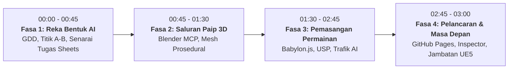

# AI untuk Pembangunan Permainan: Pelan Induk & Panduan Bengkel
## *Bagaimana AI Mengubah Reka Bentuk Permainan, Saluran Paip Kandungan, dan Dunia 3D*
**[English](AI_FOR_GAMING_MASTER_PLAN.md) | [Bahasa Melayu](AI_FOR_GAMING_MASTER_PLAN.ms-MY.md)**

---

> [!IMPORTANT]
> **Falsafah Teras Bengkel: "Permainan Adalah Titik A ke Titik B + 1-2 USP"**
> Kebanyakan projek pembangun baharu gagal disebabkan oleh pembengkakan skop dan objektif reka bentuk yang kabur. Pada asas matematik dan penceritaannya, setiap permainan adalah perjalanan dari **Titik A ke Titik B** (garisan penamat fizikal, pendedahan cerita, peningkatan kesukaran, atau ambang sumber). Apa yang mengubah perjalanan biasa menjadi permainan yang tular dan ketagih ialah **satu atau dua Cadangan Nilai Unik (USP)** — mekanik atau kelainan fizikal yang memaksa pemain membuat keputusan mikro yang menyeronokkan. Dalam makmal ini, kita membina **"King Myvi: Highway Legends"** secara langsung menggunakan tesis ini.

---

## 1. Ringkasan Eksekutif & Metadata Bengkel

| Parameter | Spesifikasi |
| :--- | :--- |
| **Tempoh Masa** | 180 Minit (3 Jam) |
| **Sasaran Peserta** | Pelajar, Pembina AI, Profesional Teknologi, Pembangun Indie (Pemula hingga Pertengahan) |
| **Keperluan Pengekodan** | Berpandukan Prom / Digerakkan Ejen (Tiada penaipan sintaks manual; semua kod dijana melalui Antigravity / OpenCode) |
| **Timbunan Teknologi** | **Babylon.js 7.x** + **Vite** (Masa larian Web 3D), **Blender 5.x + MCP** (Penjanaan prosedural 3D), **Web Audio API** (Audio prosedural) |
| **Permainan Demonstrasi** | **"King Myvi: Highway Legends"** (Larian lebuh raya arked dengan Lampu Tinggi & Tanjakan SmartTAG) |
| **Sasaran Penyebaran** | Pembangunan Tempatan (`localhost:5173`) + Penyebaran 1-Klik ke **GitHub Pages** / **Vercel** |
| **Alatan Teras** | **Antigravity** (Ejen Pengekodan Autonomi), **OpenCode** (Alternatif Ejen Tempatan), **Blender + Blender MCP** (Jambatan AI-ke-3D), **Google Sheets / Notion** (GDD & Senarai Tugas Didorong AI) |

---

## 2. Jadual Pelaksanaan Minit Demi Minit (3 Jam)

### Fasa 1: Falsafah Teras & Pra-Pengeluaran AI (00:00 – 00:45 | 45 Minit)

#### 00:00 - 00:15 | Perubahan Minda: Daripada Sintaks Kepada Arahan Kreatif
- **Skrip Pembentang**: *"10 tahun lalu, membina permainan 3D memerlukan pasukan 15 orang: pengatur cara fizik, pemodel 3D, juruanimasi, pereka aras, jurutera audio, dan QA. Hari ini, anda adalah Pengarah Kreatif. Ejen AI anda (Antigravity/OpenCode) adalah pasukan jurutera junior anda."*
- **Prinsip Emas**: Prinsip "Titik A ke Titik B".
  - Mengapa projek sering terbengkalai: 90% pembangun indie mereka "dunia terbuka tanpa had" dan terkandas selepas 2 minggu.
  - Rangka kerja:
    1. **Titik A**: Di mana pemain bermula? (Plaza Tol Jalan Duta, 0 km/j, waktu petang yang tenang).
    2. **Titik B**: Di mana pemain mesti tiba? (R&R / Plaza Tol Ayer Keroh, 5,000 meter ke hadapan, sebelum pemasa tamat).
    3. **USP 1 (Keunikan Mekanikal)**: **Pancaran Lampu Tinggi (`Spacebar`)** — Mengosongkan kesesakan trafik di lorong laju.
    4. **USP 2 (Keunikan Alam Sekitar)**: **Mengelak Lubang Jalan & Tanjakan SmartTAG** — Navigasi risiko lawan ganjaran.
- **Demonstrasi**: Mainkan demo *King Myvi: Highway Legends* selama 90 saat untuk mencetuskan keterujaan dewan.

#### 00:15 - 00:30 | Menjana Dokumen Reka Bentuk Permainan (GDD) dengan AI
- **Demo Langsung**: Mengarahkan Antigravity dengan prom sistem berstruktur untuk menjana GDD 1-halaman yang boleh dilaksanakan serta-merta.
- **Pengajaran Penting**: Arahan prom AI untuk permainan memerlukan **kekangan fizik dan tingkah laku yang boleh diukur**, bukannya prosa sastera yang kabur.
  - Prom Lemah: *"Buat satu permainan kereta yang seronok dengan suasana lebuh raya Malaysia."*
  - Prom Hebat: *"Jana spesifikasi mekanik kenderaan arked: Kelajuan maksimum Myvi 180 km/j, interpolasi tukar lorong 0.15s, kon lampu tinggi raycast 45 darjah / jarak 42m, tangguhan tindak balas trafik 0.35s."*

#### 00:30 - 00:45 | Pengurusan Projek Berbantukan AI dalam Google Sheets
- **Konsep**: Menukarkan kisah pengguna GDD kepada senarai tugas sprint agile dan helaian imbangan fizik.
- **Aktiviti Peserta**:
  - Buka templat Google Sheets sedia guna.
  - Gunakan AI untuk menjana 8 tugas sprint dengan tag kebergantungan (Seni Bina -> Fizik -> Trafik AI -> VFX -> Audio).
  - Semak **Matriks Keseimbangan Fizik** (Kelajuan puncak, pekali geseran, halaju lonjakan, pemulihan pelanggaran).

---

### Fasa 2: Saluran Paip Aset 3D & Jambatan Blender MCP (00:45 – 01:30 | 45 Minit)

#### 00:45 - 01:05 | Bagaimana Model Context Protocol (MCP) Menghubungkan Ejen ke Alatan 3D
- **Seni Bina Sistem**:
  - Apakah itu MCP? Piawaian terbuka yang membolehkan ejen AI menggunakan alatan dan API perisian tempatan.
  - Aliran kerja tradisional: Manusia klik menu dalam Blender secara manual -> modelkan bucu -> buka UV -> eksport `.glb` -> import ke enjin permainan.
  - Aliran kerja MCP: Ejen menghantar JSON-RPC ke pendengar Python Blender tempatan -> Blender menjana primitif, memanipulasi lengkung, menetapkan bahan PBR -> ejen mengeksport `.glb` terus ke `/public/assets/models/`.
- **Demonstrasi Langsung Pengajar**:
  - Prom Antigravity: *"Sambung ke Blender melalui MCP. Jana badan kereta hatchback Perodua Myvi poli rendah dengan roda berasingan, spoiler bumbung sporty, dan lampu hadapan LED. Eksport sebagai `myvi.glb` ke dalam `public/assets/models/`."*
  - Peserta melihat viewport Blender 5 mengemas kini model secara langsung semasa ejen membinanya dalam masa nyata.

#### 01:05 - 01:20 | Pembinaan Dunia Prosedural Modular
- **Demo Pengajar**: Menjana aset lebuh raya PLUS:
  - Modul jalan asfalt 3 lorong dengan pembahagi lorong putih putus-putus.
  - Papan tanda gantri hijau lebuh raya Malaysia (*"Kuala Lumpur / Seremban / Ipoh"*).
  - Pokok kelapa sawit poli rendah di bahu jalan.
  - Struktur pintu gerbang Plaza Tol di Titik B.
- **Strategi Mod Hibrid**:
  - Untuk peserta tanpa Blender tempatan: Repositori permulaan bengkel telah menyertakan fail model `.glb` sedia ada dan mesh sandaran prosedural Babylon.js, memastikan tiada seorang pun peserta terhenti.

#### 01:20 - 01:30 | Penjanaan Tekstur & Audio Prosedural
- **Saluran Paip Audio**:
  - Menunjukkan sintesis Web Audio prosedural (kenaikan pic frekuensi enjin, decitan tayar, bunyi loceng lampu tinggi).
  - Alatan Audio AI Pilihan: Menjana siaran radio Malaysia atau rentak muzik latar synthwave menggunakan Suno / Udio / ElevenLabs SFX, atau mengekstrak audio rujukan tempatan melalui `yt-dlp`.

---

### Fasa 3: Pemasangan Permainan dengan Babylon.js (01:30 – 02:45 | 75 Minit)

#### 01:30 - 01:50 | Pencapaian 1: Gelung Teras & Pengawal Kenderaan Arked
- **Objektif**: Menggerakkan Myvi, mengemudi, dan memecut dengan lancar di atas trek 3D.
- **Prom Praktikal Peserta**: Peserta mengarahkan Antigravity / OpenCode:
  - Sediakan babak Babylon.js, lampu hemisfera, matahari senja berarah, dan kamera kejar.
  - Laksanakan kawalan kenderaan arked yang responsif: Kekunci anak panah / `WASD` untuk pecutan, brek, dan stereng lorong dengan olengan condong badan kenderaan.
  - Laksanakan kiraan meter kelajuan (`km/j`) dan pelebaran medan pandangan (FOV) kamera apabila kelajuan melebihi 140 km/j.

#### 01:50 - 02:15 | Pencapaian 2: USP 1 — Pancaran Lampu Tinggi & Trafik AI
- **Objektif**: Melaksanakan mekanik lampu tinggi lebuh raya Malaysia yang ikonik!
- **Pecahan Mekanik**:
  - Menekan `Spacebar` mengaktifkan pancaran lampu tinggi (dua kon lampu sorot berkeamatan tinggi dengan suar kembangan).
  - Sistem Trafik: Kenderaan sekeliling (lori kanvas, van penghantaran, sedan lama) bergerak pada 80–95 km/j di pelbagai lorong.
  - **Mesin Keadaan AI Trafik**:
    - Apabila pemain memancarkan lampu tinggi dalam jarak 35 meter di belakang kenderaan di lorong kanan, kenderaan tersebut menyalakan lampu isyarat kiri dan beralih lorong dengan lancar ke kiri!
    - Melanggar kenderaan tanpa memberi laluan mengakibatkan lantunan bampar dengan penalti kelajuan dan kepulan asap.

#### 02:15 - 02:35 | Pencapaian 3: USP 2 — Mengelak Lubang Jalan & Tanjakan SmartTAG
- **Objektif**: Menambah cabaran bahaya jalan dan tanjakan pecutan berisiko tinggi.
- **Pecahan Mekanik**:
  - **Lubang Jalan**: Kawah asfalt gelap poli rendah yang bertaburan di lorong. Melanggarnya menggegarkan kamera, mengurangkan kelajuan sebanyak 45%, dan membunyikan dentuman suspensi logam.
  - **Lorong Tanjakan SmartTAG Penuh**: Lorong hijau zamrud bercahaya penuh yang menuju ke gantri tol dengan papan tanda SmartTAG kuning realistik. Melaluinya memberikan dorongan segera, melancarkan Myvi terbang akrobatik merentasi trafik pada kelajuan 240 km/j!

#### 02:35 - 02:45 | Pencapaian 4: Garisan Penamat Titik B, HUD & Integrasi Audio
- **Objektif**: Melengkapkan gelung permainan dengan status menang/kalah dan kemasan arked.
- **Ciri-ciri**:
  - Meter Baki Jarak: Mengira undur dari 5,000m ke 0m (Plaza Tol Titik B).
  - Pemasa: Tiba di Titik B dalam masa kurang 90 saat memenangi trofi "Raja Lebuhraya".
  - Kesan Bunyi: RPM enjin sintesis, hon tradisi (kekunci `H`), deruan nitro, dan muzik kejayaan.

---

### Fasa 4: Penyebaran Segera, Kemasan & Masa Hadapan (02:45 – 03:00 | 15 Minit)

#### 02:45 - 02:52 | Penyebaran Web 1-Klik
- **Aliran Pelancaran**:
  - Jalankan `npm run build` untuk menghasilkan bundle statik `/dist`.
  - Tolak kod ke repositori GitHub -> aktifkan GitHub Pages dalam 2 klik.
  - Uji secara langsung pada telefon pintar peserta melalui imbasan kod QR (kawalan sentuh Babylon.js).

#### 02:52 - 02:57 | Babylon.js Inspector: Penalaan Langsung Permainan
- Menunjukkan kuasa `scene.debugLayer.show()`:
  - Menala saluran pasca-pemprosesan dalam masa nyata: Kembangan cahaya (bloom), kabus senja, dan pemetaan ton.
  - Menerangkan bagaimana pengarah kreatif menggunakan inspector untuk mengimbangi visual permainan.

#### 02:57 - 03:00 | Penskalaan: Jambatan ke Unreal Engine 5 & AAA
- Bagaimana aliran kerja ejen AI ini diskalakan ke enjin AAA:
  - Teks-ke-GDD -> Skrip Python dalam Editor Unreal Engine 5 (melalui API Python UE atau MCP).
  - Penjanaan Kandungan Prosedural (PCG) dalam UE5 yang digerakkan oleh LLM.
  - Pokok Keadaan AI (StateTree) dan Tingkah Laku untuk kecerdasan NPC yang kompleks.
- Sesi Soal Jawab, sesi ujian bermain peserta, dan penyerahan repositori.
