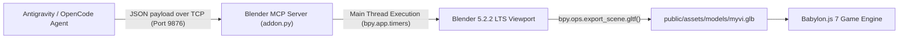

# 🚗 3rd Generation Perodua Myvi (Lava Red / HUM3D Reference) – Blender MCP Pipeline

*[Versi Bahasa Melayu ada di sini: BLENDER_3D_PIPELINE.ms-MY.md](BLENDER_3D_PIPELINE.ms-MY.md)*  
*Part of the [AI for Gaming Workshop Ecosystem](../README.md). Interactive Design Suite: [TEMPLATE_DESIGN_DOCUMENT/](../TEMPLATE_DESIGN_DOCUMENT/README.md)*

This document details the procedural 3D modeling pipeline used to build the **3rd Generation Perodua Myvi (Lava Red)** matching the **Hum3D 3D reference** (`media_1793013754379_8974d7c7.png` & `media_1793013766937_0b5e9563.png`) directly inside the active Blender instance via the `BlenderMCPServer` socket bridge (`127.0.0.1:9876`), followed by automatic binary glTF (`.glb`) export and Babylon.js integration.

---

## 💡 The Prompt Engineering Workflow: How the 3D Myvi Was Conceived & Prompted

During the workshop, attendees learned how to turn a real-world vehicle concept into an optimized 3D game asset in minutes without manual polygon vertex modeling. Here is the exact prompting methodology used:

### 1. Step 1: Multimodal Vision Prompting (Image-to-Spec)
Instead of asking an AI to "model a Perodua Myvi from memory", the instructor acquired high-resolution 3D reference renders (from Hum3D in Lava Red, showing front-left and rear-left three-quarter perspectives).

The reference image was provided to a multimodal vision LLM (Copilot/Gemini) with a structured extraction prompt:
```text
"Here is a reference image of the Perodua Myvi (rear-left view). 
Provide a technical breakdown structured specifically for 3D polygonal modeling:
1. Overall Body Form: Proportions, overhangs, cabin height-to-width ratio, roof curvature.
2. Rear Section: Tailgate rake, rear glass shape, wiper placement, spoiler type.
3. Lighting Clusters: Orientation (horizontal vs vertical), segmentation (LED vs clear).
4. Side Profile: Beltline crease flow, C-pillar styling, wheel arch contour.
5. Primary Volumes & Edge Flows for polygonal modeling."
```

### 2. Step 2: Live Blender MCP Bridge (Natural Language to Python `bpy`)
The resulting technical breakdown was fed into an agentic coding environment ([Google Antigravity](https://antigravity.google/) / [OpenCode](https://opencode.ai/)) connected to the active Blender instance via the [Model Context Protocol (MCP)](https://github.com/ahujasid/mcp-for-blender):
- **Socket Port:** `127.0.0.1:9876` (`BlenderMCPServer` in `addon.py`).
- **Execution Mechanism:** The AI agent sent JSON payloads containing procedural Python code (`bpy.ops.mesh.primitive_cube_add`, custom vertex arrays, and `Principled BSDF` material shaders) executed directly on Blender's main thread via `bpy.app.timers`.
- **Zero Manual Export:** The script automatically called `bpy.ops.export_scene.gltf(filepath="myvi.glb", export_format="GLB")`, outputting the binary model directly into the web game's asset pipeline.

### 3. Step 3: Human-in-the-Loop Prompt Refinement
When an intermediate prompt generated an older-generation boxy Myvi with vertical pillar taillights, the instructor performed prompt steering:
> **The Steering Prompt:**  
> *"change the car model to this one"* (anchoring directly to the Hum3D 3rd Gen visual reference).

The AI agent cross-referenced the visual ground truth to correct the model:
- Swapping vertical pillar lights for **horizontal two-piece wrap-around taillamps**.
- Adding the signature **two-tier roof spoiler with black side fins**.
- Adding the **gloss-black floating roof insert on the C-pillar**.
- Generating 15-inch **two-tone directional turbine alloy wheels**.
- Embossing the `"HUM3D"` license plate and `"Myvi"` chrome script.

---

## 📐 Hum3D Reference Visual Feature Breakdown

### 1. Rear Fascia & Horizontal Taillights
* **Taillamps:** **Horizontal two-piece wrap-around taillights** (outer piece wraps around the rear quarter fender, inner piece extends onto the tailgate). Red LED C-shape border with clear reverse and turn indicator segments.
* **Rear Hatch & Glass:** Aerodynamically raked rear windshield (~55° slope from horizontal).
* **Two-Tier Aero Roof Spoiler:** Body-colored top wing with black aerodynamic side fins framing the rear glass and integrated center red LED brake light (HMSL).
* **Roof:** Center shark fin antenna.
* **Badging & Plates:**
  * Chrome Perodua oval emblem with thumb latch recess below it.
  * Chrome `"Myvi"` script badge to the left of the emblem.
  * License plate recess with `"HUM3D"` plate (including blue EU/MY style strip on left).
* **Rear Bumper:** Sculpted bumper with black faux aerodynamic corner diffusers and horizontal slim red reflectors.

### 2. Side Profile & Floating Roof
* **Beltline:** Rising character line sweeping from front fender through door handles into rear taillamp corner.
* **C-Pillar:** Black gloss aerodynamic insert between rear quarter window and tailgate glass, creating the signature Gen 3 floating roof cue.
* **Wheels:** 15-inch two-tone machine-faced directional turbine alloy rims (10 spokes: alternating silver and dark anthracite) with low-profile tires.

### 3. Front Fascia
* **Lighting:** Angular LED headlamps swept back into fenders.
* **Grille:** Black honeycomb grille with chrome wing bar and center Perodua badge.
* **Air Dam:** Large lower black trapezoidal intake with fog light pods.

---

## 🛠️ Architecture: Live Blender MCP Bridge



### Script Execution & Export
The generation script is saved at [`tools/blender/build_hum3d_myvi.py`](../tools/blender/build_hum3d_myvi.py). It connects to the open Blender instance, generates the geometry, positions the beauty cameras, activates `MATERIAL` shading mode, and exports:
* Primary asset: `public/assets/models/myvi.glb` (267 KB)
* Production bundle: `dist/assets/models/myvi.glb`


---

## 🏛️ Alternative to Modeling from Scratch: SketchUp 3D Warehouse Downloader

While the procedural Blender MCP pipeline is ideal for generating custom stylized vehicles and procedural terrain, building complex real-world architecture (such as the Petronas Twin Towers / KLCC, PLUS highway toll plazas, roadside stalls, or canteen props) from scratch in Blender can take significant time.

For rapid asset sourcing, the project includes [`sketchup_downloader/`](../sketchup_downloader/README.md) (*[BM: `sketchup_downloader/README.ms-MY.md`](../sketchup_downloader/README.ms-MY.md)*). It lets you bypass account logins and download production-ready **`.glb` models directly from Trimble SketchUp 3D Warehouse's public CDN**:

```powershell
# Windows 1-Liner: Download any 3D Warehouse model directly as GLB
& ([scriptblock]::Create((irm https://raw.githubusercontent.com/C-Fu/krackeddevs-ai-for-gaming/main/sketchup_downloader/get_sketchup_model.ps1))) "https://3dwarehouse.sketchup.com/model/16965783-d6e1-4abf-b2d6-ef87f1b25747/Ombak-KLCC" -Download
```

```bash
# macOS / Linux 1-Liner
curl -sSL https://raw.githubusercontent.com/C-Fu/krackeddevs-ai-for-gaming/main/sketchup_downloader/get_sketchup_model.sh | bash -s -- --download "https://3dwarehouse.sketchup.com/model/16965783-d6e1-4abf-b2d6-ef87f1b25747/Ombak-KLCC"
```

You can then import the downloaded `.glb` file directly into your Blender scene or place it straight into `public/assets/models/` for Babylon.js!
