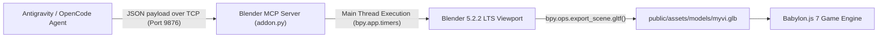

# 🚗 3rd Generation Perodua Myvi (Lava Red / HUM3D Reference) – Blender MCP Pipeline

*[Versi Bahasa Melayu ada di sini: BLENDER_3D_PIPELINE.ms-MY.md](BLENDER_3D_PIPELINE.ms-MY.md)*

This document details the procedural 3D modeling pipeline used to build the **3rd Generation Perodua Myvi (Lava Red)** matching the **Hum3D 3D reference** (`media_1793013754379_8974d7c7.png` & `media_1793013766937_0b5e9563.png`) directly inside the active Blender instance via the `BlenderMCPServer` socket bridge (`127.0.0.1:9876`), followed by automatic binary glTF (`.glb`) export and Babylon.js integration.

---

## 📐 Hum3D Reference Visual Feature Breakdown

### 1. Rear Fascia & Horizontal Taillights
* **Taillamps:** **Horizontal two-piece wrap-around taillights** (outer piece wraps around the rear quarter fender, inner piece extends onto the tailgate). Red LED C-shape border with clear reverse and turn indicator segments.
* **Rear Hatch & Glass:** Aerodynamically raked rear windshield (~55° slope from horizontal).
* **Two-Tier Aero Roof Spoiler:** Body-colored top wing with black aerodynamic side fins framing the rear glass and integrated center red LED brake light (HMSL).
* **Roof:** Center shark fin antenna.
* **Badging & Plates:**
  * Chrome Perodua oval emblem with thumb latch recess below it.
  * Chrome `"Myvi"` script badge to the left of the emblem.
  * License plate recess with `"HUM3D"` plate (including blue EU/MY style strip on left).
* **Rear Bumper:** Sculpted bumper with black faux aerodynamic corner diffusers and horizontal slim red reflectors.

### 2. Side Profile & Floating Roof
* **Beltline:** Rising character line sweeping from front fender through door handles into rear taillamp corner.
* **C-Pillar:** Black gloss aerodynamic insert between rear quarter window and tailgate glass, creating the signature Gen 3 floating roof cue.
* **Wheels:** 15-inch two-tone machine-faced directional turbine alloy rims (10 spokes: alternating silver and dark anthracite) with low-profile tires.

### 3. Front Fascia
* **Lighting:** Angular LED headlamps swept back into fenders.
* **Grille:** Black honeycomb grille with chrome wing bar and center Perodua badge.
* **Air Dam:** Large lower black trapezoidal intake with fog light pods.

---

## 🛠️ Architecture: Live Blender MCP Bridge

### Script Execution & Export
The generation script is saved at [`tools/blender/build_hum3d_myvi.py`](../tools/blender/build_hum3d_myvi.py). It connects to the open Blender instance, generates the geometry, positions the beauty cameras, activates `MATERIAL` shading mode, and exports:
* Primary asset: `public/assets/models/myvi.glb` (267 KB)
* Production bundle: `dist/assets/models/myvi.glb`
