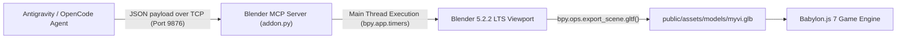

# 🚗 Classic Perodua Myvi 3D Model – Blender MCP Pipeline

*[Versi Bahasa Melayu ada di sini: BLENDER_3D_PIPELINE.ms-MY.md](BLENDER_3D_PIPELINE.ms-MY.md)*

This document details the procedural 3D modeling pipeline used to build the iconic **Classic Perodua Myvi (Rear-Left View specification)** directly inside the active Blender instance via the `BlenderMCPServer` socket bridge (`127.0.0.1:9876`), followed by automatic binary glTF (`.glb`) export and Babylon.js integration.

---

## 📐 Technical Breakdown & Specification Adherence

### 1. Overall Body Form
* **Type:** Compact 5-door hatchback configuration.
* **Proportions:** Short rear overhang, tall cabin height relative to width, maximizing interior space.
* **Surface Language:** Smooth continuous panels with subtle beltline creases; slightly flared wheel arches for stance.
* **Roofline:** Mildly curved, peaking gently above the front seats and tapering gracefully toward the rear hatch.

### 2. Rear Section & Glass
* **Tailgate:** Large, near-vertical hatch plane (~82° upright angle) with integrated rear windshield.
* **Rear Glass:** Wide, slightly trapezoidal tinted glass with black ceramic frit border.
* **Rear Wiper:** Single black rear wiper arm and horizontal blade mounted at the **bottom center** of the rear glass.
* **Lip Spoiler:** Subtle roof-mounted lip spoiler extending slightly beyond the rear glass with black underside trim and integrated center High-Mount Stop Lamp (HMSL).
* **Badging & Plates:**
  * Center: Chrome `"MYVI"` model script badge.
  * Emblem: Perodua silver roundel above hatch latch.
  * License Plate Area: Rectangular recess with license plate (`"HUM3D"`).

### 3. Vertical Angular Tail Lamps
* **Form & Position:** Angular, vertically oriented clusters wrapping around the rear corners, extending all the way from the bumper line up toward the roofline along the C-pillar.
* **Segment Zoning:** Vibrant red polycarbonate upper and lower brake/tail housings with a clear/white center segment housing the amber turn indicator bulb and reverse lamp.

### 4. Side Profile & Thick C-Pillar
* **C-Pillar:** **Thick, painted body color**, supporting the rear hatch structure.
* **Rear Door:** Conventional hinged door with visible shutline; window tapering upward toward the rear pillar.
* **Wheel Arches:** Rounded contour with slight muscular flare over compact alloy wheels.

### 5. Lower Rear Bumper
* **Bumper:** Smooth, body-colored with integrated horizontal shadow styling crease.
* **Exhaust:** Completely hidden beneath the bumper.
* **Reflectors:** Small rectangular red reflector inserts at the bottom bumper corners.

---

## 🛠️ Architecture: Live Blender MCP Bridge

### Script Execution & Export
The generation script is saved at [`tools/blender/build_classic_myvi.py`](../tools/blender/build_classic_myvi.py). It connects to the open Blender instance, generates the geometry, positions the beauty cameras, activates `MATERIAL` shading mode, and exports:
* Primary asset: `public/assets/models/myvi.glb` (259 KB)
* Production bundle: `dist/assets/models/myvi.glb`
