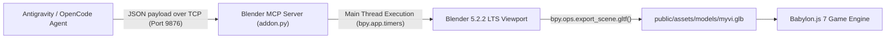

# 🚗 Low-Poly 3D Perodua Myvi Gen 3 (Lava Red) – Blender MCP Pipeline

*[Versi Bahasa Melayu ada di sini: BLENDER_3D_PIPELINE.ms-MY.md](BLENDER_3D_PIPELINE.ms-MY.md)*

This document details the live procedural 3D modeling pipeline used to build the iconic **Malaysian 3rd Generation Perodua Myvi ("King of the Highway")** directly inside the active Blender instance via the `BlenderMCPServer` socket bridge (`127.0.0.1:9876`), followed by automatic binary glTF (`.glb`) export and Babylon.js integration.

---

## 🎨 Design & Styling Details (Gen 3 Reference Faithful)

1. **Official Color Palette**:
   - **Lava Red / Cranberry Red Metallic**: Primary body color (`#C21017`, metallic 0.32, roughness 0.20).
   - **Tinted Aerodynamic Glass**: Sleek tumblehome greenhouse canopy (`#0A0F17`, roughness 0.08, high specular).
   - **Matte Charcoal Trim**: Front lower air dam, rear diffuser, B-pillars, and side aero fins.
   - **Machined Alloy & Silver**: 15-inch dual 5-spoke alloy wheels, front chrome wing grille bar, and Perodua roundel badges.
2. **Signature King Myvi Features**:
   - **Aggressive Front Fascia**: Tapered hood rake, angular LED headlights with chrome brows, wide trapezoidal lower intake, and round fog lamps in recessed pods.
   - **Iconic Two-Tier Rear Aero Spoiler**: Extended roof wing with trailing gurney flap, integrated center High-Mount Stop Lamp (HMSL), and downward side aero fins framing the rear glass.
   - **Aerodynamic Roof Details**: Center shark-fin antenna on the rear roofline.
   - **Sporty Rear Styling**: Wrap-around vertical taillights (red LED light guides + clear reverse indicators), lower rear bumper diffuser with vertical aerodynamic strakes, and Malaysian license plate recess.
   - **Side Profile**: Body-colored wing mirrors with amber turn signal strips and chrome door handles.

---

## 🛠️ Architecture: Live Blender MCP Bridge



### Script Execution & Export
The generation script is saved at [`tools/blender/build_myvi_live.py`](../tools/blender/build_myvi_live.py). It connects to the open Blender instance, builds the mesh, positions the beauty camera, sets viewport shading to `MATERIAL`, and exports the binary asset to:
- Primary asset: `public/assets/models/myvi.glb` (234 KB)
- Production bundle: `dist/assets/models/myvi.glb`

### In-Game Babylon.js Loading
[`src/myvi.js`](../src/myvi.js) loads the GLB asynchronously using `BABYLON.SceneLoader.ImportMeshAsync`:
```javascript
BABYLON.SceneLoader.ImportMeshAsync('', './assets/models/', 'myvi.glb', this.scene)
  .then(result => {
    // Hide procedural placeholder meshes once glb model is active
    if (this.proceduralMeshes) {
      this.proceduralMeshes.forEach(m => m.setEnabled(false));
    }
    const modelRoot = result.meshes[0];
    modelRoot.parent = this.rootNode;
    modelRoot.position.set(0, 0, 0);

    // Filter wheels for arcade driving wheel rotation
    this.modelWheels = result.meshes.filter(m => {
      const n = (m.name || '').toLowerCase();
      return n.includes('tire') || n.includes('rim') || n.includes('spoke') || n.includes('wheel');
    });
  });
```
