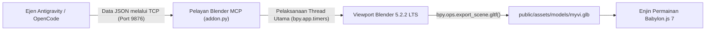

# 🚗 Model 3D Low-Poly Perodua Myvi Gen 3 (Merah Lava) – Saliran Blender MCP

*[English version available here: BLENDER_3D_PIPELINE.md](BLENDER_3D_PIPELINE.md)*

Dokumen ini memperincikan saliran pemodelan 3D prosedur yang digunakan untuk membina model ikonik **Perodua Myvi Generasi ke-3 ("Raja Lebuhraya")** terus di dalam aplikasi Blender yang sedang dibuka melalui jambatan soket `BlenderMCPServer` (`127.0.0.1:9876`), diikuti dengan eksport automatik glTF binari (`.glb`) dan integrasi ke dalam enjin permainan Babylon.js.

---

## 🎨 Ciri Reka Bentuk & Penggayaan (Berasaskan Rujukan Rasmi Gen 3)

1. **Palet Warna Rasmi**:
   - **Lava Red / Cranberry Red Metallic**: Warna badan utama (`#C21017`, logam 0.32, kekasaran 0.20).
   - **Kaca Aerodinamik Gelap**: Kanopi tingkap aerodinamik (`#0A0F17`, kekasaran 0.08, pantulan tinggi).
   - **Kemasan Arang Mampat (Matte Charcoal)**: Salur udara hadapan, peresap udara belakang (diffuser), tiang B, dan sirip sisi spoiler.
   - **Rim Aloi Permukaan Mesin**: Roda aloi 15 inci dwi-5 jejari, palang gril krom bersayap hadapan, dan lencana Perodua perak.
2. **Ciri Khas Raja Myvi**:
   - **Muka Hadapan Agresif**: Cerun bonet tirus, lampu utama LED bersudut tajam dengan kening krom, salur masuk trapezoid yang lebar, serta lampu kabus bulat dalam perumah khas.
   - **Spoiler Belakang Dua Tingkat Ikonik**: Sayap bumbung belakang berserta bibir aero, Lampu Brek Ketiga Atas (HMSL) bersepadu, dan sirip sisi yang mengapit cermin belakang.
   - **Perincian Bumbung**: Antena sirip jerung di bahagian belakang bumbung.
   - **Gaya Belakang Sporty**: Lampu belakang menegak melengkung (jalur panduan LED merah + isyarat undur putih), peresap bampar bawah dengan sirip strakes menegak, serta ruang nombor plat Malaysia.
   - **Profil Sisi**: Cermin sisi sewarna badan dengan jalur lampu isyarat ambar dan pemegang pintu krom.

---

## 🛠️ Senibina: Jambatan Blender MCP Langsung

### Skrip Pelaksanaan & Eksport
Skrip penjanaan disimpan di [`tools/blender/build_myvi_live.py`](../tools/blender/build_myvi_live.py). Skrip ini menyambung ke aplikasi Blender yang dibuka, membina geometri mesh, menetapkan kamera kecantikan, mengaktifkan mod paparan bahan `MATERIAL`, dan mengeksport aset binari ke:
- Aset utama: `public/assets/models/myvi.glb` (234 KB)
- Pakej produksi: `dist/assets/models/myvi.glb`
