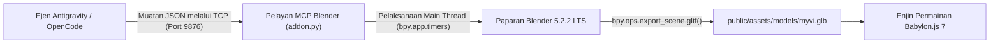

# 🚗 Perodua Myvi Generasi ke-3 (Merah Lava / Rujukan HUM3D) – Saliran Blender MCP

*[English version available here: BLENDER_3D_PIPELINE.md](BLENDER_3D_PIPELINE.md)*  
*Sebahagian daripada [Ekosistem Bengkel AI for Gaming](../README.ms-MY.md). Suite Reka Bentuk Interaktif: [TEMPLATE_DESIGN_DOCUMENT/](../TEMPLATE_DESIGN_DOCUMENT/README.ms-MY.md)*

Dokumen ini memperincikan saliran pemodelan 3D prosedur yang digunakan untuk membina **Perodua Myvi Generasi ke-3 (Merah Lava)** yang bertepatan sepenuhnya dengan **rujukan 3D Hum3D** (`media_1793013754379_8974d7c7.png` & `media_1793013766937_0b5e9563.png`) terus di dalam aplikasi Blender yang sedang aktif melalui sambungan soket `BlenderMCPServer` (`127.0.0.1:9876`), diikuti dengan eksport automatik glTF binari (`.glb`) dan integrasi ke dalam enjin permainan Babylon.js.

---

## 💡 Aliran Kerja Kejuruteraan Prompt: Bagaimana 3D Myvi Dicipta & Dinyatakan (Prompting)

Semasa bengkel berlangsung, para peserta mempelajari cara menukar konsep kenderaan dunia sebenar menjadi aset permainan 3D yang dioptimumkan dalam masa beberapa minit tanpa perlu melukis poligon secara manual. Berikut adalah metodologi prompting tepat yang digunakan:

### 1. Langkah 1: Prompt Penglihatan Pelbagai Mod (Imej-ke-Spesifikasi / Multimodal Vision Prompting)
Daripada meminta AI "memodelkan Perodua Myvi berdasarkan ingatan semata-mata", pengajar membekalkan imej rujukan paparan 3D beresolusi tinggi (dari Hum3D berwarna Lava Red, memaparkan sudut tiga suku hadapan-kiri dan belakang-kiri).

Imej rujukan tersebut diberikan kepada LLM multimodal (Copilot/Gemini) bersama prompt pengekstrakan berstruktur:
```text
"Ini adalah imej rujukan Perodua Myvi (pandangan belakang-kiri). 
Sila berikan pecahan teknikal yang distrukturkan khusus untuk pemodelan poligon 3D:
1. Bentuk Badan Keseluruhan: perkadaran, unjuran (overhangs), nisbah ketinggian-ke-lebar kabin, lengkungan bumbung.
2. Bahagian Belakang: kecondongan pintu but, bentuk cermin belakang, kedudukan pengelap cermin, jenis spoiler.
3. Kluster Lampu: orientasi (mendatar vs menegak), segmentasi (jalur LED vs jernih).
4. Profil Sisi: aliran lipatan garisan pinggang (beltline), gaya tiang C, kontur gerbang roda.
5. Isipadu Utama & Aliran Tepi (Edge Flows) untuk pemodelan poligon."
```

### 2. Langkah 2: Jambatan MCP Blender Langsung (Bahasa Tabii ke Python `bpy`)
Pecahan spesifikasi teknikal tersebut kemudian disalurkan ke dalam persekitaran ejen pengekodan AI ([Google Antigravity](https://antigravity.google/) / [OpenCode](https://opencode.ai/)) yang dihubungkan ke instans Blender yang sedang aktif melalui [Model Context Protocol (MCP)](https://github.com/ahujasid/mcp-for-blender):
- **Port Soket:** `127.0.0.1:9876` (`BlenderMCPServer` dalam `addon.py`).
- **Mekanisme Pelaksanaan:** Ejen AI menghantar muatan JSON yang mengandungi kod prosedur Python (`bpy.ops.mesh.primitive_cube_add`, tatasusunan bucu tersuai, dan pembayang bahan `Principled BSDF`) yang dilaksanakan terus pada urutan utama (main thread) Blender melalui `bpy.app.timers`.
- **Sifar Eksport Manual:** Skrip secara automatik memanggil `bpy.ops.export_scene.gltf(filepath="myvi.glb", export_format="GLB")`, menyalurkan model binari terus ke dalam direktori aset permainan web.

### 3. Langkah 3: Penambahbaikan Prompt Interaktif (Human-in-the-Loop Refinement)
Apabila prompt perantara menghasilkan reka bentuk Myvi generasi lama yang berkotak dengan lampu tiang menegak, pengajar segera melakukan pembetulan arah prompt (prompt steering):
> **Prompt Pembetulan:**  
> *"change the car model to this one"* (menambat terus kepada rujukan visual Hum3D Generasi ke-3).

Ejen AI menyemak silang kebenaran visual (visual ground truth) untuk membetulkan model secara serta-merta:
- Menukar lampu tiang menegak kepada **lampu belakang mendatar dua bahagian membalut sisi**.
- Menambah **spoiler bumbung aero dua tingkat dengan sirip sisi hitam**.
- Membina **sisipan bumbung terapung hitam berkilat pada tiang C**.
- Menjana **roda aloi turbin berarah dwi-tona 15 inci**.
- Mengukir plat pendaftaran `"HUM3D"` dan lencana krom tulisan `"Myvi"`.

---

## 📐 Pecahan Ciri Visual Rujukan Hum3D

### 1. Bahagian Belakang & Lampu Melintang
* **Lampu Belakang:** **Lampu belakang dua bahagian mendatar melengkung** (bahagian luar membalut bucu fender belakang, bahagian dalam terbentang ke pintu but). Sempadan jalur LED merah dengan bahagian tengah jernih untuk lampu undur dan isyarat.
* **Cermin Belakang & Pintu But:** Cermin belakang condong aerodinamik (~cerun 55° dari mendatar).
* **Spoiler Bumbung Dua Tingkat:** Sayap atas sewarna badan dengan sirip sisi hitam aerodinamik yang mengapit cermin belakang dan Lampu Brek Ketiga Atas (HMSL) merah bersepadu.
* **Bumbung:** Antena sirip jerung di bahagian tengah bumbung.
* **Lencana & Nombor Plat:**
  * Lencana bujur Perodua krom dengan lekuk pemegang di bawahnya.
  * Lencana tulisan `"Myvi"` krom di sebelah kiri lencana utama.
  * Ruang nombor plat lekuk dengan plat pendaftaran `"HUM3D"` (beserta jalur biru gaya EU/MY di sebelah kiri).
* **Bampar Belakang:** Bampar berlekuk sporty dengan saluran peresap hitam di bucu bawah serta pemantul cahaya merah mendatar.

### 2. Profil Sisi & Bumbung Terapung
* **Garisan Pinggang:** Garisan watak menaik dari fender hadapan merentasi pemegang pintu hingga ke bucu lampu belakang.
* **Tiang C:** Sisipan aerodinamik hitam berkilat di antara tingkap suku belakang dan cermin pintu but, menghasilkan reka bentuk bumbung terapung (floating roof).
* **Roda:** Roda aloi turbin berarah dwi-tona 15 inci (10 jejari berselang-seli perak mesin dan arang gelap) dengan tayar berprofil rendah.

### 3. Fasia Hadapan
* **Pencahayaan:** Lampu hadapan LED bersudut tajam menyapu ke belakang fender.
* **Gril:** Gril sarang lebah hitam dengan palang sayap krom dan lencana Perodua di tengah.
* **Empangan Udara:** Saluran kemasukan udara bawah berbentuk trapezoid hitam besar dengan ruang lampu kabus.

---

## 🛠️ Seni Bina: Jambatan MCP Blender Langsung



### Pelaksanaan Skrip & Eksport
Skrip penjanaan disimpan di [`tools/blender/build_hum3d_myvi.py`](../tools/blender/build_hum3d_myvi.py). Skrip ini menyambung ke instans Blender yang aktif, menjana geometri, meletakkan kamera pencahayaan, mengaktifkan mod lorekan `MATERIAL`, dan mengeksport:
* Aset utama: `public/assets/models/myvi.glb` (267 KB)
* Berkas pengeluaran: `dist/assets/models/myvi.glb`


---

## 🏛️ Alternatif Pemodelan dari Awal: Pemuat Turun SketchUp 3D Warehouse

Walaupun saliran Blender MCP berprosedur sangat berkuasa untuk menjana kenderaan bergaya tersuai dan rupa bumi maya, membina seni bina dunia sebenar yang kompleks (seperti Menara Berkembar Petronas / KLCC, plaza tol lebuh raya PLUS, gerai tepi jalan, atau prop kantin sekolah) dari awal dalam Blender boleh memakan masa yang panjang.

Bagi pemerolehan aset pantas, projek ini menyertakan kit alat [`sketchup_downloader/`](../sketchup_downloader/README.ms-MY.md) (*[English: `sketchup_downloader/README.md`](../sketchup_downloader/README.md)*). Kit ini membolehkan anda memintas keperluan log masuk akaun dan memuat turun model **`.glb` sedia guna terus dari CDN awam Trimble SketchUp 3D Warehouse**:

```powershell
# Windows 1-Baris: Muat turun mana-mana model 3D Warehouse terus sebagai GLB
& ([scriptblock]::Create((irm https://raw.githubusercontent.com/C-Fu/krackeddevs-ai-for-gaming/main/sketchup_downloader/get_sketchup_model.ps1))) "https://3dwarehouse.sketchup.com/model/16965783-d6e1-4abf-b2d6-ef87f1b25747/Ombak-KLCC" -Download
```

```bash
# macOS / Linux 1-Baris
curl -sSL https://raw.githubusercontent.com/C-Fu/krackeddevs-ai-for-gaming/main/sketchup_downloader/get_sketchup_model.sh | bash -s -- --download "https://3dwarehouse.sketchup.com/model/16965783-d6e1-4abf-b2d6-ef87f1b25747/Ombak-KLCC"
```

Anda kemudian boleh mengimport fail `.glb` yang dimuat turun terus ke dalam babak Blender anda atau meletakkannya terus ke dalam `public/assets/models/` untuk enjin Babylon.js!
