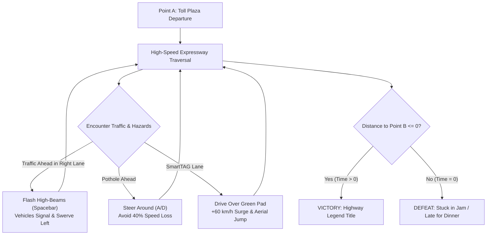

# Game Design Document (GDD)
## King Myvi: Highway Legends
**Platform:** Web (Babylon.js 7.x / WebGL / WebGPU)  
**Genre:** High-Octane 3D Arcade Highway Runner  
**Target Audience:** Casual Gamers, Arcade Enthusiasts, Malaysian Culture & Meme Fans  
**Pacing:** Fast-paced (90-second adrenaline run)

---

## 1. High Concept & Narrative Premise

### 1.1 The Logline
Take the wheel of Malaysia's undisputed "King of the Road" — the white Perodua Myvi — on an urgent sunset sprint along the PLUS North-South Expressway from **Point A (Toll Plaza Jalan Duta)** to **Point B (Ayer Keroh R&R)** before the dinner reservation expires. Flash your high beams to part heavy traffic, dodge treacherous potholes, and launch off SmartTAG booster lanes at supersonic speed.

### 1.2 The Core Thesis: "Point A to Point B + 1-2 USPs"
* **Point A:** Starting gantry at Kilometer 0. Engine idling, evening traffic ahead, timer set to 90 seconds.
* **Point B:** The illuminated Ayer Keroh Toll Plaza & Rest Stop at Kilometer 5.0 (5,000 meters). Crossing this line triggers the victory sequence.
* **USP 1 (Mechanical Twist): The High-Beam Flasher (`Spacebar`)**  
  Unlike Western racers where you ram cars or shoot missiles, in Malaysia the true power weapon is the **Right-Lane High-Beam Flash**. When flashed, slow-moving lorries and sedans panic, signal left, and clear your overtaking lane.
* **USP 2 (Environmental Twist): Pothole Slalom & SmartTAG Ramp Boosts**  
  Road repairs have created treacherous potholes that destabilize your steering and sap velocity. Conversely, hitting the glowing green SmartTAG toll lanes grants immense nitro boost and launches your car into an acrobatic aerial jump over traffic.

---

## 2. Core Game Loop



---

## 3. Gameplay Mechanics & Specifications

### 3.1 Vehicle Controls & Arcade Physics
* **Steering (`A` / `D` or `Left` / `Right` Arrow keys):** Smooth progressive lane drift with visual chassis roll (banking up to 8 degrees). Responsive arcade response time: 0.12s from center to full lock.
* **Acceleration (`W` / `Up` Arrow):** Fast, non-linear torque curve reaching 110 km/h in 3.0s, top cruising speed 180 km/h (uncapped to 240 km/h during SmartTAG boost).
* **Brake / Reverse (`S` / `Down` Arrow):** Strong progressive disc brake with rear red brake light emission.
* **Horn (`H` / `B`):** Classic twin-tone kapcai/car horn sound (`pon-pon!`) with a momentary comic vibration effect.

### 3.2 USP 1: High-Beam Flash System
* **Trigger:** `Spacebar` (Tap or Hold).
* **Visuals:** High-intensity twin spotlight beams project 40 meters ahead with pulsing lens-flare bloom and screen shake.
* **AI Traffic Reaction State Machine:**
  ```mermaid
  stateDiagram-v2
      [*] --> Cruising: Spawn in Random Lane (80-100 km/h)
      Cruising --> HighBeamDetected: Player Flashes High-Beam within 35m behind in same lane
      HighBeamDetected --> SignalingLeft: Turn Signal Blinks (0.2s delay)
      SignalingLeft --> ChangingLane: Smooth Lateral Interpolation to Left Lane (0.6s)
      ChangingLane --> Yielded: Cruises in Left Lane (allows player pass)
      Cruising --> Collision: Player hits vehicle without yielding
      Collision --> Spinout: Speed drops to 40 km/h, smoke particles
  ```
* **Score Multiplier:** Each successfully yielded vehicle yields a **"Fast Lane Cleared! +250 PTS"** popup.

### 3.3 USP 2: Pothole Slalom & SmartTAG Boosters
* **Potholes:**
  * Procedural placement: 2–3 potholes per 100 meters across lanes 1 and 2.
  * Penalty: Speed drops by 40%, steering wobbles for 1.2 seconds, camera shudders, and audio triggers a heavy metal chassis thud.
* **SmartTAG Boost Lanes:**
  * Visuals: Luminescent emerald green floor decals with animated chevron arrows leading through toll and gantry zones.
  * Reward: Instant +60 km/h impulse surge, temporary invincibility shield, and a ramp-jump launching the Myvi into low-gravity flight for 25 meters.

---

## 4. Environment & Art Direction

### 4.1 Art Style: Malaysian Synthwave / Low-Poly Stylized
* **Sky & Atmosphere:** Tropical dusk/sunset gradient (deep magenta, warm amber, and indigo) with glowing highway lighting.
* **Highway Structure:**
  * 3 lanes in each direction with standard PLUS highway dashed white markings and solid yellow emergency shoulder lines.
  * Green overhead highway exit boards:
    * *"KM 0: TOL JALAN DUTA"*
    * *"KM 2.5: RAWANG / SHAH ALAM"*
    * *"KM 5.0: R&R AYER KEROH"*
  * Roadside flora: Rows of stylized low-poly oil palm trees (*Kelapa Sawit*) and steel guardrails.
* **Vehicles:**
  * **Player:** Iconic Perodua Myvi (White, black alloy wheels, rear roof spoiler, tinted windows, bright LED headlights).
  * **Traffic:** Classic Malaysian road denizens — Old blue proton sedan, Bas Kilang (factory bus), 1-tonne canvas lorry, and red delivery van.

---

## 5. Audio Direction

* **Dynamic Engine Synthesizer:** Real-time Web Audio oscillator modulated by vehicle velocity (low drone at 0 km/h, high-pitch screaming 4-cylinder revs at 180 km/h).
* **Tire Screech:** White noise filtered frequency sweep triggered on aggressive lateral turns.
* **High-Beam Strobe:** High-tech acoustic chime / camera flash sound on trigger.
* **SmartTAG Booster:** Sci-fi plasma woosh with ascending pitch tone.
* **BGM:** 80s City-Pop / Synthwave or upbeat Malaysian chiptune highway soundtrack.
