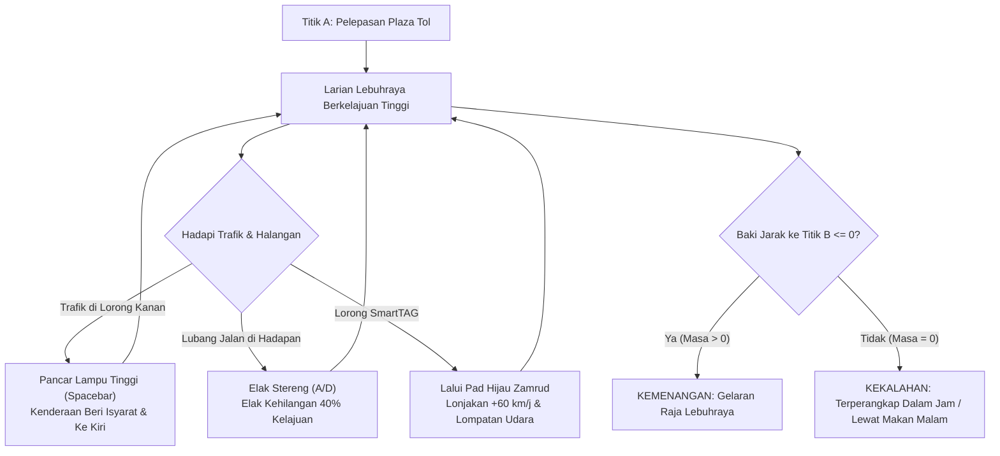

# Dokumen Reka Bentuk Permainan (GDD)
## King Myvi: Highway Legends
**[English](GAME_DESIGN_DOCUMENT.md) | [Bahasa Melayu](GAME_DESIGN_DOCUMENT.ms-MY.md)**

**Platform:** Web (Babylon.js 7.x / WebGL / WebGPU)  
**Genre:** Larian Lebuhraya Arked 3D Berhalaju Tinggi  
**Sasaran Khalayak:** Pemain Kasual, Peminat Permainan Arked, Peminat Budaya & Meme Malaysia  
**Rentak Permainan:** Pantas & Beradrenalin Tinggi (Larian 90 Saat)

---

## 1. Konsep Utama & Premis Penceritaan

### 1.1 Ringkasan Konsep (Logline)
Ambil alih stereng "Raja Jalanan" Malaysia yang tiada tandingannya — Perodua Myvi putih — dalam pecutan senja yang mendesak di sepanjang Lebuhraya Utara-Selatan (PLUS) dari **Titik A (Plaza Tol Jalan Duta)** ke **Titik B (R&R Ayer Keroh)** sebelum tempahan makan malam tamat. Pancarkan lampu tinggi anda untuk mengosongkan trafik sesak, elak lubang jalan raya yang merbahaya, dan lancarkan kenderaan melalui tanjakan SmartTAG pada kelajuan supersonik.

### 1.2 Falsafah Teras: "Titik A ke Titik B + 1-2 USP"
* **Titik A:** Gantri permulaan di Kilometer 0. Enjin melahu, trafik petang di hadapan, pemasa bermula pada 90 saat.
* **Titik B:** Plaza Tol & Kawasan Rehat Ayer Keroh yang bercahaya di Kilometer 5.0 (5,000 meter). Melepasi garisan ini mencetuskan urutan kemenangan.
* **USP 1 (Keunikan Mekanikal): Pancaran Lampu Tinggi (`Spacebar`)**  
  Tidak seperti permainan lumba Barat di mana pemain merempuh kereta atau menembak peluru berpandu, di Malaysia senjata sebenar ialah **Pancaran Lampu Tinggi di Lorong Kanan**. Apabila dipancarkan, lori dan kereta perlahan akan panik, memberi isyarat ke kiri, dan mengosongkan lorong memotong anda.
* **USP 2 (Keunikan Alam Sekitar): Mengelak Lubang Jalan & Tanjakan SmartTAG**  
  Kawasan pembaikan jalan menghasilkan lubang-lubang yang mengganggu kestabilan stereng serta mengurangkan halaju. Sebaliknya, melalui lorong SmartTAG bertanda hijau zamrud memberikan lonjakan nitro yang hebat dan melancarkan kereta ke udara dalam lompatan akrobatik melangkaui trafik.

---

## 2. Gelung Teras Permainan (Core Game Loop)



---

## 3. Mekanik Permainan & Spesifikasi Teknikal

### 3.1 Kawalan Kenderaan & Fizik Arked
* **Stereng (`A` / `D` atau Anak Panah `Kiri` / `Kanan`):** Hanyutan lorong progresif yang lancar dengan olengan visual kerangka badan (senget sehingga 8 darjah). Masa tindak balas arked yang pantas: 0.12 saat dari tengah ke pusingan penuh.
* **Pecutan (`W` / Anak Panah `Atas`):** Lengkung tork bukan linear yang pantas mencapai 110 km/j dalam 3.0 saat, kelajuan pelayaran maksimum 180 km/j (meningkat sehingga 240 km/j semasa lonjakan SmartTAG).
* **Brek / Undur (`S` / Anak Panah `Bawah`):** Brek cakera progresif yang kuat dengan pelepasan cahaya lampu brek merah di belakang.
* **Hon (`H` / `B`):** Bunyi hon kapcai/kereta dwi-ton klasik Malaysia (`pon-pon!`) berserta kesan getaran komik sementara.

### 3.2 USP 1: Sistem Pancaran Lampu Tinggi (High-Beam)
* **Pencetus:** `Spacebar` (Tekan Sekali atau Tahan).
* **Visual:** Pancaran lampu sorot berkembar berkeamatan tinggi memancar 40 meter ke hadapan dengan kesan cahaya kembangan (lens-flare bloom) dan sedikit gegaran kamera.
* **Mesin Keadaan (State Machine) Tindak Balas Trafik AI:**
  ```mermaid
  stateDiagram-v2
      [*] --> Cruising: Dijana di Lorong Rawak (80-100 km/j)
      Cruising --> HighBeamDetected: Pemain Pancar Lampu Tinggi dalam jarak 35m di lorong sama
      HighBeamDetected --> SignalingLeft: Lampu Isyarat Kiri Berkelip (tangguhan 0.28s)
      SignalingLeft --> ChangingLane: Peralihan Lateral Lancar ke Lorong Kiri (0.7s)
      ChangingLane --> Yielded: Memandu di Lorong Kiri (Beri Laluan)
      Cruising --> Collision: Pemain Langgar Kenderaan Tanpa Laluan
      Collision --> Spinout: Kelajuan Turun ke 35 km/j, Asap Berkepul
  ```
* **Pengganda Markah:** Setiap kenderaan yang berjaya memberi laluan menghasilkan pemberitahuan banner **"LORONG MEMOTONG DIKOSONGKAN! +250 MATA"**.

### 3.3 USP 2: Mengelak Lubang Jalan & Pelancar SmartTAG
* **Lubang Jalan:**
  * Penempatan prosedural: 2–3 lubang bagi setiap 100 meter di sepanjang lorong 1 dan 2.
  * Penalti: Kelajuan jatuh sebanyak 45%, stereng bergegar secara tidak menentu selama 1.2 saat, kamera bergetar, dan audio membunyikan dentuman casis logam yang berat.
* **Tanjakan SmartTAG Penuh Lorong:**
  * Visual: Tanjakan condong 3D penuh seluas 4.2 meter dengan pelekat lantai hijau zamrud luminesen, anak panah chevron bercahaya, dan struktur gantri kuning dengan lampu hijau `⬇`.
  * Ganjaran: Lonjakan dorongan serta-merta +60 km/j, perisai kebal sementara, dan lompatan tanjakan yang melancarkan Myvi terbang merentasi trafik selama 25 meter.

---

## 4. Persekitaran & Arahan Seni Visual

### 4.1 Gaya Seni: Malaysian Synthwave / Poli Rendah Bergaya
* **Langit & Suasana:** Kecerunan senja tropika (magenta gelap, jingga keemasan, dan indigo) dengan pencahayaan lebuh raya yang memukau.
* **Struktur Lebuhraya:**
  * 3 lorong bagi setiap arah dengan garisan putih putus-putus standard PLUS dan garisan kuning bahu kecemasan padu.
  * Papan tanda gantri hijau lebuh raya PLUS:
    * *"KM 0: TOL JALAN DUTA"*
    * *"KM 2.5: RAWANG / SHAH ALAM"*
    * *"KM 5.0: R&R AYER KEROH"*
  * Tumbuh-tumbuhan tepi jalan: Barisan pokok kelapa sawit poli rendah (*Elaeis guineensis*) dan penghadang besi tepi jalan.
* **Kenderaan:**
  * **Pemain:** Perodua Myvi Putih ikonik (Kemasan putih berkilat, rim aloi hitam, spoiler bumbung belakang sporty, cermin gelap, lampu hadapan LED terang).
  * **Trafik:** Kenderaan tipikal jalan raya Malaysia — Proton sedan biru klasik, Bas Kilang pekerja, lori kanvas 1 tan, dan van penghantaran merah.

---

## 5. Arahan Reka Bentuk Audio

* **Penyintesis Enjin Dinamik:** Osilator Web Audio masa nyata yang dimodulasikan mengikut kelajuan kenderaan (dengungan rendah pada 0 km/j, jeritan enjin 4-silinder frekuensi tinggi pada 180 km/j).
* **Decitan Tayar:** Sapuan frekuensi berpenapis hingar putih yang dicetuskan semasa membelok tajam ke sisi.
* **Kerdipan Lampu Tinggi:** Bunyi loceng akustik canggih / kelipan kamera futuristik semasa butang ditekan.
* **Lonjakan SmartTAG:** Deruan angin plasma sci-fi dengan nada frekuensi menaik pantas.
* **Muzik Latar (BGM):** Trek synthwave lebuh raya bertempo tinggi atau chiptune arked yang bertenaga.
