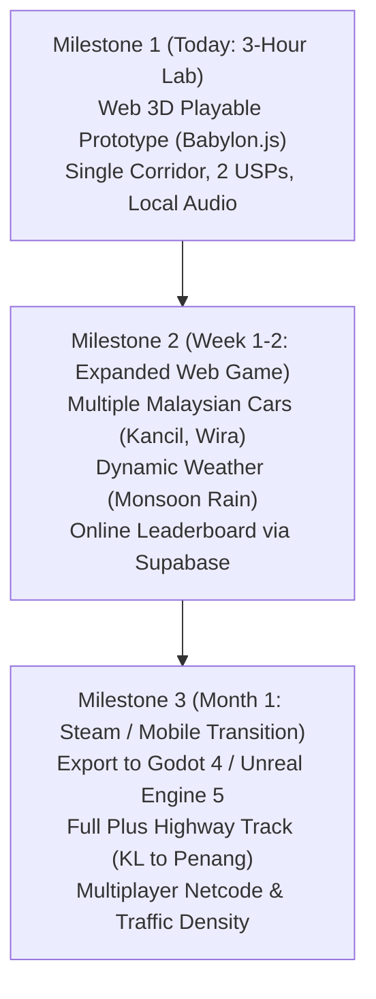

# Project Management & Game Balancing Matrix
## King Myvi: Highway Legends (Google Sheets / Excel Template)
**[English](PROJECT_MANAGEMENT_TEMPLATE.md) | [Bahasa Melayu](PROJECT_MANAGEMENT_TEMPLATE.ms-MY.md)**

---

## 1. Feature Backlog (Sprint 1: 3-Hour Workshop Lab)

You can copy and paste the markdown table below, or use the raw CSV snippet in Section 4 to import directly into Google Sheets (`File -> Import -> Paste CSV`).

| Task ID | Epic / Category | Feature / User Story | Priority | Est. (Min) | Tool / Owner | Verification Criteria | Status |
| :--- | :--- | :--- | :--- | :--- | :--- | :--- | :--- |
| **ENG-01** | Architecture | Initialize Vite + Babylon.js 7 canvas loop & chase camera | P0 | 15 | Antigravity / OpenCode | Smooth 60 FPS render loop running in browser at `localhost:5173` | Done |
| **ENG-02** | Mechanics | Build Myvi vehicle controller with acceleration, braking, and steering | P0 | 25 | Antigravity | Responsive arrow/WASD controls with banking chassis tilt | Done |
| **ENG-03** | Mechanics (USP 1) | Implement High-Beam Flash system (`Spacebar`) with dual spotlight cones | P0 | 20 | Antigravity | Spotlight cones project 40m forward; visual bloom flare triggers | Done |
| **ENG-04** | AI Systems | Implement Traffic Spawner & Yield State Machine | P0 | 25 | Antigravity | Ambient cars move at 80-100km/h; signal and lane-shift left when flashed | Done |
| **ENG-05** | Hazards (USP 2) | Procedural Pothole Slalom and SmartTAG Ramp Boost pads | P1 | 20 | Antigravity | Potholes slow car by 40%; SmartTAG pads launch car with speed surge | Done |
| **ART-01** | 3D Assets | Model Low-Poly Myvi chassis & wheels via Blender MCP / Procedural | P1 | 25 | Blender MCP | Stylized hatchback mesh exported as `.glb` or procedural Babylon mesh | Done |
| **ART-02** | Environment | Modular PLUS Expressway, overhead gantry signs & palm trees | P1 | 20 | Blender / Procedural | 3-lane textured highway with Malaysian bilingual road signs | Done |
| **AUD-01** | Audio / SFX | Synthesize Web Audio dynamic engine RPM, horn, and boost sounds | P2 | 15 | Antigravity | Web Audio synthesizes revs linked to speed; horn sounds on 'H' key | Done |
| **UI-01** | Interface / HUD | Retro arcade HUD: Speedometer (km/h), Distance to Point B, Timer | P1 | 15 | Antigravity | Digital HUD updates real-time with victory/game-over modals | Done |
| **DEP-01** | Deployment | Configure static build and automated deploy to GitHub Pages / Vercel | P1 | 10 | Host / Instructor | Live public URL accessible on mobile phones via QR code | Done |

---

## 2. Vehicle & Physics Balancing Matrix (The "Feel" Sheet)

In game development, design documents are useless without a tuning table. This matrix allows the Creative Director and AI agent to tune the vehicle feel instantly without altering game engine code.

| Parameter Name | Default Value | Min Value | Max Value | Unit | Impact Description |
| :--- | :--- | :--- | :--- | :--- | :--- |
| `top_speed_standard` | 180.0 | 120.0 | 220.0 | km/h | Cruising velocity on open highway |
| `top_speed_boost` | 240.0 | 200.0 | 300.0 | km/h | Maximum velocity during SmartTAG boost surge |
| `acceleration_rate` | 38.0 | 20.0 | 60.0 | m/s² | Time to reach 100 km/h from standstill (approx 2.8s) |
| `braking_force` | 65.0 | 30.0 | 100.0 | m/s² | Deceleration strength on `S` / Down Arrow |
| `lateral_steer_speed` | 22.0 | 10.0 | 35.0 | m/s | Responsiveness of lane switching |
| `chassis_roll_angle` | 0.12 | 0.02 | 0.25 | radians | Visual lean angle during tight cornering |
| `high_beam_range` | 42.0 | 25.0 | 70.0 | meters | Forward distance within which traffic detects high beams |
| `high_beam_cone_angle` | 0.45 | 0.20 | 0.80 | radians | Field of illumination of high-beam spotlights |
| `traffic_reaction_delay`| 0.35 | 0.10 | 1.00 | seconds | Reaction time of slow car before signaling left |
| `traffic_lane_shift_time`| 0.70 | 0.30 | 1.50 | seconds | Time taken for traffic car to complete lane switch |
| `pothole_speed_penalty` | 0.40 | 0.20 | 0.70 | percentage | Fractional speed loss upon hitting an unpaved pothole |
| `pothole_wobble_duration`| 1.20 | 0.50 | 2.50 | seconds | Duration of erratic steering wobble post-impact |
| `smarttag_boost_duration`| 3.50 | 1.50 | 6.00 | seconds | Duration of supersonic nitro speed window |
| `target_distance_total` | 5000 | 2000 | 10000 | meters | Total distance from Point A to Point B |
| `stage_countdown_timer` | 90.0 | 60.0 | 150.0 | seconds | Time limit to cross Toll B before failure |

---

## 3. Milestone Roadmap: From Lab Prototype to Full Indie Game



---

## 4. Raw CSV for Google Sheets Import

To import directly into Google Sheets:
1. Copy the text block below.
2. In Google Sheets, create a new sheet.
3. Paste directly into cell `A1` or save as `backlog.csv` and use `File -> Import`.

```csv
Task ID,Category,Feature / Story,Priority,Est_Minutes,Owner_Tool,Status,Verification_Notes
ENG-01,Architecture,Initialize Vite + Babylon.js 7 canvas loop & chase camera,P0,15,Antigravity,Done,Smooth 60 FPS render loop
ENG-02,Mechanics,Build Myvi vehicle controller with acceleration & steering,P0,25,Antigravity,Done,Responsive WASD controls with banking tilt
ENG-03,Mechanics (USP 1),Implement High-Beam Flash system with dual spotlight cones,P0,20,Antigravity,Done,Spotlights project 40m forward
ENG-04,AI Systems,Implement Traffic Spawner & Yield State Machine,P0,25,Antigravity,Done,Traffic yields left when flashed
ENG-05,Hazards (USP 2),Procedural Pothole Slalom and SmartTAG Ramp Boost pads,P1,20,Antigravity,Done,Potholes slow car; SmartTAG launches car
ART-01,3D Assets,Model Low-Poly Myvi chassis & wheels via Blender MCP,P1,25,Blender MCP,Done,Exported as .glb or procedural mesh
ART-02,Environment,Modular PLUS Expressway & overhead gantry signs,P1,20,Blender / Procedural,Done,3-lane highway with Malaysian road signs
AUD-01,Audio / SFX,Synthesize Web Audio dynamic engine RPM and horn sounds,P2,15,Antigravity,Done,Engine pitch linked to speed; horn on H key
UI-01,Interface / HUD,Retro arcade HUD: Speedometer and Distance to Point B,P1,15,Antigravity,Done,Digital HUD updates real-time
DEP-01,Deployment,Configure static build and deploy to GitHub Pages,P1,10,Host / Instructor,Done,Live public URL accessible on mobile
```

---

## 5. AI Prompt Pack: Populating & Modifying Backlogs

### Prompt: Generating an Agile Game Backlog from a GDD
```text
Act as a Senior Technical Game Producer. Based on the attached Game Design Document for "King Myvi: Highway Legends", generate a structured 12-task sprint backlog.
Each task must contain:
1. Task ID (ENG, ART, AUD, UI, QA)
2. User Story ("As a player, I want...")
3. Technical Implementation notes for an autonomous AI coding agent (specifying Babylon.js components, vector math, or Blender geometry)
4. Verification & QA criteria
Format the output as a Markdown table ready to be copied into Google Sheets.
```

### Prompt: Rebalancing Game Physics for Arcade Feel
```text
Act as a Principal Gameplay Tuner. Review the following vehicle physics parameters:
[Paste Section 2 Parameter Table here]
Modify the parameters to make the vehicle feel significantly faster, driftier, and more forgiving of collisions, while increasing the intensity of the High-Beam flash response. Output the updated table with an explanation of your mathematical changes.
```
