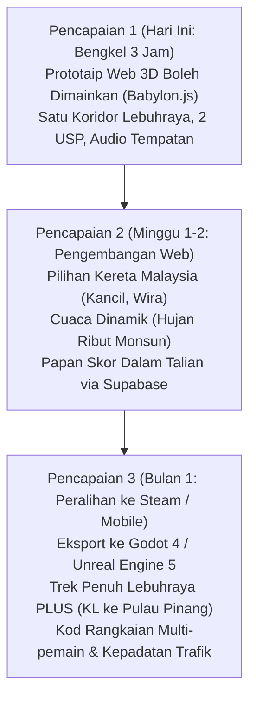

# Pengurusan Projek & Matriks Keseimbangan Permainan
## King Myvi: Highway Legends (Templat Google Sheets / Excel)
**[English](PROJECT_MANAGEMENT_TEMPLATE.md) | [Bahasa Melayu](PROJECT_MANAGEMENT_TEMPLATE.ms-MY.md)**

---

## 1. Senarai Tugas Ciri (Feature Backlog - Sprint 1: Bengkel 3 Jam)

Anda boleh menyalin jadual markdown di bawah, atau menggunakan kod CSV mentah di Bahagian 4 untuk diimport terus ke dalam Google Sheets (`File -> Import -> Paste CSV`).

| ID Tugas | Kategori / Epik | Ciri / Kisah Pengguna | Keutamaan | Anggaran (Minit) | Alatan / Pemilik | Kriteria Pengesahan | Status |
| :--- | :--- | :--- | :--- | :--- | :--- | :--- | :--- |
| **ENG-01** | Seni Bina | Mulakan gelung kanvas Vite + Babylon.js 7 & kamera kejar | P0 | 15 | Antigravity / OpenCode | Gelung pemaparan 60 FPS lancar berjalan dalam pelayar di `localhost:5173` | Selesai |
| **ENG-02** | Mekanik | Bina pengawal kenderaan Myvi dengan pecutan, brek, dan stereng | P0 | 25 | Antigravity | Kawalan anak panah/WASD responsif dengan olengan kerangka badan | Selesai |
| **ENG-03** | Mekanik (USP 1) | Laksanakan sistem Lampu Tinggi (`Spacebar`) dengan lampu sorot kembar | P0 | 20 | Antigravity | Lampu sorot memancar 40m ke hadapan; suar kembangan kanta tercetus | Selesai |
| **ENG-04** | Sistem AI | Laksanakan Penjana Trafik & Mesin Keadaan Beralih Lorong | P0 | 25 | Antigravity | Trafik bergerak pada 80-100km/j; beri isyarat dan beralih ke kiri apabila di-high-beam | Selesai |
| **ENG-05** | Halangan (USP 2) | Penjanaan Prosedural Lubang Jalan & Tanjakan Loncatan SmartTAG | P1 | 20 | Antigravity | Lubang memperlahankan kereta 40%; tanjakan melancarkan lonjakan kelajuan | Selesai |
| **ART-01** | Aset 3D | Modelkan casis & roda Myvi poli rendah melalui Blender MCP / Prosedural | P1 | 25 | Blender MCP | Kereta hatchback bergaya dieksport sebagai `.glb` atau mesh Babylon | Selesai |
| **ART-02** | Alam Sekitar | Lebuhraya PLUS modular, papan tanda gantri hijau & pokok kelapa sawit | P1 | 20 | Blender / Prosedural | Lebuhraya 3 lorong bertekstur dengan papan tanda dwibahasa Malaysia | Selesai |
| **AUD-01** | Audio / SFX | Sintesiskan RPM enjin dinamik, hon, dan bunyi pecutan Web Audio | P2 | 15 | Antigravity | Pic audio enjin berkadar langsung dengan kelajuan; hon berbunyi pada kekunci 'H' | Selesai |
| **UI-01** | Antara Muka / HUD | HUD arked retro: Meter Kelajuan (km/j), Baki Jarak Titik B, Pemasa | P1 | 15 | Antigravity | HUD digital dikemas kini masa nyata dengan modal kemenangan/kekalahan | Selesai |
| **DEP-01** | Penyebaran | Konfigurasi binaan statik dan penyebaran automatik ke GitHub Pages / Vercel | P1 | 10 | Pengajar / Hos | URL awam langsung boleh diakses pada telefon pintar melalui kod QR | Selesai |

---

## 2. Matriks Keseimbangan Fizik & Kenderaan (Helaian "Sentuhan Rasa")

Dalam pembangunan permainan, dokumen reka bentuk tidak berguna tanpa jadual penalaan. Matriks ini membolehkan Pengarah Kreatif dan ejen AI menala "rasa pemanduan" kenderaan serta-merta tanpa mengubah kod enjin utama.

| Nama Parameter | Nilai Lalai | Nilai Min | Nilai Maks | Unit | Penerangan Impak |
| :--- | :--- | :--- | :--- | :--- | :--- |
| `top_speed_standard` | 180.0 | 120.0 | 220.0 | km/j | Kelajuan pelayaran di lebuh raya terbuka |
| `top_speed_boost` | 240.0 | 200.0 | 300.0 | km/j | Kelajuan maksimum semasa lonjakan SmartTAG |
| `acceleration_rate` | 38.0 | 20.0 | 60.0 | m/s² | Masa untuk mencapai 100 km/j dari pegun (~2.8s) |
| `braking_force` | 65.0 | 30.0 | 100.0 | m/s² | Kekuatan nyahpecutan pada kekunci `S` / Anak Panah Bawah |
| `lateral_steer_speed` | 22.0 | 10.0 | 35.0 | m/s | Kepekaan tindak balas pertukaran lorong |
| `chassis_roll_angle` | 0.12 | 0.02 | 0.25 | radian | Sudut kecondongan visual semasa membelok tajam |
| `high_beam_range` | 42.0 | 25.0 | 70.0 | meter | Jarak ke hadapan di mana trafik mengesan lampu tinggi |
| `high_beam_cone_angle` | 0.45 | 0.20 | 0.80 | radian | Sudut medan pencahayaan kon lampu sorot |
| `traffic_reaction_delay`| 0.35 | 0.10 | 1.00 | saat | Masa reaksi kereta perlahan sebelum menyalakan lampu isyarat |
| `traffic_lane_shift_time`| 0.70 | 0.30 | 1.50 | saat | Masa yang diambil oleh trafik untuk melengkapkan peralihan lorong |
| `pothole_speed_penalty` | 0.40 | 0.20 | 0.70 | peratus | Pecahan penurunan kelajuan apabila melanggar lubang jalan |
| `pothole_wobble_duration`| 1.20 | 0.50 | 2.50 | saat | Tempoh masa stereng bergegar tidak menentu selepas impak |
| `smarttag_boost_duration`| 3.50 | 1.50 | 6.00 | saat | Tempoh masa tetingkap kelajuan supersonik nitro |
| `target_distance_total` | 5000 | 2000 | 10000 | meter | Jumlah jarak keseluruhan dari Titik A ke Titik B |
| `stage_countdown_timer` | 90.0 | 60.0 | 150.0 | saat | Had masa untuk melepasi Tol Titik B sebelum gagal |

---

## 3. Pelan Hala Tuju Pencapaian (Milestone Roadmap)



---

## 4. Kod CSV Mentah untuk Import Google Sheets

Untuk mengimport terus ke dalam Google Sheets:
1. Salin blok teks di bawah.
2. Dalam Google Sheets, buka helaian baharu.
3. Tampal terus ke dalam sel `A1` atau simpan sebagai `backlog.csv` dan gunakan menu `File -> Import`.

```csv
Task ID,Category,Feature / Story,Priority,Est_Minutes,Owner_Tool,Status,Verification_Notes
ENG-01,Seni Bina,Mulakan gelung kanvas Vite + Babylon.js 7 & kamera kejar,P0,15,Antigravity,Selesai,Gelung pemaparan 60 FPS lancar
ENG-02,Mekanik,Bina pengawal kenderaan Myvi dengan pecutan & stereng,P0,25,Antigravity,Selesai,Kawalan WASD responsif dengan olengan badan
ENG-03,Mekanik (USP 1),Laksanakan sistem Lampu Tinggi dengan lampu sorot berkembar,P0,20,Antigravity,Selesai,Lampu sorot memancar 40m ke hadapan
ENG-04,Sistem AI,Laksanakan Penjana Trafik & Mesin Keadaan Beralih Lorong,P0,25,Antigravity,Selesai,Trafik beralih ke kiri apabila di-high-beam
ENG-05,Halangan (USP 2),Penjanaan Prosedural Lubang Jalan & Tanjakan Loncatan SmartTAG,P1,20,Antigravity,Selesai,Lubang memperlahankan kereta; SmartTAG melancarkan lompatan
ART-01,Aset 3D,Modelkan casis & roda Myvi poli rendah melalui Blender MCP,P1,25,Blender MCP,Selesai,Dieksport sebagai .glb atau mesh Babylon
ART-02,Alam Sekitar,Lebuhraya PLUS modular & papan tanda gantri hijau,P1,20,Blender / Prosedural,Selesai,Lebuhraya 3 lorong dengan papan tanda Malaysia
AUD-01,Audio / SFX,Sintesiskan RPM enjin dinamik dan hon Web Audio,P2,15,Antigravity,Selesai,Pic enjin berkadar kelajuan; hon pada kekunci H
UI-01,Antara Muka / HUD,HUD arked retro: Meter Kelajuan dan Baki Jarak,P1,15,Antigravity,Selesai,HUD digital dikemas kini masa nyata
DEP-01,Penyebaran,Konfigurasi binaan statik dan penyebaran ke GitHub Pages,P1,10,Hos / Pengajar,Selesai,URL awam langsung boleh diakses di telefon
```

---

## 5. Pek Prom AI: Menjana & Mengubah Suai Backlog

### Prom: Menjana Backlog Permainan Agile Daripada GDD
```text
Bertindak sebagai Penerbit Teknikal Permainan Kanan. Berdasarkan Dokumen Reka Bentuk Permainan (GDD) terlampir untuk "King Myvi: Highway Legends", jana senarai tugas (backlog) sprint berstruktur mengandungi 12 tugasan.
Setiap tugasan mesti mengandungi:
1. ID Tugas (ENG, ART, AUD, UI, QA)
2. Kisah Pengguna ("Sebagai seorang pemain, saya mahu...")
3. Nota Pelaksanaan Teknikal untuk ejen pengekodan AI autonomi (nyatakan komponen Babylon.js, matematik vektor, atau geometri Blender)
4. Kriteria Pengesahan & QA
Formatkan output sebagai jadual Markdown sedia untuk disalin ke Google Sheets.
```

### Prom: Mengimbangi Semula Fizik Permainan untuk Sentuhan Arked
```text
Bertindak sebagai Jurutera Penalaan Permainan Utama. Semak parameter fizik kenderaan berikut:
[Tampal Jadual Parameter Bahagian 2 di sini]
Ubah suai parameter ini untuk menjadikan kenderaan berasa lebih pantas, lebih mudah menggelongsor (drifty), dan lebih memaafkan pelanggaran, sambil meningkatkan kepekaan tindak balas lampu tinggi sebanyak 30%. Keluarkan jadual yang dikemas kini beserta penjelasan matematik mengenai perubahan anda.
```
