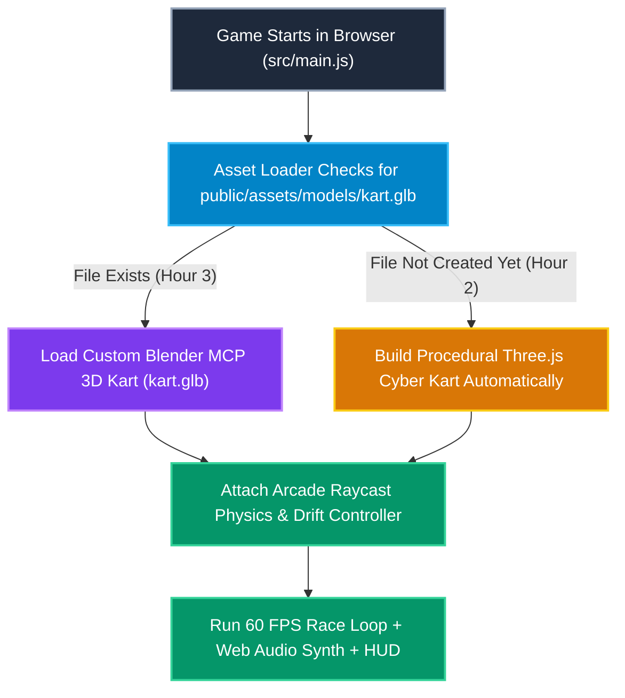

# 🎮 Neon Kart 3D — AI for Gaming (3-Hour Hands-On Lab)

**English** | **[Bahasa Melayu (README.ms-MY.md)](README.ms-MY.md)** | **[GitHub Wiki Guide (WIKI.md)]WIKI.md)**

Welcome to the official repository for **"AI for Gaming: How AI is Changing the Way Games Are Made"**!

In this 3-hour hands-on workshop, you will build a complete, playable 3D web racing game (**Neon Kart 3D**, inspired by Mario Kart) from start to finish **without writing code by hand**. Even if you have never made a game or opened 3D software before, you will learn how to direct AI coding agents and 3D modeling tools like a Game Director.

---

## 🌟 What You Will Build & Learn in 3 Hours

1. **Plan Like a Game Designer (Hour 1):** Use AI to write a **Game Design Document (`docs/GDD.md`)**, populate a **Project Management Backlog (`AI_for_Gaming_Project_Management_Template.xlsx`)**, and design a clean **Game Architecture (`docs/ARCHITECTURE.md`)**.
2. **Build a 3D Web Game with AI Agents (Hour 2):** Use **[Google Antigravity](https://antigravity.google/)** or **[OpenCode](https://opencode.ai/)** powered by free **[Google Gemini](https://aistudio.google.com/)** models to generate a 60 FPS **[Three.js](https://threejs.org/)** 3D circuit track, arcade drift-boost physics, mystery item boxes, and AI rival karts.
3. **Create 3D Models in Blender Using AI (Hour 3):** Connect **[Blender](https://www.blender.org/)** to your AI agent via **[MCP for Blender](https://github.com/ahujasid/mcp-for-blender)** (`uvx mcp-for-blender`) to procedurally generate a custom 3D racing kart (`kart.glb`), add background music with **[yt-dlp](https://github.com/yt-dlp/yt-dlp)** or **[Suno](https://suno.com/)**, and publish your game online for free on **[GitHub Pages](https://pages.github.com/)**, **[Vercel](https://vercel.com/)**, or **[Netlify](https://www.netlify.com/)**.

---

## 🗺️ How the AI Game Pipeline Works (Visual Overview)

The diagram below shows how your ideas flow from simple text prompts into a playable 3D web game:

```mermaid
flowchart LR
    A["1. Game Idea & Rules"] --> B["2. AI Game Design Doc (docs/GDD.md)"]
    B --> C["3. AI Project Backlog (Excel / Google Sheets)"]
    C --> D["4. Modular Game Architecture (docs/ARCHITECTURE.md)"]
    D --> E["5. AI Coding Agent (Google Antigravity / OpenCode)"]
    E --> F["6. Procedural 3D Scene (Three.js + Web Audio)"]
    E --> G["7. Blender MCP Server (uvx mcp-for-blender)"]
    G --> H["8. Custom 3D Assets (kart.glb + arch.glb)"]
    F --> I["9. Playable 3D Web Game (GitHub Pages / Vercel)"]
    H --> I

    classDef design fill:#0284c7,stroke:#38bdf8,stroke-width:2px,color:#ffffff;
    classDef agent fill:#d97706,stroke:#facc15,stroke-width:2px,color:#ffffff;
    classDef asset fill:#7c3aed,stroke:#c084fc,stroke-width:2px,color:#ffffff;
    classDef deploy fill:#059669,stroke:#34d399,stroke-width:2px,color:#ffffff;

    class A,B,C,D design;
    class E agent;
    class F,G,H asset;
    class I deploy;
```



---

## 📂 What Is Inside This Repository?

| File / Folder | What It Does (In Simple Terms) |
| :--- | :--- |
| `index.html` | **Interactive Workshop Slide Deck** built with [Reveal.js](https://revealjs.com/) and Markdown. Open this in your browser to follow the slides and click **Copy Prompt** on every exercise! |
| `neon_kart_3d_prototype.html` | **Playable 3D Kart Game Demo**. Open this in any browser to test-drive the finished game immediately (WASD/Arrows to steer, `SPACE` to drift-boost, `E` to use items). |
| `AI_for_Gaming_3Hour_Lab_Runbook_and_Templates.md` | **Complete Step-by-Step Guide & Prompt Book** containing the 3-hour schedule, GDD template, architecture blueprint, and copy-paste AI prompts. |
| `AI_for_Gaming_Project_Management_Template.xlsx` | **Ready-to-Use Project Management Spreadsheet** (works in Excel and Google Sheets) with a 16-task Backlog, auto-calculated Milestone Schedule, and AI Prompt Primer. |
| `WIKI.md` | **GitHub Wiki Knowledge Base** with deep-dive explanations on architecture, Blender MCP setup, audio licensing, and troubleshooting. |
| `README.ms-MY.md` | **Panduan Penuh dalam Bahasa Melayu** (Full documentation in Bahasa Melayu). |

---

## 🚀 Quick Start Guide (Step-by-Step for Beginners)

### Step 1: Install the Free Tools on Your Laptop (Windows or macOS)

Open **PowerShell (Run as Administrator)** on Windows or **Terminal** on macOS and run the command for your laptop:

#### Windows (PowerShell)
```powershell
winget install OpenJS.NodeJS.LTS Git.Git BlenderFoundation.Blender yt-dlp.yt-dlp Gyan.FFmpeg
powershell -ExecutionPolicy ByPass -c "irm https://astral.sh/uv/install.ps1 | iex"
npm install -g @opencode/cli@latest
```

#### macOS (Terminal with Homebrew)
```bash
brew install node git uv yt-dlp ffmpeg
brew install --cask blender
npm install -g @opencode/cli@latest
```

*(Optional GUI IDE)*: You can also download and install **[Google Antigravity IDE](https://antigravity.google/download/)** if you prefer a visual code editor over the terminal.

---

### Step 2: Connect Your Free Google Gemini API Key (or Free OpenCode LLMs)

1. Go to **[Google AI Studio](https://aistudio.google.com/docs/api-key)** and click **Create API Key** (100% free tier for students and builders).
2. Set the key in your terminal so your AI coding agent can use it:

```bash
# On macOS / Linux / Git Bash:
export GEMINI_API_KEY="AIzaSyYourFreeKeyHere"

# On Windows PowerShell:
$env:GEMINI_API_KEY="AIzaSyYourFreeKeyHere"
```

3. Make sure a file named `opencode.json` is in your project folder so **[OpenCode](https://opencode.ai/)** automatically connects to **Gemini** and **[MCP for Blender](https://github.com/ahujasid/mcp-for-blender)**:

```json
{
  "$schema": "https://opencode.ai/config.json",
  "provider": "google",
  "model": "google/gemini-2.5-pro",
  "small_model": "google/gemini-2.5-flash",
  "mcp": {
    "blender": {
      "command": "uvx",
      "args": ["mcp-for-blender"]
    }
  }
}
```

> **💡 Beginner Tip:** When you run `opencode` in your terminal, you can also type `/models` to switch between your Google Gemini key and OpenCode's built-in free models!

---

### Step 3: How Our "Fail-Safe" Game Architecture Works

When building a 3D game live in a 3-hour class, you never want a missing 3D file to crash your game. Our project uses a **"Graceful Procedural Fallback"** pattern:



* **In Hour 2:** Before you even open Blender, your game builds a sleek 3D kart out of simple **[Three.js](https://threejs.org/)** shapes so you can drive, drift, and race right away.
* **In Hour 3:** Once you use **[MCP for Blender](https://github.com/ahujasid/mcp-for-blender)** to export `public/assets/models/kart.glb`, the game automatically detects your new 3D model and swaps it onto the track!

---

## 🎮 Controls for the Playable Demo (`neon_kart_3d_prototype.html`)

| Action | Keyboard Key | Touch / Mouse Control |
| :--- | :--- | :--- |
| **Accelerate (Gas)** | `W` or `Up Arrow` | Hold **GAS** button |
| **Brake / Reverse** | `S` or `Down Arrow` | Hold **BRAKE** button |
| **Steer Left / Right** | `A` / `D` or `Left` / `Right Arrow` | Hold **◀** / **▶** buttons |
| **Drift & Charge Mini-Turbo** | Hold `SPACE` or `Left Shift` while turning for 1.0s, then release | Hold **DRIFT** button while turning |
| **Use Power-Up Item** | Press `E` or `Enter` | Tap the **Center Item Slot** |
| **Change Camera View** | Click **Cam: Chase** in top bar | Tap **Cam: Chase** |
| **Live-Tune GDD Physics** | Click **AI GDD & Physics** in top bar | Adjust sliders in real time |

---

## 🛠️ Free Assets & Audio Licensing Best Practices

* **3D Models & Sky Textures:** Use **[Poly Haven](https://polyhaven.com/)** and **[Kenney Game Assets](https://kenney.nl/assets)** for 100% free CC0 (Public Domain) textures and racing kits, or generate new 3D props from text using **[Meshy](https://www.meshy.ai/)** and **[Tripo3D](https://www.tripo3d.ai/)**.
* **Music & Sound Effects:**
  * Our prototype includes a built-in **Web Audio API synthesizer** that generates engine hums, drift sparks, and turbo boosts using pure math—no external sound files required!
  * For background music during local lab testing on your own laptop, you can run `yt-dlp -x --audio-format mp3 <YOUTUBE_URL> -o "public/assets/audio/bgm.%(ext)s"`.
  * **Important:** Before deploying your game publicly to **[GitHub Pages](https://pages.github.com/)**, **[Vercel](https://vercel.com/)**, or **[Netlify](https://www.netlify.com/)**, replace any YouTube audio with royalty-free CC0 music or an AI-generated synthwave track from **[Suno](https://suno.com/)** and **[ElevenLabs Sound Effects](https://elevenlabs.io/docs/overview/capabilities/sound-effects)**.

---

## 📚 Need More Help?
Check out **[WIKI.md](https://www.google.com/search?q=./WIKI.md)** for the full GitHub Wiki documentation, including **Git Checkpoint Branches**, **Blender MCP Port Setup**, and how to upgrade this prototype into a full commercial 3D game with **[Rapier](https://rapier.rs/)** physics!
