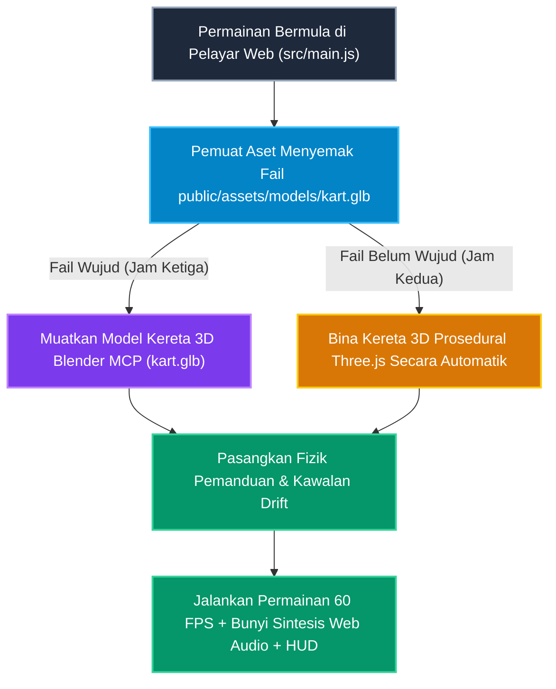

# 🎮 Neon Kart 3D — AI untuk Pembangunan Permainan (Bengkel Amali 3 Jam)

**[English](https://github.com/C-Fu/krackeddevs-ai-for-gaming/blob/main/neon_kart_3d/readme.md)** | **[Bahasa Melayu (README.ms-MY.md)](https://github.com/C-Fu/krackeddevs-ai-for-gaming/blob/main/neon_kart_3d/readme_ms_my.md)** | **[GitHub Wiki Guide (WIKI.md)](https://github.com/C-Fu/krackeddevs-ai-for-gaming/blob/main/neon_kart_3d/wiki.md)**

Selamat datang ke repositori rasmi untuk bengkel dan tutorial **"AI for Gaming: Bagaimana AI Mengubah Cara Permainan Dibina"**!

Dalam bengkel amali (hands-on) selama 3 jam ini, anda akan membina sebuah permainan perlumbaan 3D di pelayar web (**Neon Kart 3D**, diinspirasikan daripada Mario Kart) dari mula hingga siap **tanpa perlu menaip kod secara manual**. Walaupun anda tidak pernah membina permainan video atau menggunakan perisian 3D sebelum ini, anda akan belajar cara mengawal ejen AI dan perisian 3D seperti seorang Pengarah Permainan (Game Director).

---

## 🌟 Apa Yang Anda Akan Bina & Pelajari Dalam 3 Jam

1. **Merancang Seperti Pereka Permainan (Jam Pertama):** Gunakan AI untuk menghasilkan **Dokumen Reka Bentuk Permainan (`docs/GDD.md`)**, mengisi jadual **Pengurusan Projek (`AI_for_Gaming_Project_Management_Template.xlsx`)**, dan menyusun **Seni Bina Kod (`docs/ARCHITECTURE.md`)** yang kemas.
2. **Membina Permainan Web 3D Dengan Ejen AI (Jam Kedua):** Gunakan **[Google Antigravity](https://antigravity.google/)** atau **[OpenCode](https://opencode.ai/)** bersama model percuma **[Google Gemini](https://aistudio.google.com/)** untuk menjana litar lumba 3D **[Three.js](https://threejs.org/)**, fizik pemanduan *drift-boost*, kotak item kuasa, serta kereta lumba AI lawan.
3. **Menjana Model 3D Dalam Blender Melalui MCP (Jam Ketiga):** Sambungkan **[Blender](https://www.blender.org/)** terus kepada ejen AI menggunakan **[MCP for Blender](https://github.com/ahujasid/mcp-for-blender)** (`uvx mcp-for-blender`) untuk membina kereta lumba 3D (`kart.glb`) secara automatik, menambah muzik latar menggunakan **[yt-dlp](https://github.com/yt-dlp/yt-dlp)** atau **[Suno](https://suno.com/)**, dan melancarkan permainan anda ke internet secara percuma di **[GitHub Pages](https://pages.github.com/)**, **[Vercel](https://vercel.com/)**, atau **[Netlify](https://www.netlify.com/)**.

---

## 🗺️ Aliran Kerja Pembangunan Permainan AI (Gambaran Visual)

Gambar rajah di bawah menunjukkan bagaimana idea anda bertukar daripada arahan teks (prompt) yang mudah kepada sebuah permainan web 3D yang boleh dimainkan:

```mermaid
flowchart LR
    A["1. Idea & Peraturan Permainan"] --> B["2. Dokumen GDD AI (docs/GDD.md)"]
    B --> C["3. Jadual Tugas Projek (Excel / Google Sheets)"]
    C --> D["4. Seni Bina Modular (docs/ARCHITECTURE.md)"]
    D --> E["5. Ejen Pengekodan AI (Google Antigravity / OpenCode)"]
    E --> F["6. Dunia 3D Prosedural (Three.js + Web Audio)"]
    E --> G["7. Pelayan Blender MCP (uvx mcp-for-blender)"]
    G --> H["8. Aset 3D Tersuai (kart.glb + arch.glb)"]
    F --> I["9. Permainan Web 3D Siap (GitHub Pages / Vercel)"]
    H --> I

    classDef design fill:#0284c7,stroke:#38bdf8,stroke-width:2px,color:#ffffff;
    classDef agent fill:#d97706,stroke:#facc15,stroke-width:2px,color:#ffffff;
    classDef asset fill:#7c3aed,stroke:#c084fc,stroke-width:2px,color:#ffffff;
    classDef deploy fill:#059669,stroke:#34d399,stroke-width:2px,color:#ffffff;

    class A,B,C,D design;
    class E agent;
    class F,G,H asset;
    class I deploy;
```



---

## 📂 Kandungan Repositori Ini

| Fail / Folder | Fungsi & Kegunaan (Dalam Bahasa Mudah) |
| :--- | :--- |
| `index.html` | **Slaid Pembentangan Interaktif** yang dibina dengan [Reveal.js](https://revealjs.com/) dan Markdown. Buka fail ini di pelayar web untuk melihat slaid dan klik butang **Copy Prompt** pada setiap latihan! |
| `neon_kart_3d_prototype.html` | **Demo Permainan Neon Kart 3D**. Buka fail ini terus di pelayar web anda untuk memandu uji permainan yang telah siap (kekunci WASD/Anak Panah untuk memandu, `SPACE` untuk *drift-boost*, `E` untuk guna item). |
| `AI_for_Gaming_3Hour_Lab_Runbook_and_Templates.md` | **Buku Panduan Lengkap & Koleksi Prompt** yang mengandungi jadual 3 jam, templat GDD, pelan seni bina fail, dan arahan *copy-paste* untuk ejen AI. |
| `AI_for_Gaming_Project_Management_Template.xlsx` | **Templat Pengurusan Projek (Excel / Google Sheets)** lengkap dengan senarai 16 tugasan (*Backlog*), jadual pencapaian (*Milestone*) automatik, dan panduan prompt AI. |
| `WIKI.md` | **Dokumentasi Wiki GitHub** yang menerangkan seni bina secara mendalam, cara sambungan Blender MCP, panduan lesen audio, serta penyelesaian masalah (*troubleshooting*). |
| `README.md` | **Dokumentasi Penuh dalam Bahasa Inggeris** (English README). |

---

## 🚀 Panduan Mula Pantas (Langkah demi Langkah untuk Pemula)

### Langkah 1: Pasang Perisian Percuma Pada Komputer Riba Anda (Windows atau macOS)

Buka **PowerShell (Run as Administrator)** pada Windows atau **Terminal** pada macOS, kemudian jalankan arahan mengikut sistem operasi anda:

#### Windows (PowerShell)
```powershell
winget install OpenJS.NodeJS.LTS Git.Git BlenderFoundation.Blender yt-dlp.yt-dlp Gyan.FFmpeg
powershell -ExecutionPolicy ByPass -c "irm https://astral.sh/uv/install.ps1 | iex"
npm install -g @opencode/cli@latest
```

#### macOS (Terminal dengan Homebrew)
```bash
brew install node git uv yt-dlp ffmpeg
brew install --cask blender
npm install -g @opencode/cli@latest
```

*(Pilihan IDE Bergrafik)*: Anda juga boleh memuat turun **[Google Antigravity IDE](https://antigravity.google/download/)** jika anda lebih selesa menggunakan editor visual berbanding terminal.

---

### Langkah 2: Sambungkan Kunci API Google Gemini Percuma (atau Model Percuma OpenCode)

1. Layari **[Google AI Studio](https://aistudio.google.com/docs/api-key)** dan klik **Create API Key** (percuma untuk pelajar dan pembangun).
2. Tetapkan kunci API tersebut di dalam terminal anda:

```bash
# Pada macOS / Linux / Git Bash:
export GEMINI_API_KEY="AIzaSyKunciPercumaAndaDiSini"

# Pada Windows PowerShell:
$env:GEMINI_API_KEY="AIzaSyKunciPercumaAndaDiSini"
```

3. Pastikan fail `opencode.json` berada di dalam folder utama projek supaya **[OpenCode](https://opencode.ai/)** bersambung secara automatik kepada **Gemini** dan **[MCP for Blender](https://github.com/ahujasid/mcp-for-blender)**:

```json
{
  "$schema": "https://opencode.ai/config.json",
  "provider": "google",
  "model": "google/gemini-2.5-pro",
  "small_model": "google/gemini-2.5-flash",
  "mcp": {
    "blender": {
      "command": "uvx",
      "args": ["mcp-for-blender"]
    }
  }
}
```

> **💡 Tip Mudah:** Semasa menjalankan `opencode` di terminal, anda boleh menaip `/models` pada bila-bila masa untuk menukar antara model **Google Gemini** atau model percuma yang sedia terbina di dalam OpenCode!

---

### Langkah 3: Bagaimana Sistem "Fallback Prosedural" Kami Berfungsi

Apabila membina permainan 3D secara langsung dalam bengkel 3 jam, kita tidak mahu permainan gagal berfungsi hanya kerana fail model 3D belum siap dieksport. Projek ini menggunakan teknik **"Graceful Procedural Fallback"** (Pelan Sandaran Automatik):



* **Pada Jam Kedua:** Sebelum anda membuka Blender, permainan ini membina kereta lumba 3D menggunakan bentuk asas **[Three.js](https://threejs.org/)** supaya anda boleh terus memandu dan berlumba.
* **Pada Jam Ketiga:** Sebaik sahaja anda mengeksport `public/assets/models/kart.glb` daripada **[MCP for Blender](https://github.com/ahujasid/mcp-for-blender)**, permainan akan mengesan fail baharu tersebut dan menukarkan rupa kereta anda secara automatik!

---

## 🎮 Kawalan Permainan (`neon_kart_3d_prototype.html`)

| Tindakan | Kekunci Papan Kekunci | Kawalan Skrin Sentuh / Tetikus |
| :--- | :--- | :--- |
| **Pecut (Minimis/Gas)** | `W` atau `Anak Panah Atas` | Tekan & tahan butang **GAS** |
| **Brek / Undur** | `S` atau `Anak Panah Bawah` | Tekan & tahan butang **BRAKE** |
| **Belok Kiri / Kanan** | `A` / `D` atau `Anak Panah Kiri` / `Kanan` | Tekan & tahan butang **◀** / **▶** |
| **Drift & Cas Mini-Turbo** | Tahan `SPACE` atau `Shift Kiri` sambil membelok selama 1.0s, kemudian lepaskan | Tahan butang **DRIFT** sambil membelok |
| **Guna Item Kuasa** | Tekan `E` atau `Enter` | Klik **Slot Item di Tengah Bawah** |
| **Tukar Sudut Kamera** | Klik **Cam: Chase** di bar atas | Klik **Cam: Chase** |
| **Ubah Suai Fizik GDD** | Klik **AI GDD & Physics** di bar atas | Laraskan *slider* kelajuan & belokan secara langsung |

---

## 🛠️ Aset Percuma & Amalan Terbaik Lesen Audio

* **Model 3D & Tekstur Langit:** Gunakan **[Poly Haven](https://polyhaven.com/)** dan **[Kenney Game Assets](https://kenney.nl/assets)** untuk mendapatkan tekstur dan model 3D berlesen CC0 (Domain Awam) secara percuma, atau jana objek 3D baharu daripada teks menggunakan **[Meshy](https://www.meshy.ai/)** dan **[Tripo3D](https://www.tripo3d.ai/)**.
* **Muzik Latar & Kesan Bunyi (SFX):**
  * Prototaip kami mempunyai **penjana bunyi Web Audio API** terbina dalam yang menghasilkan deruman enjin dan bunyi turbo secara matematik tanpa memerlukan sebarang fail audio luaran!
  * Untuk ujian muzik latar secara tempatan (*localhost*) di dalam makmal, anda boleh menjalankan arahan `yt-dlp -x --audio-format mp3 <URL_YOUTUBE> -o "public/assets/audio/bgm.%(ext)s"`.
  * **Penting:** Sebelum memuat naik permainan anda untuk tontonan umum di **[GitHub Pages](https://pages.github.com/)**, **[Vercel](https://vercel.com/)**, atau **[Netlify](https://www.netlify.com/)**, gantikan audio YouTube dengan muzik bebas royalti CC0 atau lagu janaan AI daripada **[Suno](https://suno.com/)** serta kesan bunyi **[ElevenLabs Sound Effects](https://elevenlabs.io/docs/overview/capabilities/sound-effects)**.

---

## 📚 Perlukan Bantuan Lanjut?
Sila rujuk **[WIKI.md](https://www.google.com/search?q=./WIKI.md)** untuk dokumentasi penuh Wiki GitHub, termasuk **Cabang Checkpoint Git**, **Cara Tetapan Port Blender MCP**, dan panduan menaik taraf prototaip ini kepada permainan 3D penuh menggunakan enjin fizik **[Rapier](https://rapier.rs/)**!
