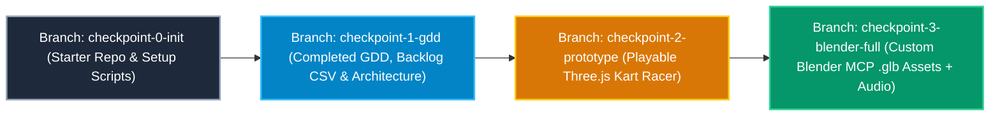
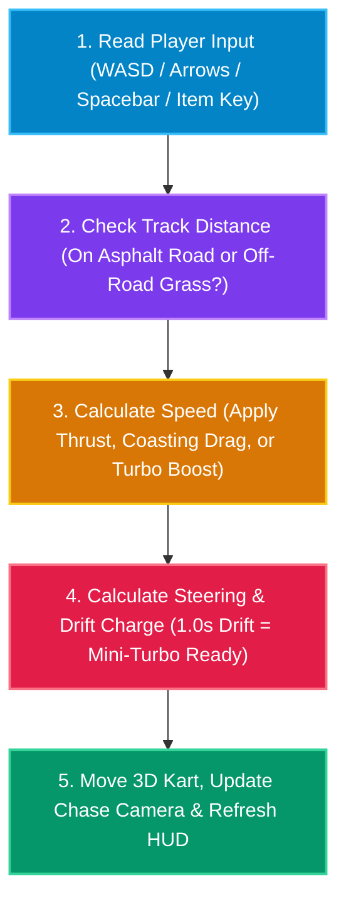
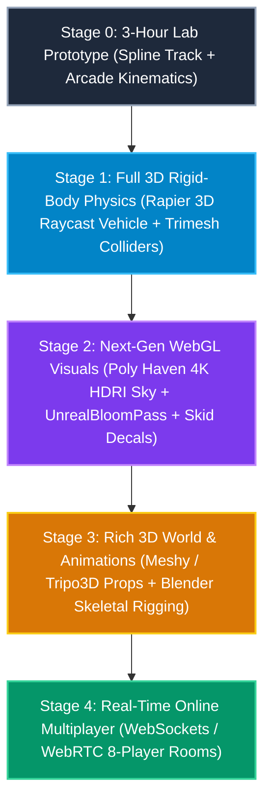

# 📖 GitHub Wiki Reference Guide (Panduan Wiki Repositori) — Neon Kart 3D

This document contains ready-to-use pages for your **GitHub Repository Wiki** (in both **English** and **Bahasa Melayu**). You can copy each section into separate GitHub Wiki pages (`Home`, `Architecture-and-Physics`, `Blender-MCP-Pipeline`, `Git-Checkpoints-and-Troubleshooting`, and `Scaling-to-Full-3D`) or keep this file in your repo as a single-page manual.

---

## Wiki Page 1: Home & Lab Checkpoint Branches (Laman Utama & Cabang Checkpoint Git)

### Why We Use Git Checkpoint Branches (Mengapa Kita Menggunakan Cabang Checkpoint)
In a 3-hour hands-on workshop, no student should ever get left behind if a command takes too long or a prompt has a typo. Our repository includes **4 pre-built Git branches** so anyone can jump to the exact current stage of the lab in 5 seconds:



### How to Switch Checkpoints (Cara Menukar Cabang Checkpoint)
If you fall behind at any point during the workshop, run the matching command in your terminal:

```bash
# Jump to Hour 1 Completion (GDD + Architecture ready):
git checkout -f checkpoint-1-gdd

# Jump to Hour 2 Completion (Playable 3D Game ready):
git checkout -f checkpoint-2-prototype

# Jump to Hour 3 Completion (Blender MCP .glb Models + Audio integrated):
git checkout -f checkpoint-3-blender-full
```

---

## Wiki Page 2: How the Game Mechanics & Physics Work (Cara Mekanik & Fizik Permainan Berfungsi)

### Simple Explanation of Arcade Kart Physics (Penerangan Mudah Fizik Kereta Lumba Arked)
Real-world car simulators calculate complex tire friction, gear ratios, and suspension springs, which often feel too slippery or frustrating for casual players. **Arcade Kart Racers** (like Mario Kart and **Neon Kart 3D**) use a simpler, more fun 4-step loop every frame (60 times per second):



### Key Game Mechanics Explained Simply (Mekanik Utama Secara Ringkas)
* **Spline Circuit Track (`CatmullRomCurve3`):** Instead of placing hundreds of road tiles by hand, we give **[Three.js](https://threejs.org/)** 10 points in 3D space. Three.js connects them into a smooth, closed racing loop and generates the asphalt road and red-and-white curbs automatically.
* **Off-Road Slowdown (`OFFROAD_DRAG`):** Every frame, the game measures how far your kart is from the center of the road. If you drive wider than `7.5 units` (onto the grass) without a **Plasma Shield**, your speed multiplies by `0.91` so cutting corners slows you down.
* **Anti-Cheat Lap Counting:** You cannot just drive backward across the Start/Finish line to win! Your kart must pass through sequential track segments (`maxProgressIdx > 78%` of the track) before crossing the finish line counts as a completed lap.

---

## Wiki Page 3: Blender MCP Procedural 3D Guide (Panduan Model 3D Blender MCP)

### What is MCP for Blender? (Apakah Itu MCP untuk Blender?)
**MCP (Model Context Protocol)** acts like a universal USB cable that lets AI coding agents (**[Google Antigravity](https://antigravity.google/)** and **[OpenCode](https://opencode.ai/)**) talk directly to **[Blender](https://www.blender.org/)**. Instead of spending hours learning Blender's 1,000 keyboard shortcuts, you describe what you want in plain English or Bahasa Melayu, and the AI writes and runs the Blender Python (`bpy`) code for you.

```mermaid
flowchart LR
    Prompt["1. Your Natural Language Prompt in Antigravity / OpenCode"] --> Agent["2. Gemini 2.5 Pro Agent Plans 3D Geometry & Materials"]
    Agent --> MCP["3. MCP Bridge (uvx mcp-for-blender)"]
    MCP --> Blender["4. Blender 3D Viewport Builds Kart, Wheels & Spoiler Live"]
    Blender --> Export["5. Auto-Export Binary glTF (public/assets/models/kart.glb)"]
    Export --> Game["6. Neon Kart 3D Hot-Swaps New 3D Model into Browser"]

    classDef pNode fill:#0284c7,stroke:#38bdf8,stroke-width:2px,color:#ffffff;
    classDef aNode fill:#d97706,stroke:#facc15,stroke-width:2px,color:#ffffff;
    classDef bNode fill:#7c3aed,stroke:#c084fc,stroke-width:2px,color:#ffffff;
    classDef gNode fill:#059669,stroke:#34d399,stroke-width:2px,color:#ffffff;

    class Prompt pNode;
    class Agent,MCP aNode;
    class Blender,Export bNode;
    class Game gNode;
```



### 4-Step Setup Checklist for Blender MCP (Senarai Semak 4 Langkah Blender MCP)
1. Download the `addon.py` file from **[MCP for Blender (`ahujasid/mcp-for-blender`)](https://github.com/ahujasid/mcp-for-blender)**.
2. Open **[Blender](https://www.blender.org/)** -> go to `Edit > Preferences > Add-ons` -> click **Install from Disk...** and select `addon.py`. Check the box next to **Interface: Blender MCP**.
3. In the main Blender 3D Viewport, press the `N` key on your keyboard to open the right-hand sidebar, click the **BlenderMCP** tab, and click **Start Server**.
4. Open **[OpenCode](https://opencode.ai/)** or **[Google Antigravity](https://antigravity.google/)** in your project folder (where `opencode.json` is saved) and run **Prompt #4** from the Runbook to generate and export your custom 3D kart!

---

## Wiki Page 4: Scaling from Prototype to Full Immersive 3D Game (Naik Taraf ke Permainan 3D Penuh)

Once you finish the 3-hour workshop prototype, how do studios turn a web prototype into a commercial-grade 3D game? Follow this 4-stage upgrade roadmap:



---

## Wiki Page 5: Common FAQ & Troubleshooting (Soalan Lazim & Penyelesaian Masalah)

| Problem / Masalah | Cause / Punca | Quick Fix / Penyelesaian Pantas |
| :--- | :--- | :--- |
| **`uvx: command not found` on Windows** | Python `uv` is not yet in your PowerShell `PATH`. | Close and reopen PowerShell after running `irm https://astral.sh/uv/install.ps1 \| iex`. |
| **Blender MCP says "Connection Refused"** | The socket server inside Blender is not started yet. | In Blender, press `N` -> open the **BlenderMCP** tab -> click **Start Server**. |
| **No sound plays when driving the kart** | Web browsers block audio until you click or press a key on the page. | Click anywhere on the game screen or press `W` / `Up Arrow` to start the Web Audio synth. |
| **Blank white screen on GitHub Pages** | Vite defaults to absolute `/assets/...` paths instead of relative `./assets/...` paths. | Add `base: './'` inside `vite.config.js` before running `npm run build`. |
| **`yt-dlp` error converting to `.mp3`** | `ffmpeg` is not installed on the laptop. | Install via `winget install Gyan.FFmpeg` (Windows) or `brew install ffmpeg` (macOS). |
